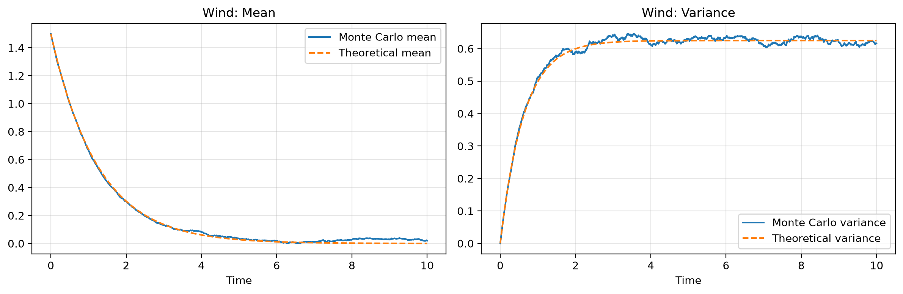
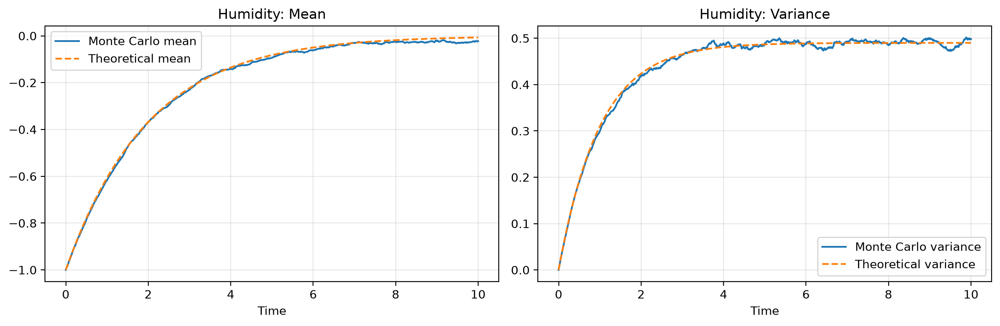
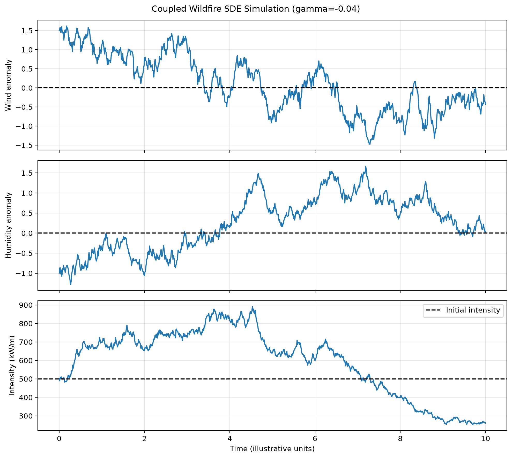

# Q1 — Coupled Stochastic Dynamic System

## 1. Research Question

How can wildfire intensity and environmental variables, specifically
wind speed and relative humidity, be represented as an interconnected
stochastic dynamic system?

Status: Implemented and numerically demonstrated.

---

## 2. Mathematical Formulation

We represent wildfire intensity and environmental conditions using
a three-dimensional continuous-time stochastic process.

Following Equation (3.17) of the Mathematical Model report, define

$$
X_t =
\begin{pmatrix}
I_t \\
Z_t^W \\
Z_t^H
\end{pmatrix},
$$

where:

- $I_t$ is wildfire head fire intensity at time $t$ (kW/m).
- $Z_t^W$ is the standardized wind-speed anomaly.
- $Z_t^H$ is the standardized relative-humidity anomaly.

The environmental anomalies are defined in Equation (2.1):

$$
Z_t^W = \frac{W_t-\mu_W}{s_W},
\qquad
Z_t^H = \frac{H_t-\mu_H}{s_H}.
$$

Using the reference statistics obtained from the Alberta historical
wildfire dataset,

$$
Z_t^W = \frac{W_t-8.920230}{8.415991},
$$

$$
Z_t^H = \frac{H_t-45.203347}{18.674584}.
$$

Standardization allows us to describe environmental conditions
relative to their historical reference averages.

---

## 3. Environmental Stochastic Processes

### 3.1 Wind Speed

Following Equation (3.1), wind speed anomalies are modeled using
an Ornstein-Uhlenbeck (OU) process:

$$
dZ_t^W =
-\kappa_W Z_t^W\,dt
+\sigma_W\,dB_t^{(W)}.
$$

The analytical solution from Equation (3.2) is

$$
Z_t^W =
Z_0^W e^{-\kappa_W t}
+
\sigma_W
\int_0^t e^{-\kappa_W(t-s)}\,dB_s^{(W)}.
$$

For a fixed initial condition, Equations (3.3) and (3.4) give

$$
\mathbb{E}[Z_t^W]
=
Z_0^W e^{-\kappa_W t},
$$

and

$$
\operatorname{Var}(Z_t^W)
=
\frac{\sigma_W^2}{2\kappa_W}
(1-e^{-2\kappa_W t}).
$$

The mean-reversion parameter $\kappa_W$ controls how quickly wind
anomalies tend to return toward zero, while $\sigma_W$ controls
the magnitude of random fluctuations.

### 3.2 Relative Humidity

Similarly, following Equation (3.5), relative humidity anomalies
are modeled as

$$
dZ_t^H =
-\kappa_H Z_t^H\,dt
+\sigma_H\,dB_t^{(H)}.
$$

The analytical solution from Equation (3.6) is

$$
Z_t^H =
Z_0^H e^{-\kappa_H t}
+
\sigma_H
\int_0^t e^{-\kappa_H(t-s)}\,dB_s^{(H)}.
$$

Equations (3.7) and (3.8) give

$$
\mathbb{E}[Z_t^H]
=
Z_0^H e^{-\kappa_H t},
$$

and

$$
\operatorname{Var}(Z_t^H)
=
\frac{\sigma_H^2}{2\kappa_H}
(1-e^{-2\kappa_H t}).
$$

Both environmental processes exhibit mean reversion in expectation,
while allowing random fluctuations around their reference means.

---

## 4. Wildfire Intensity Process

### 4.1 Environmental Growth Rate

Following Equation (3.9), define the wildfire intensity growth
rate as

$$
r(w,h)
=
\alpha_c+\beta_Ww-\beta_Hh+\gamma wh.
$$

The parameters represent:

- $\alpha_c$: baseline intensity growth rate for fuel category $c$.
- $\beta_W$: individual effect of wind on intensity growth.
- $\beta_H$: individual effect of humidity on intensity growth.
- $\gamma$: interaction between wind and humidity.

The interaction term allows the effect of wind to depend on the
humidity level.

From Equation (3.10),

$$
\frac{\partial r}{\partial w}
=
\beta_W+\gamma h.
$$

Similarly, differentiating with respect to humidity gives

$$
\frac{\partial r}{\partial h}
=
-\beta_H+\gamma w.
$$

Therefore, the effects of wind and humidity are not necessarily
constant when $\gamma\neq0$.

When $\gamma=0$, the environmental effects are additive.

When $\gamma\neq0$, the environmental variables interact.

### 4.2 Wildfire Intensity SDE

Following Equation (3.11), wildfire intensity is modeled as

$$
dI_t =
I_t
\left(
\alpha_c+\beta_WZ_t^W-\beta_HZ_t^H
+\gamma Z_t^WZ_t^H
\right)dt
+
\sigma_I I_t\,dB_t^{(I)}.
$$

Equivalently,

$$
dI_t =
I_t r(Z_t^W,Z_t^H)\,dt
+
\sigma_I I_t\,dB_t^{(I)}.
$$

The drift term represents the expected local change in wildfire
intensity under the current environmental conditions.

The diffusion term represents stochastic fluctuations in wildfire
intensity that are not explicitly explained by wind and humidity.

Both terms are proportional to the current intensity.

### 4.3 Positivity of Wildfire Intensity

Since wildfire intensity cannot be negative, we apply Ito's
formula to the logarithmic transformation

$$
Y_t=\ln I_t.
$$

Following Equations (3.12) and (3.13),

$$
dY_t =
\frac{1}{I_t}dI_t
-
\frac{1}{2I_t^2}\sigma_I^2I_t^2\,dt.
$$

Substituting the intensity SDE gives

$$
dY_t =
\left(
r(Z_t^W,Z_t^H)-\frac{\sigma_I^2}{2}
\right)dt
+
\sigma_I\,dB_t^{(I)}.
$$

Integrating from zero to time $t$,

$$
\begin{aligned}
\ln I_t
={}&
\ln I_0
+
\left(\alpha_c-\frac{\sigma_I^2}{2}\right)t\\
&+\beta_W\int_0^t Z_s^W\,ds\\
&-\beta_H\int_0^t Z_s^H\,ds\\
&+\gamma\int_0^t Z_s^WZ_s^H\,ds\\
&+\sigma_I B_t^{(I)}.
\end{aligned}
$$

This corresponds to Equation (3.14).

Exponentiating gives the representation in Equations (3.15)
and (3.16):

$$
I_t=I_0e^{A_t},
$$

where

$$
\begin{aligned}
A_t
={}&
\left(\alpha_c-\frac{\sigma_I^2}{2}\right)t\\
&+\beta_W\int_0^t Z_s^W\,ds\\
&-\beta_H\int_0^t Z_s^H\,ds\\
&+\gamma\int_0^t Z_s^WZ_s^H\,ds\\
&+\sigma_I B_t^{(I)}.
\end{aligned}
$$

Since the exponential function is strictly positive,

$$
I_0>0 \implies I_t>0.
$$

Therefore, the proposed stochastic intensity model preserves
positive wildfire intensity.

---

## 5. Complete Coupled Stochastic System

Following Section 3.3 of the Mathematical Model report, the
complete system is

$$
\boxed{
\begin{aligned}
dI_t
={}&
I_t
\left(
\alpha_c+\beta_WZ_t^W-\beta_HZ_t^H
+\gamma Z_t^WZ_t^H
\right)dt\\
&+\sigma_I I_t\,dB_t^{(I)},\\
dZ_t^W
={}&-\kappa_WZ_t^W\,dt+\sigma_W\,dB_t^{(W)},\\
dZ_t^H
={}&-\kappa_HZ_t^H\,dt+\sigma_H\,dB_t^{(H)}.
\end{aligned}
}
$$

From Equation (3.18), this can be expressed in vector form as

$$
dX_t=b(X_t)\,dt+A(X_t)\,dB_t.
$$

The drift vector from Equation (3.19) is

$$
b(i,w,h)=
\begin{pmatrix}
i(\alpha_c+\beta_Ww-\beta_Hh+\gamma wh)\\
-\kappa_Ww\\
-\kappa_Hh
\end{pmatrix}.
$$

The diffusion matrix from Equation (3.20) is

$$
A(i,w,h)=
\begin{pmatrix}
\sigma_I i&0&0\\
0&\sigma_W&0\\
0&0&\sigma_H
\end{pmatrix}.
$$

The three Brownian motions are initially assumed to be independent.

However, independence of the Brownian motions does not imply
independence of the three state variables.

Wildfire intensity depends on both environmental processes through
its drift function.

The dependency structure is directional:

- Wind influences wildfire intensity.
- Humidity influences wildfire intensity.
- Wind and humidity interact within the intensity growth function.
- Wildfire intensity does not directly influence wind or humidity.
- Wind and humidity are independently driven in the baseline model.

This creates a coupled stochastic system with one-way environmental
influence on wildfire intensity.

The joint process $X_t$ is Markov because its dynamics depend on
its current state rather than its complete past history.

Wildfire intensity alone is not necessarily Markov because its
future dynamics also depend on the environmental state.

---

## 6. Numerical Methodology

### 6.1 Exact OU Transition

The wind and humidity processes are simulated using the exact
conditional transition derived from Equations (3.2) and (3.6).

For a general OU process,

$$
Z_{n+1}
=
e^{-\kappa\Delta t}Z_n
+
\sigma
\sqrt{
\frac{1-e^{-2\kappa\Delta t}}{2\kappa}
}
\varepsilon_n,
$$

where

$$
\varepsilon_n\sim\mathcal{N}(0,1).
$$

This method reproduces the exact OU transition distribution
at the discrete simulation time points.

Implementation:

- src/environment.py
- Function: simulate_ou()

### 6.2 Log-Euler Intensity Simulation

Using Equation (3.13), the log-intensity process is approximated
over each time step by

$$
Y_{n+1}
=
Y_n
+
\left(
r(Z_n^W,Z_n^H)-\frac{\sigma_I^2}{2}
\right)\Delta t
+
\sigma_I\sqrt{\Delta t}\varepsilon_n^I.
$$

Exponentiating gives

$$
\begin{aligned}
I_{n+1}=I_n\exp\Bigg[
&\left(
\alpha_c+\beta_WZ_n^W-\beta_HZ_n^H
+\gamma Z_n^WZ_n^H
-\frac{\sigma_I^2}{2}
\right)\Delta t\\
&+\sigma_I\sqrt{\Delta t}\varepsilon_n^I
\Bigg].
\end{aligned}
$$

This numerical method preserves positive intensity in exact
arithmetic.

Unlike the exact OU transition, the intensity update approximates
the environmental drift integral using its value at the beginning
of each time step.

Implementation:

- src/intensity.py
- Function: growth_rate()
- Function: simulate_intensity()

### 6.3 Coupled Simulation

The complete simulation is performed in three stages:

1. Generate a wind OU trajectory.
2. Generate a humidity OU trajectory.
3. Generate wildfire intensity using both environmental trajectories.

Separate pseudorandom streams are used for the three processes
to implement the independent Brownian-motion assumption.

Implementation:

- src/simulation.py
- Function: simulate_wildfire()

---

## 7. Baseline Simulation Configuration

### 7.1 Environmental Parameters

| Parameter | Value | Description |
|---|---:|---|
| $\kappa_W$ | 0.8 | Wind mean-reversion rate |
| $\sigma_W$ | 1.0 | Wind volatility |
| $\kappa_H$ | 0.5 | Humidity mean-reversion rate |
| $\sigma_H$ | 0.7 | Humidity volatility |

### 7.2 Wildfire Intensity Parameters

| Parameter | Value | Description |
|---|---:|---|
| $\alpha_c$ | 0.05 | Baseline intensity growth |
| $\beta_W$ | 0.12 | Wind effect |
| $\beta_H$ | 0.10 | Humidity effect |
| $\gamma$ | -0.04 | Wind-humidity interaction |
| $\sigma_I$ | 0.15 | Intensity volatility |

The fuel category is fixed at C2 (Boreal Spruce).

These dynamic parameters are illustrative assumptions and have
not been estimated from longitudinal observations.

### 7.3 Initial Conditions

The initial state is

$$
X_0=
\begin{pmatrix}
500\\
1.5\\
-1
\end{pmatrix}.
$$

Therefore,

$$
I_0=500\text{ kW/m},
$$

$$
Z_0^W=1.5,
$$

$$
Z_0^H=-1.
$$

Converting the environmental anomalies into physical units,

$$
W_0
=
8.920230+8.415991(1.5)
\approx21.54\text{ km/h},
$$

$$
H_0
=
45.203347+18.674584(-1)
\approx26.53\%.
$$

The baseline simulation begins under above-average wind speed
and below-average relative humidity.

### 7.4 Numerical Settings

| Setting | Value |
|---|---:|
| Simulation horizon | 10.0 |
| Time-step size | 0.01 |
| Number of time steps | 1000 |
| Number of time points | 1001 |
| Random seed | 42 |

The time unit is illustrative and has not been calibrated
to hours or days.

---

## 8. Numerical Validation of Environmental Processes

Before simulating wildfire intensity, the environmental
processes were validated against their theoretical means
and variances.

A total of 5000 independent trajectories were generated
for each environmental process.

### 8.1 Theoretical Values

For wind,

$$
\mathbb{E}[Z_t^W]=1.5e^{-0.8t},
$$

$$
\operatorname{Var}(Z_t^W)
=
0.625(1-e^{-1.6t}).
$$

For humidity,

$$
\mathbb{E}[Z_t^H]=-e^{-0.5t},
$$

$$
\operatorname{Var}(Z_t^H)
=
0.49(1-e^{-t}).
$$

### 8.2 Monte Carlo Estimation

The empirical mean is calculated using

$$
\widehat{m}(t)
=
\frac{1}{M}
\sum_{j=1}^{M}Z_t^{(j)},
$$

where $M=5000$.

The empirical variance is calculated using

$$
\widehat{v}(t)
=
\frac{1}{M-1}
\sum_{j=1}^{M}
\left(Z_t^{(j)}-\widehat{m}(t)\right)^2.
$$

### 8.3 Validation Results

At the final simulation time $T=10$:

| Process | Statistic | Empirical | Theoretical |
|---|---|---:|---:|
| Wind | Mean | 0.02007 | 0.00050 |
| Wind | Variance | 0.61631 | 0.62500 |
| Humidity | Mean | -0.02274 | -0.00674 |
| Humidity | Variance | 0.49803 | 0.48998 |

The empirical results are close to the corresponding
theoretical values.

The differences between empirical and theoretical variances
are approximately 1.39% for wind and 1.64% for humidity.

The standard error of the Monte Carlo mean estimator is

$$
\operatorname{SE}(\widehat{m}(t))
=
\sqrt{\frac{\operatorname{Var}(Z_t)}{M}}.
$$

At $T=10$, the standardized differences between empirical
and theoretical means are approximately

$$
z_W=1.75,
$$

$$
z_H=-1.62.
$$

These differences are consistent with ordinary Monte Carlo
sampling variation.

### 8.4 Validation Figures

The validation results support the correctness of the
numerical implementation of the environmental processes.

However, this does not establish that real environmental
conditions follow OU processes.

---

## 9. Coupled Wildfire Simulation Results

The complete stochastic system was simulated using the
baseline parameters and initial conditions.

### 9.1 Summary of Results

| Statistic | Approximate intensity (kW/m) |
|---|---:|
| Initial intensity | 500 |
| Maximum intensity | 890 |
| Final intensity | 260 |

The maximum and final intensities are approximate values
obtained from the simulation figure.

The maximum intensity is approximately 78% higher than
the initial intensity:

$$
\frac{890-500}{500}\times100\%
\approx78\%.
$$

The final intensity is approximately 48% lower than
the initial intensity:

$$
\frac{260-500}{500}\times100\%
\approx-48\%.
$$

These results describe one simulated trajectory and should
not be interpreted as population-level estimates.

---

## 10. Interpretation of the Simulation

### 10.1 Phase 1: Wildfire Intensification

Approximate time interval:

$$
0\leq t\leq3.
$$

During the early simulation:

- Wind is predominantly above its reference mean.
- Humidity is predominantly below its reference mean.
- Wildfire intensity generally increases.

Using the baseline growth-rate function,

$$
r(w,h)=0.05+0.12w-0.10h-0.04wh.
$$

At the initial environmental conditions,

$$
w=1.5,\qquad h=-1,
$$

we obtain

$$
\begin{aligned}
r(1.5,-1)
&=0.05+0.12(1.5)-0.10(-1)\\
&\quad-0.04(1.5)(-1)\\
&=0.05+0.18+0.10+0.06\\
&=0.39.
\end{aligned}
$$

Therefore, the initial intensity drift is

$$
I_0r(1.5,-1)
=
500(0.39)
=
195.
$$

The positive drift favors increasing wildfire intensity
under the initial environmental conditions.

This is consistent with the observed increase in intensity
during the early simulation.

### 10.2 Phase 2: Peak Intensity and Transition

Approximate time interval:

$$
3\leq t\leq5.
$$

During this period:

- Wind fluctuates closer to its reference mean.
- Humidity increases and becomes above average.
- Wildfire intensity reaches approximately 890 kW/m.
- Intensity subsequently begins to decline.

The increase in humidity contributes negatively to the
growth-rate function through

$$
-\beta_H Z_t^H.
$$

Under the selected coefficients, the interaction term also
modifies the effect of wind as humidity increases.

The observed transition is consistent with the changing
environmental drift and stochastic intensity fluctuations.

### 10.3 Phase 3: Wildfire Weakening

Approximate time interval:

$$
5\leq t\leq10.
$$

During the later simulation:

- Wind is predominantly below its reference mean.
- Humidity is predominantly above its reference mean.
- Wildfire intensity generally decreases.

Consider representative environmental conditions:

$$
w=-1,\qquad h=1.
$$

The corresponding growth rate is

$$
\begin{aligned}
r(-1,1)
&=0.05+0.12(-1)-0.10(1)\\
&\quad-0.04(-1)(1)\\
&=0.05-0.12-0.10+0.04\\
&=-0.13.
\end{aligned}
$$

The negative drift favors decreasing wildfire intensity.

This is consistent with the general decline observed
during the later portion of the simulated trajectory.

The intensity eventually reaches approximately 260 kW/m.

---

## 11. Effect of the Wind-Humidity Interaction

The current simulation uses

$$
\gamma=-0.04.
$$

Consequently, the marginal effect of wind is

$$
\frac{\partial r}{\partial w}
=
0.12-0.04h.
$$

For different humidity conditions:

| Humidity anomaly | Marginal wind effect |
|---:|---:|
| -2 | 0.20 |
| -1 | 0.16 |
| 0 | 0.12 |
| 1 | 0.08 |
| 2 | 0.04 |

Under these illustrative coefficients, the marginal effect
of wind is stronger when humidity is below average.

At the initial conditions,

$$
\gamma wh
=
-0.04(1.5)(-1)
=
0.06.
$$

Without the interaction term,

$$
r_0(1.5,-1)
=
0.05+0.18+0.10
=
0.33.
$$

With the interaction term,

$$
r(1.5,-1)=0.39.
$$

The interaction therefore increases the initial proportional
intensity drift by 0.06 per illustrative time unit.

However, the interaction does not always increase intensity.
Its contribution depends on the signs and magnitudes of
both environmental anomalies.

Furthermore, the current baseline trajectory does not isolate
the overall effect of the interaction term.

A controlled comparison between $\gamma=0$ and $\gamma\neq0$
will be conducted in subsequent research questions.

---

## 12. Limitations

### 12.1 Parameter Calibration

Although the environmental reference means and standard
deviations are obtained from historical wildfire records,
the dynamic parameters are illustrative.

The available data do not contain sufficiently detailed
longitudinal observations to estimate the environmental
and intensity SDE parameters directly.

### 12.2 Physical Environmental Constraints

OU processes have Gaussian distributions with unbounded
support.

Therefore, reconstructed physical wind speeds may become
negative, and relative humidity may fall outside the
physical interval from 0% to 100%.

This is a limitation of the current environmental model.

### 12.3 Simplified Wildfire Dynamics

The current model does not explicitly incorporate:

- Temperature.
- Precipitation.
- Terrain.
- Fuel depletion.
- Fire suppression.
- Wildfire ignition or extinction.

Fuel category remains fixed throughout the simulation.

### 12.4 Environmental Dependence

The baseline model assumes independent Brownian motions.

Real environmental variables may exhibit dependence that
is not captured by the current formulation.

Alternative dependence assumptions will be investigated
in Research Question 6.

### 12.5 Single-Trajectory Analysis

The baseline wildfire experiment generates only one
realization of the coupled stochastic system.

Consequently, the observed maximum intensity, final
intensity, and trajectory shape cannot be generalized
to all possible realizations.

Monte Carlo simulations are required to investigate
the distribution and uncertainty of wildfire intensity.

### 12.6 Numerical Approximation

The OU transitions are exact at the simulation grid points.

However, the intensity simulation approximates the
environmental drift integral using a log-Euler scheme.

Sensitivity to the numerical time-step size should be
investigated in subsequent experiments.

---

## 13. Final Answer to Research Question 1

Wildfire intensity and environmental conditions can be
represented as a three-dimensional coupled stochastic
dynamic system consisting of two Ornstein-Uhlenbeck
environmental processes and one multiplicative wildfire
intensity process.

The environmental processes capture mean reversion and
random fluctuations in wind speed and relative humidity.
These environmental variables influence wildfire intensity
through a growth-rate function that incorporates baseline
growth, individual environmental effects, and a
wind-humidity interaction.

The logarithmic transformation of wildfire intensity
provides an exponential representation that guarantees
positive intensity whenever the initial intensity is
positive.

Numerical validation using 5000 independent trajectories
for each environmental process demonstrates that the
simulated OU means and variances are consistent with
their theoretical expressions.

The complete baseline wildfire simulation also demonstrates
how changing environmental conditions can influence
wildfire intensity. Under the selected parameters,
above-average wind and below-average humidity initially
favor intensity growth, while weaker wind and higher
humidity later favor intensity reduction.

The resulting system provides a mathematically consistent
and computationally implementable framework for studying
wildfire intensity under environmental uncertainty.

However, the model remains illustrative rather than
calibrated against observed wildfire intensity. Its
predictive accuracy has not been established.

This framework establishes the foundation for subsequent
research questions concerning future intensity distributions,
threshold crossing probabilities, parameter sensitivity,
seasonal differences, and alternative dependence assumptions.

---

## 14. Corresponding Implementation Files

| File | Contribution to Q1 |
|---|---|
| src/config.py | Model parameters and reference statistics |
| src/environment.py | Exact OU simulation |
| src/intensity.py | Growth-rate function and log-Euler intensity simulation |
| src/simulation.py | Complete coupled stochastic system |
| experiments/baseline.py | Environmental trajectory visualization |
| experiments/validate_ou.py | Monte Carlo environmental validation |
| experiments/wildfire_baseline.py | Coupled wildfire simulation and visualization |
| tests/test_environment.py | Environmental numerical correctness tests |
| tests/test_intensity.py | Intensity numerical correctness tests |

---

## 15. Reproducing the Results

Run the environmental baseline:

    python -m experiments.baseline

Run the OU validation:

    python -m experiments.validate_ou

Run the coupled wildfire simulation:

    python -m experiments.wildfire_baseline

Run the numerical tests:

    python -m pytest -q

All commands should be executed from the project root.

---

## 16. Completion Checklist

- [x] Define the joint stochastic state process.
- [x] Formulate the wind OU process.
- [x] Formulate the humidity OU process.
- [x] Derive the environmental analytical solutions.
- [x] Derive the environmental means and variances.
- [x] Formulate the wildfire intensity SDE.
- [x] Incorporate the wind-humidity interaction.
- [x] Derive the log-intensity equation using Ito's formula.
- [x] Establish theoretical positivity of intensity.
- [x] Formulate the complete coupled SDE system.
- [x] Implement exact OU transitions.
- [x] Implement the log-Euler intensity simulation.
- [x] Validate OU means and variances using Monte Carlo.
- [x] Generate the complete baseline wildfire trajectory.
- [x] Analyze the baseline simulation results.
- [x] Document model assumptions and limitations.
- [x] Answer Research Question 1.
- [ ] Confirm all intensity unit tests pass.

Overall status: Q1 implemented and answered.

---

## 17. References

1. STAT 471 Mathematical Model:
   Stochastic Modeling of Wildfire Intensity Under Changing
   Environmental Conditions.

   - Section 2: Model formulation.
   - Section 3.1: Environmental processes.
   - Section 3.2: Wildfire intensity.
   - Section 3.3: Coupled SDE system.
   - Equations (3.1)-(3.20).

2. Project Data Analysis Report:
   Historical Alberta wildfire observations and environmental
   reference statistics.

3. Alberta Historical Wildfire Data, 2006-2025.

4. Numerical experiments and simulation figures generated
   within this project.