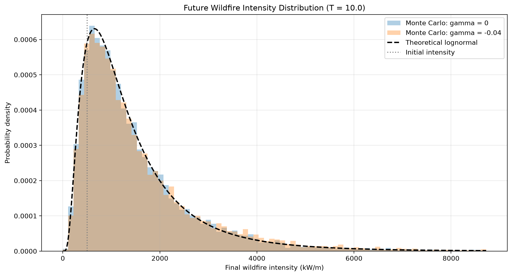
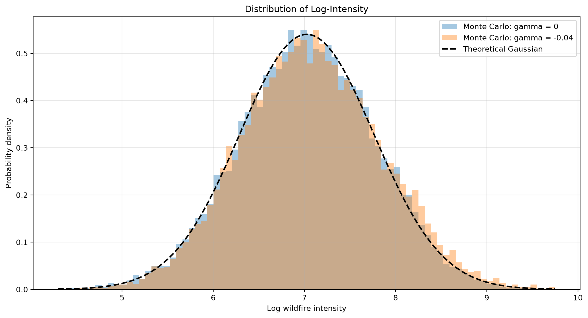
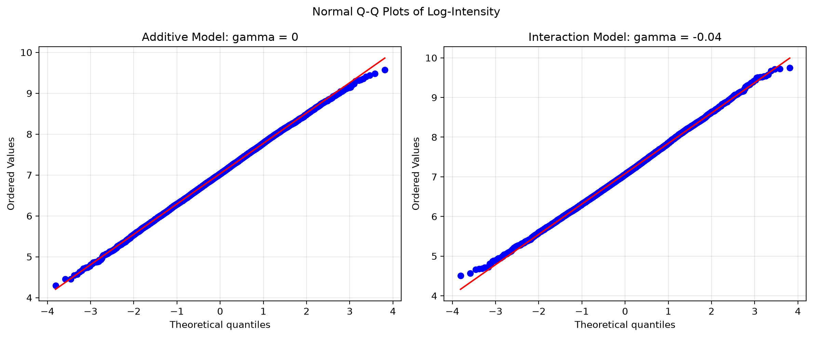
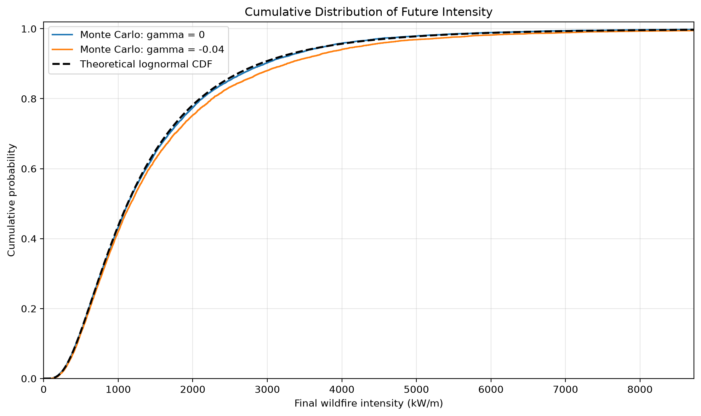

# Q2 — Future Wildfire Intensity Distribution

## 1. Research Question

What is the probability distribution of wildfire intensity
at a future time T under stochastic environmental conditions?

In particular, we investigate:

- Can the future intensity distribution be derived analytically?
- What are its expected value and variance?
- How closely does Monte Carlo simulation agree with theory?
- How does the wind-humidity interaction affect the distribution?
- Does the interaction increase the likelihood of high-intensity outcomes?
- How much uncertainty exists in future wildfire intensity?

---

## 2. Mathematical Foundation

### 2.1 Wildfire Intensity Model

Following Equation (3.11) of the Mathematical Model report,

$$
dI_t=
I_t
\left(
\alpha_c+\beta_WZ_t^W-\beta_HZ_t^H
+\gamma Z_t^WZ_t^H
\right)dt
+\sigma_I I_t\,dB_t^{(I)}.
$$

The environmental processes are

$$
dZ_t^W=
-\kappa_WZ_t^W\,dt
+\sigma_W\,dB_t^{(W)},
$$

$$
dZ_t^H=
-\kappa_HZ_t^H\,dt
+\sigma_H\,dB_t^{(H)}.
$$

We assume deterministic initial conditions and independent
Brownian drivers.

### 2.2 Logarithmic Transformation

Following Equations (3.12)-(3.13), define

$$
Y_t=\ln I_t.
$$

Applying Ito's formula gives

$$
\begin{aligned}
dY_t={}&
\left(
\alpha_c+\beta_WZ_t^W-\beta_HZ_t^H
+\gamma Z_t^WZ_t^H
-\frac{\sigma_I^2}{2}
\right)dt\\
&+\sigma_I\,dB_t^{(I)}.
\end{aligned}
$$

Integrating from zero to T,

$$
\begin{aligned}
Y_T={}&
\ln I_0+
\left(\alpha_c-\frac{\sigma_I^2}{2}\right)T\\
&+\beta_W\int_0^T Z_s^W\,ds\\
&-\beta_H\int_0^T Z_s^H\,ds\\
&+\gamma\int_0^T Z_s^WZ_s^H\,ds\\
&+\sigma_I B_T^{(I)}.
\end{aligned}
$$

This follows from the integrated intensity representation
in Equations (3.14)-(3.16).

The future wildfire intensity is therefore

$$
I_T=e^{Y_T}.
$$

To determine the distribution of future intensity,
we first investigate the distribution of log-intensity.

---

## 3. Analytical Distribution of the Additive Model

### 3.1 Removing the Interaction Term

Consider the additive model, where

$$
\gamma=0.
$$

The log-intensity becomes

$$
\begin{aligned}
Y_T={}&
\ln I_0+
\left(\alpha_c-\frac{\sigma_I^2}{2}\right)T\\
&+\beta_W\int_0^T Z_s^W\,ds\\
&-\beta_H\int_0^T Z_s^H\,ds\\
&+\sigma_I B_T^{(I)}.
\end{aligned}
$$

Define the integrated environmental processes

$$
J_T^W=\int_0^T Z_s^W\,ds,
$$

$$
J_T^H=\int_0^T Z_s^H\,ds.
$$

Then

$$
Y_T=
\ln I_0+
\left(\alpha_c-\frac{\sigma_I^2}{2}\right)T
+\beta_WJ_T^W-\beta_HJ_T^H
+\sigma_I B_T^{(I)}.
$$

To determine the distribution of Y_T, we need the
distributions of the integrated OU processes.

---

### 3.2 Derivation of the Integrated OU Process

Consider a general OU process

$$
dZ_t=-\kappa Z_t\,dt+\sigma\,dB_t.
$$

Its analytical solution is

$$
Z_t=
z_0e^{-\kappa t}
+\sigma\int_0^t e^{-\kappa(t-s)}\,dB_s.
$$

Define

$$
J_T=\int_0^T Z_t\,dt.
$$

Substituting the analytical OU solution,

$$
\begin{aligned}
J_T={}&
z_0\int_0^T e^{-\kappa t}\,dt\\
&+\sigma\int_0^T
\int_0^t e^{-\kappa(t-s)}\,dB_s\,dt.
\end{aligned}
$$

Using stochastic Fubini to interchange the integrals,

$$
\begin{aligned}
J_T={}&
\frac{z_0}{\kappa}(1-e^{-\kappa T})\\
&+\sigma\int_0^T
\left(
\int_s^T e^{-\kappa(t-s)}\,dt
\right)dB_s.
\end{aligned}
$$

The inner integral is

$$
\int_s^T e^{-\kappa(t-s)}\,dt
=
\frac{1-e^{-\kappa(T-s)}}{\kappa}.
$$

Therefore,

$$
\boxed{
J_T=
\frac{z_0}{\kappa}(1-e^{-\kappa T})
+
\frac{\sigma}{\kappa}
\int_0^T
(1-e^{-\kappa(T-s)})\,dB_s
}
$$

The stochastic integral has a deterministic integrand.
Consequently, it is Gaussian.

Since the first term is deterministic, the integrated
OU process is also Gaussian.

---

### 3.3 Expectation of the Integrated OU Process

The stochastic integral has expectation zero:

$$
\mathbb E\left[
\int_0^T
(1-e^{-\kappa(T-s)})\,dB_s
\right]=0.
$$

Therefore,

$$
\boxed{
\mathbb E[J_T]
=
\frac{z_0}{\kappa}(1-e^{-\kappa T})
}
$$

This represents the expected cumulative environmental
anomaly over the simulation horizon.

---

### 3.4 Variance of the Integrated OU Process

Using Ito isometry,

$$
\operatorname{Var}(J_T)
=
\frac{\sigma^2}{\kappa^2}
\int_0^T
(1-e^{-\kappa(T-s)})^2\,ds.
$$

Let

$$
u=T-s.
$$

Then

$$
\operatorname{Var}(J_T)
=
\frac{\sigma^2}{\kappa^2}
\int_0^T(1-e^{-\kappa u})^2\,du.
$$

Expanding the square,

$$
\operatorname{Var}(J_T)
=
\frac{\sigma^2}{\kappa^2}
\int_0^T
(1-2e^{-\kappa u}+e^{-2\kappa u})\,du.
$$

Evaluating each integral,

$$
\int_0^T1\,du=T,
$$

$$
\int_0^T e^{-\kappa u}\,du
=
\frac{1-e^{-\kappa T}}{\kappa},
$$

$$
\int_0^T e^{-2\kappa u}\,du
=
\frac{1-e^{-2\kappa T}}{2\kappa}.
$$

Consequently,

$$
\boxed{
\begin{aligned}
\operatorname{Var}(J_T)
=
\frac{\sigma^2}{\kappa^2}
\Bigg[
&T-\frac{2(1-e^{-\kappa T})}{\kappa}\\
&+\frac{1-e^{-2\kappa T}}{2\kappa}
\Bigg].
\end{aligned}
}
$$

Together, these results completely characterize
the Gaussian integrated OU process.

---

### 3.5 Distribution of Additive Log-Intensity

Recall that

$$
Y_T=
\ln I_0+
\left(\alpha_c-\frac{\sigma_I^2}{2}\right)T
+\beta_WJ_T^W-\beta_HJ_T^H
+\sigma_I B_T^{(I)}.
$$

The three stochastic components

$$
J_T^W,\qquad J_T^H,\qquad B_T^{(I)}
$$

are independent Gaussian random variables under the
baseline assumptions.

A linear combination of independent Gaussian
random variables is Gaussian.

Therefore,

$$
\boxed{
Y_T=\ln I_T\sim\mathcal N(m_T,v_T)
}
$$

where

$$
m_T=\mathbb E[Y_T]
$$

and

$$
v_T=\operatorname{Var}(Y_T).
$$

---

### 3.6 Mean of Log-Intensity

Taking expectations,

$$
\begin{aligned}
m_T={}&
\ln I_0+
\left(\alpha_c-\frac{\sigma_I^2}{2}\right)T\\
&+\beta_W\mathbb E[J_T^W]
-\beta_H\mathbb E[J_T^H].
\end{aligned}
$$

Substituting the integrated OU expectations,

$$
\boxed{
\begin{aligned}
m_T={}&
\ln I_0+
\left(\alpha_c-\frac{\sigma_I^2}{2}\right)T\\
&+\frac{\beta_Wz_0^W}{\kappa_W}
(1-e^{-\kappa_WT})\\
&-\frac{\beta_Hz_0^H}{\kappa_H}
(1-e^{-\kappa_HT}).
\end{aligned}
}
$$

The expected log-intensity depends on:

- Initial wildfire intensity.
- Baseline fuel-dependent growth.
- Initial environmental conditions.
- Environmental mean-reversion rates.
- Wind and humidity growth coefficients.
- Intensity volatility through the Ito correction.

---

### 3.7 Variance of Log-Intensity

Using independence,

$$
\boxed{
v_T=
\beta_W^2\operatorname{Var}(J_T^W)
+\beta_H^2\operatorname{Var}(J_T^H)
+\sigma_I^2T
}
$$

Expanding the integrated OU variances,

$$
\begin{aligned}
v_T={}&
\frac{\beta_W^2\sigma_W^2}{\kappa_W^2}
\left[
T-\frac{2(1-e^{-\kappa_WT})}{\kappa_W}
+\frac{1-e^{-2\kappa_WT}}{2\kappa_W}
\right]\\
&+
\frac{\beta_H^2\sigma_H^2}{\kappa_H^2}
\left[
T-\frac{2(1-e^{-\kappa_HT})}{\kappa_H}
+\frac{1-e^{-2\kappa_HT}}{2\kappa_H}
\right]\\
&+\sigma_I^2T.
\end{aligned}
$$

The log-intensity variance consists of three
independent contributions:

1. Cumulative wind uncertainty.
2. Cumulative humidity uncertainty.
3. Direct wildfire intensity uncertainty.

This provides an analytical decomposition of the
sources of uncertainty in future wildfire intensity.

---

## 4. Lognormal Wildfire Intensity Distribution

Since

$$
Y_T=\ln I_T\sim\mathcal N(m_T,v_T),
$$

and

$$
I_T=e^{Y_T},
$$

the future intensity follows a lognormal distribution.

$$
\boxed{
I_T\sim\operatorname{Lognormal}(m_T,v_T)
}
$$

Here, the second parameter represents the variance
of log-intensity, not its standard deviation.

This is an exact analytical result for the additive
continuous-time model under the stated assumptions.

---

### 4.1 Probability Density Function

For x > 0, the probability density is

$$
\boxed{
f_T(x)
=
\frac{1}{x\sqrt{2\pi v_T}}
\exp\left(
-\frac{(\ln x-m_T)^2}{2v_T}
\right)
}
$$

For x <= 0,

$$
f_T(x)=0.
$$

The lognormal distribution is consistent with the
strict positivity of wildfire intensity.

---

### 4.2 Expected Wildfire Intensity

For a Gaussian random variable Y,

$$
\mathbb E[e^{aY}]
=
e^{am_T+\frac{a^2v_T}{2}}.
$$

Setting a = 1,

$$
\mathbb E[I_T]
=
\mathbb E[e^{Y_T}].
$$

Therefore,

$$
\boxed{
\mathbb E[I_T]=e^{m_T+v_T/2}
}
$$

Notice that

$$
\mathbb E[I_T]\neq e^{\mathbb E[Y_T]}
$$

when the log-intensity variance is positive.

This occurs because exponentiation is nonlinear.

In particular, increasing log-intensity variance while
holding its mean fixed increases expected intensity.

---

### 4.3 Variance of Wildfire Intensity

Setting a = 2,

$$
\mathbb E[I_T^2]
=
e^{2m_T+2v_T}.
$$

Using the variance identity,

$$
\operatorname{Var}(I_T)
=
\mathbb E[I_T^2]
-
(\mathbb E[I_T])^2.
$$

Substituting the moments,

$$
\operatorname{Var}(I_T)
=
e^{2m_T+2v_T}
-e^{2m_T+v_T}.
$$

Factoring,

$$
\boxed{
\operatorname{Var}(I_T)
=
(e^{v_T}-1)e^{2m_T+v_T}
}
$$

The standard deviation is

$$
\boxed{
\operatorname{SD}(I_T)
=
\sqrt{(e^{v_T}-1)e^{2m_T+v_T}}
}
$$

---

### 4.4 Median Wildfire Intensity

Since the Gaussian distribution is symmetric around m_T,

$$
\mathbb P(Y_T\leq m_T)=0.5.
$$

Because exponentiation is strictly increasing,

$$
\mathbb P(I_T\leq e^{m_T})=0.5.
$$

Therefore,

$$
\boxed{
\operatorname{Median}(I_T)=e^{m_T}
}
$$

For positive log-intensity variance,

$$
\mathbb E[I_T]>\operatorname{Median}(I_T).
$$

This reflects the positive skewness of the
lognormal distribution.

---

### 4.5 Cumulative Distribution Function

The cumulative distribution function is

$$
F_T(x)=\mathbb P(I_T\leq x).
$$

For x > 0,

$$
F_T(x)
=
\mathbb P(e^{Y_T}\leq x).
$$

Taking logarithms,

$$
F_T(x)=\mathbb P(Y_T\leq\ln x).
$$

Standardizing the Gaussian random variable,

$$
\boxed{
F_T(x)
=
\Phi\left(
\frac{\ln x-m_T}{\sqrt{v_T}}
\right)
}
$$

where Phi is the standard Gaussian cumulative
distribution function.

The terminal exceedance probability is therefore

$$
\boxed{
\mathbb P(I_T>K)
=
1-\Phi\left(
\frac{\ln K-m_T}{\sqrt{v_T}}
\right)
}
$$

This provides an analytical probability of exceeding
a selected intensity threshold at the terminal time.

---

### 4.6 Quantiles and Prediction Intervals

Let q_p denote the p-th quantile.

Then

$$
F_T(q_p)=p.
$$

Using the lognormal CDF,

$$
\Phi\left(
\frac{\ln q_p-m_T}{\sqrt{v_T}}
\right)=p.
$$

Applying the inverse Gaussian CDF,

$$
\frac{\ln q_p-m_T}{\sqrt{v_T}}
=
\Phi^{-1}(p).
$$

Therefore,

$$
\boxed{
q_p=
\exp\left(
m_T+\sqrt{v_T}\Phi^{-1}(p)
\right)
}
$$

The central 95% prediction interval is

$$
\boxed{
\left[
e^{m_T-1.96\sqrt{v_T}},
e^{m_T+1.96\sqrt{v_T}}
\right]
}
$$

where 1.96 is the approximate 97.5th percentile
of the standard Gaussian distribution.

This interval describes the variability of individual
future wildfire intensity outcomes.

It is not a confidence interval for expected intensity.

---

### 4.7 Skewness

The skewness of a random variable X is

$$
\operatorname{Skew}(X)
=
\frac{\mathbb E[(X-\mu)^3]}{\sigma^3}.
$$

For the lognormal distribution,

$$
\boxed{
\operatorname{Skew}(I_T)
=
(e^{v_T}+2)\sqrt{e^{v_T}-1}
}
$$

Since v_T > 0, the skewness is positive.

Consequently, the intensity distribution has a
longer right tail, with occasional high-intensity
outcomes increasing the expected intensity.

---

## 5. Interaction Model

### 5.1 Distribution with Nonzero Interaction

The complete model includes

$$
\gamma Z_t^WZ_t^H.
$$

The integrated log-intensity becomes

$$
Y_T^{(\gamma)}
=
Y_T^{(0)}
+
\gamma\int_0^T Z_s^WZ_s^H\,ds.
$$

Although both environmental processes are Gaussian,
their product is generally not Gaussian.

Consequently,

$$
\int_0^T Z_s^WZ_s^H\,ds
$$

is generally a non-Gaussian random variable.

Moreover, this interaction contribution is not
generally independent of the additive log-intensity.

Therefore, the Gaussian derivation used for the
additive model does not directly extend to the
interaction model.

The interaction model is generally not exactly
lognormal.

Monte Carlo simulation is used to investigate
its distribution numerically.

---

### 5.2 Analytical Expected Log-Interaction Effect

Although the complete interaction distribution is
more complicated, its expected log-intensity effect
can still be derived analytically.

For two models with identical Brownian realizations
and parameters except gamma,

$$
Y_T^{(\gamma)}-Y_T^{(0)}
=
\gamma\int_0^T Z_s^WZ_s^H\,ds.
$$

Taking expectations,

$$
\mathbb E[Y_T^{(\gamma)}-Y_T^{(0)}]
=
\gamma\int_0^T
\mathbb E[Z_s^WZ_s^H]\,ds.
$$

Under independent environmental processes,

$$
\mathbb E[Z_s^WZ_s^H]
=
\mathbb E[Z_s^W]\mathbb E[Z_s^H].
$$

From Equations (3.3) and (3.7),

$$
\mathbb E[Z_s^W]=z_0^We^{-\kappa_Ws},
$$

$$
\mathbb E[Z_s^H]=z_0^He^{-\kappa_Hs}.
$$

Therefore,

$$
\mathbb E[Z_s^WZ_s^H]
=
z_0^Wz_0^H
e^{-(\kappa_W+\kappa_H)s}.
$$

Substituting,

$$
\begin{aligned}
\mathbb E[Y_T^{(\gamma)}-Y_T^{(0)}]
={}&
\gamma z_0^Wz_0^H\\
&\times\int_0^T
e^{-(\kappa_W+\kappa_H)s}\,ds.
\end{aligned}
$$

Evaluating the integral,

$$
\boxed{
\mathbb E[Y_T^{(\gamma)}-Y_T^{(0)}]
=
\frac{\gamma z_0^Wz_0^H}
{\kappa_W+\kappa_H}
\left(
1-e^{-(\kappa_W+\kappa_H)T}
\right)
}
$$

This result explains how the expected log-interaction
effect depends on:

- Interaction coefficient.
- Initial wind anomaly.
- Initial humidity anomaly.
- Environmental mean-reversion rates.
- Simulation horizon.

---

### 5.3 Interpretation of the Interaction Effect

Since

$$
\kappa_W+\kappa_H>0
$$

and, for T > 0,

$$
1-e^{-(\kappa_W+\kappa_H)T}>0,
$$

the sign of the expected log-interaction effect
is determined by

$$
\gamma z_0^Wz_0^H.
$$

For the selected baseline scenario,

$$
\gamma=-0.04,
$$

$$
z_0^W=1.5,
$$

$$
z_0^H=-1.
$$

Consequently,

$$
\gamma z_0^Wz_0^H
=
(-0.04)(1.5)(-1)
=
0.06>0.
$$

Therefore, the interaction increases expected
log-intensity under these initial conditions.

However, this does not imply that the interaction
increases intensity under every environmental scenario.

Different initial environmental conditions may
produce different expected log-interaction effects.

This provides a mathematical motivation for the
seasonal comparison in Q5.

---

## 6. Experimental Methodology

### 6.1 Parameter Configuration

The following parameters are used in the experiment.

| Parameter | Value |
|---|---:|
| Initial intensity | 500 kW/m |
| Initial wind anomaly | 1.5 |
| Initial humidity anomaly | -1.0 |
| Baseline growth coefficient | 0.05 |
| Wind growth coefficient | 0.12 |
| Humidity growth coefficient | 0.10 |
| Wind mean-reversion rate | 0.8 |
| Wind volatility | 1.0 |
| Humidity mean-reversion rate | 0.5 |
| Humidity volatility | 0.7 |
| Intensity volatility | 0.15 |
| Additive interaction coefficient | 0 |
| Nonzero interaction coefficient | -0.04 |
| Simulation horizon | 10 |
| Time-step size | 0.01 |
| Monte Carlo trajectories per model | 10000 |
| Random seed | 42 |
| Fuel category | C2 |

The environmental initial conditions correspond to

$$
W_0=
8.920230+8.415991(1.5)
\approx21.54\text{ km/h},
$$

$$
H_0=
45.203347+18.674584(-1)
\approx26.53\%.
$$

Therefore, the simulation begins with relatively
windy and dry conditions compared with the historical
wildfire-event reference statistics.

The dynamic parameters are illustrative rather than
statistically calibrated.

The simulation horizon is expressed in illustrative
time units, not necessarily hours or days.

---

### 6.2 Numerical Environmental Simulation

The environmental processes are simulated using
their exact OU transitions.

For wind,

$$
\begin{aligned}
Z_{n+1}^W={}&
e^{-\kappa_W\Delta t}Z_n^W\\
&+\sigma_W
\sqrt{
\frac{1-e^{-2\kappa_W\Delta t}}{2\kappa_W}
}
\varepsilon_n^W.
\end{aligned}
$$

For humidity,

$$
\begin{aligned}
Z_{n+1}^H={}&
e^{-\kappa_H\Delta t}Z_n^H\\
&+\sigma_H
\sqrt{
\frac{1-e^{-2\kappa_H\Delta t}}{2\kappa_H}
}
\varepsilon_n^H.
\end{aligned}
$$

The normal innovations are independent under the
baseline model.

---

### 6.3 Numerical Intensity Simulation

The wildfire intensity is simulated using the
log-Euler method derived in Q1.

$$
\begin{aligned}
Y_{n+1}={}&Y_n+
\Bigg(
\alpha_c+\beta_WZ_n^W-\beta_HZ_n^H\\
&+\gamma Z_n^WZ_n^H
-\frac{\sigma_I^2}{2}
\Bigg)\Delta t\\
&+\sigma_I\sqrt{\Delta t}\varepsilon_n^I.
\end{aligned}
$$

The intensity is recovered through

$$
I_{n+1}=e^{Y_{n+1}}.
$$

This preserves positivity while approximating the
integrated environmental growth rate.

---

### 6.4 Monte Carlo Simulation

A total of

$$
M=10000
$$

independent trajectories are simulated for each model.

The number of numerical time steps is

$$
N=\frac{10}{0.01}=1000.
$$

Including the initial time, each trajectory contains
1001 intensity observations.

The complete simulation matrix therefore has shape

    (10000, 1001)

The final intensity sample is obtained by extracting
the last column of the trajectory matrix:

    final_intensity = intensity_paths[:, -1]

This produces

$$
I_T^{(1)},I_T^{(2)},\ldots,I_T^{(10000)}.
$$

These observations are used to estimate the
future intensity distribution.

---

### 6.5 Monte Carlo Statistical Estimation

The empirical mean is

$$
\widehat\mu_I
=
\frac{1}{M}
\sum_{j=1}^M I_T^{(j)}.
$$

The empirical variance is

$$
\widehat v_I
=
\frac{1}{M-1}
\sum_{j=1}^M
(I_T^{(j)}-\widehat\mu_I)^2.
$$

The empirical standard deviation is

$$
\widehat\sigma_I=\sqrt{\widehat v_I}.
$$

The empirical cumulative distribution function is

$$
\widehat F_T(x)
=
\frac{1}{M}
\sum_{j=1}^M
\mathbf 1_{\{I_T^{(j)}\leq x\}}.
$$

Additional statistics include:

- Median.
- 2.5th percentile.
- 97.5th percentile.
- Intensity skewness.
- Log-intensity mean.
- Log-intensity variance.
- Log-intensity skewness.

---

### 6.6 Common Random Numbers

The additive and interaction models are simulated
using common random numbers.

For each paired trajectory, both models receive
identical wind, humidity, and intensity innovations.

The only difference is the interaction coefficient.

Define

$$
D_j=I_T^{(\gamma,j)}-I_T^{(0,j)}.
$$

The paired comparison isolates the effect of changing
gamma while controlling for stochastic realizations.

The variance of a paired difference is

$$
\begin{aligned}
\operatorname{Var}(D_j)
={}&
\operatorname{Var}(I_T^{(\gamma,j)})
+\operatorname{Var}(I_T^{(0,j)})\\
&-2\operatorname{Cov}
(I_T^{(\gamma,j)},I_T^{(0,j)}).
\end{aligned}
$$

When the paired outcomes are positively correlated,
common random numbers reduce the variance of the
estimated interaction effect.

---

## 7. Analytical and Numerical Results

### 7.1 Theoretical Additive Distribution

Using the selected parameters,

$$
m_{10}=7.02569,
$$

$$
v_{10}=0.54556.
$$

Therefore,

$$
\boxed{
\ln I_{10}\sim\mathcal N(7.02569,0.54556)
}
$$

and

$$
\boxed{
I_{10}\sim
\operatorname{Lognormal}(7.02569,0.54556)
}
$$

The theoretical intensity statistics are:

| Statistic | Theoretical value |
|---|---:|
| Log mean | 7.02569 |
| Log variance | 0.54556 |
| Mean intensity | 1478.02852 |
| Intensity variance | 1585062.13318 |
| Standard deviation | 1258.99251 |
| Median | 1125.16507 |
| 2.5th percentile | 264.54661 |
| 97.5th percentile | 4785.53261 |
| Skewness | 3.17346 |

Although the initial intensity is 500 kW/m,
the expected terminal intensity is approximately
1478.03 kW/m under the additive model.

The standard deviation is also large, indicating
substantial uncertainty in future intensity.

---

### 7.2 Complete Numerical Comparison

| Statistic | Theory (gamma=0) | MC (gamma=0) | MC (gamma=-0.04) |
|---|---:|---:|---:|
| Mean | 1478.02852 | 1485.38922 | 1596.96718 |
| Variance | 1585062.13318 | 1495024.21055 | 2068770.98421 |
| Standard deviation | 1258.99251 | 1222.71183 | 1438.32228 |
| Median | 1125.16507 | 1132.65977 | 1166.65167 |
| 2.5th percentile | 264.54661 | 264.02823 | 277.31807 |
| 97.5th percentile | 4785.53261 | 4727.54330 | 5434.03406 |
| Skewness | 3.17346 | 2.53473 | 3.02021 |
| Log mean | 7.02569 | 7.03215 | 7.07871 |
| Log variance | 0.54556 | 0.55024 | 0.58505 |
| Log skewness | 0.00000 | -0.03885 | 0.08614 |

Intensity means, medians, quantiles, and standard
deviations are measured in kW/m.

Intensity variances are measured in squared intensity units.

---

## 8. Validation of the Additive Model

### 8.1 Relative Numerical Errors

The relative error of a Monte Carlo statistic
against its analytical benchmark is

$$
\text{Relative Error}
=
\frac{
|\widehat\theta-\theta|
}{
|\theta|
}
\times100\%.
$$

The observed errors are approximately:

| Statistic | Absolute relative error |
|---|---:|
| Mean intensity | 0.50% |
| Intensity variance | 5.68% |
| Standard deviation | 2.88% |
| Median | 0.67% |
| Log mean | 0.09% |
| Log variance | 0.86% |
| 2.5th percentile | 0.20% |
| 97.5th percentile | 1.21% |
| Intensity skewness | 20.13% |

Most empirical statistics closely approximate
their theoretical counterparts.

Variance and skewness exhibit larger relative errors
because these statistics are more sensitive to
rare, high-intensity observations.

In particular, estimating skewness involves cubed
deviations from the mean.

A small number of extreme observations can therefore
substantially influence its Monte Carlo estimate.

---

### 8.2 Monte Carlo Standard Error of the Mean

For independent trajectories,

$$
\operatorname{SE}(\overline I_T)
=
\frac{\sigma_{I_T}}{\sqrt M}.
$$

Using the theoretical standard deviation,

$$
\operatorname{SE}(\overline I_T)
=
\frac{1258.99251}{\sqrt{10000}}
=
12.58993.
$$

The difference between the empirical and theoretical
means is

$$
1485.38922-1478.02852
=
7.36070.
$$

The standardized difference is approximately

$$
z=
\frac{7.36070}{12.58993}
=
0.585.
$$

The observed mean difference is small relative to
the expected Monte Carlo sampling uncertainty.

This supports the numerical correctness of the
additive simulation.

However, the comparison is against the continuous-time
analytical model, while the numerical intensity scheme
uses a discretized environmental drift integral.

The observed difference may therefore include both
sampling error and discretization error.

---

### 8.3 Computational Performance

The vectorized Monte Carlo implementation generated
10000 complete trajectories in approximately

$$
1.074\text{ seconds}.
$$

Each trajectory contains 1001 intensity observations.

Therefore, the simulation generated approximately

$$
10000\times1001=10010000
$$

intensity values.

This demonstrates the computational efficiency of
vectorizing the numerical updates across trajectories.

The same implementation can be reused for subsequent
threshold crossing and sensitivity experiments.

Execution time depends on the development machine
and is not a universal performance guarantee.

---

## 9. Figure Analysis

### 9.1 Figure 1 — Future Wildfire Intensity Distribution

The figure compares:

- Monte Carlo additive intensity distribution.
- Monte Carlo interaction intensity distribution.
- Theoretical additive lognormal density.
- Initial wildfire intensity.

#### Additive Model Validation

The additive Monte Carlo histogram closely follows
the theoretical lognormal density.

This agrees with the analytical result

$$
I_T^{(0)}
\sim\operatorname{Lognormal}(m_T,v_T).
$$

The agreement supports both the analytical derivation
and the numerical simulation.

#### Positive Skewness

Both distributions are positively skewed.

For the additive model,

$$
1485.38922>1132.65977.
$$

For the interaction model,

$$
1596.96718>1166.65167.
$$

In both cases, expected intensity exceeds median intensity.

This occurs because relatively rare, high-intensity
outcomes increase the mean.

The empirical intensity skewness values are

$$
2.53473
$$

for the additive model and

$$
3.02021
$$

for the interaction model.

The interaction model therefore exhibits greater
empirical positive skewness.

#### Effect of Interaction

The interaction histogram displays greater density
in several high-intensity regions.

This observation is supported by the larger variance,
standard deviation, and upper prediction quantile.

However, the histogram alone does not establish
a mathematically heavier asymptotic tail.

#### Conclusion

The interaction increases the observed variability
and upper-range intensity outcomes under the
selected experimental configuration.

---

### 9.2 Figure 2 — Distribution of Log-Intensity

The figure investigates the distribution of

$$
Y_T=\ln I_T.
$$

#### Additive Model

The additive log-intensity histogram closely follows
the theoretical Gaussian density.

The empirical log-skewness is

$$
-0.03885,
$$

which is close to the theoretical value of zero.

This supports the exact Gaussian result derived
for the additive continuous-time model.

#### Interaction Model

The interaction log-intensity distribution remains
approximately bell-shaped.

However, its center shifts toward larger values,
and its variance increases.

| Statistic | Additive | Interaction |
|---|---:|---:|
| Log mean | 7.03215 | 7.07871 |
| Log variance | 0.55024 | 0.58505 |
| Log skewness | -0.03885 | 0.08614 |

The increase in log-intensity variance is

$$
\frac{0.58505-0.55024}{0.55024}
\times100\%
\approx6.33\%.
$$

The interaction log-intensity distribution exhibits
a small positive empirical skewness.

#### Why Does the Distribution Remain Approximately Gaussian?

The interaction model can be represented as

$$
Y_T^{(\gamma)}
=
Y_T^{(0)}
+
\gamma\int_0^T Z_s^WZ_s^H\,ds.
$$

The additive component is Gaussian, while the
interaction contribution is generally non-Gaussian.

For the selected coefficient gamma = -0.04,
the nonlinear contribution does not appear large
enough to substantially alter the overall
bell-shaped distribution.

This is a numerical observation rather than
a proof of Gaussianity.

#### Conclusion

The interaction model remains approximately Gaussian
in log-space under the selected configuration.

However, it is not generally exactly Gaussian,
and its intensity distribution is not guaranteed
to be exactly lognormal.

---

### 9.3 Figure 3 — Normal Q-Q Plots

A normal Q-Q plot compares empirical log-intensity
quantiles with theoretical Gaussian quantiles.

For a Gaussian distribution,

$$
Y_{(j)}
\approx
m_T+\sqrt{v_T}\Phi^{-1}(p_j).
$$

Consequently, approximately Gaussian observations
should follow a straight reference line.

#### Additive Model

The additive Q-Q plot shows close agreement
with the reference line across most quantiles.

Small deviations occur at the extreme tails.

Such deviations are expected in finite samples,
particularly for the most extreme order statistics.

The result is consistent with the analytical
Gaussian log-intensity distribution.

#### Interaction Model

The interaction Q-Q plot also follows the
reference line closely across most quantiles.

Some deviations occur in the extreme quantiles,
but the overall departure from normality is modest.

Because a separate reference line is fitted
for each dataset, the Q-Q plots primarily
evaluate distributional shape.

They do not imply that the two distributions
have identical means or variances.

#### Conclusion

Both models exhibit approximately Gaussian
log-intensity distributions in the numerical experiment.

The additive model is theoretically Gaussian.

The interaction model exhibits approximate
Gaussianity only under the current experimental
configuration.

---

### 9.4 Figure 4 — Cumulative Distribution Function

The cumulative distribution function is

$$
F_T(x)=\mathbb P(I_T\leq x).
$$

The empirical CDF is

$$
\widehat F_T(x)
=
\frac{1}{M}
\sum_{j=1}^M
\mathbf 1_{\{I_T^{(j)}\leq x\}}.
$$

#### Additive Model Validation

The empirical additive CDF closely overlaps
the theoretical lognormal CDF.

This provides additional evidence that the
Monte Carlo simulation approximates the
analytical additive distribution.

#### Interaction Model

The interaction CDF lies below the additive
CDF over much of the displayed intensity range.

Where

$$
F_T^{(\gamma)}(x)<F_T^{(0)}(x),
$$

we have

$$
1-F_T^{(\gamma)}(x)
>
1-F_T^{(0)}(x).
$$

Therefore,

$$
\mathbb P(I_T^{(\gamma)}>x)
>
\mathbb P(I_T^{(0)}>x).
$$

This indicates greater terminal exceedance
probabilities at those intensity thresholds.

However, the figure does not establish that this
inequality holds for every possible threshold.

#### Example

At approximately 2000 kW/m, the graphical readings
suggest

$$
F_T^{(0)}(2000)\approx0.78,
$$

$$
F_T^{(\gamma)}(2000)\approx0.76.
$$

Consequently,

$$
\mathbb P(I_T^{(0)}>2000)\approx0.22,
$$

$$
\mathbb P(I_T^{(\gamma)}>2000)\approx0.24.
$$

These probabilities are approximate graphical
readings rather than directly calculated
Monte Carlo estimates.

#### Connection to Q3

The terminal exceedance probability is

$$
\mathbb P(I_T>K).
$$

However, a wildfire may exceed a threshold before
the terminal time and subsequently decrease.

Therefore,

$$
\mathbb P(I_T\geq K)
\leq
\mathbb P\left(
\sup_{0\leq t\leq T}I_t\geq K
\right).
$$

The second probability will be investigated
in Q3 using first-passage times.

---

## 10. Quantitative Effect of the Interaction

### 10.1 Expected Intensity

The empirical expected intensity increases from

$$
1485.38922
$$

to

$$
1596.96718.
$$

The absolute increase is

$$
1596.96718-1485.38922
=
111.57796\text{ kW/m}.
$$

The percentage increase is

$$
\frac{1596.96718-1485.38922}
{1485.38922}
\times100\%
\approx7.51\%.
$$

Therefore, including the interaction increases
estimated expected terminal intensity by approximately
7.51% under the selected configuration.

---

### 10.2 Intensity Variance

The empirical intensity variance increases from

$$
1495024.21055
$$

to

$$
2068770.98421.
$$

The relative increase is

$$
\frac{
2068770.98421-1495024.21055
}{
1495024.21055
}
\times100\%
\approx38.38\%.
$$

The standard deviation increases from

$$
1222.71183
$$

to

$$
1438.32228.
$$

This represents an increase of approximately 17.63%.

The interaction therefore increases variability
proportionally more than it increases the mean.

This is particularly relevant when studying
uncertainty and high-intensity wildfire outcomes.

---

### 10.3 Median Intensity

The median increases from

$$
1132.65977
$$

to

$$
1166.65167.
$$

The percentage increase is approximately

$$
3.00\%.
$$

The increase in median intensity is smaller
than the increase in expected intensity.

This is consistent with the interaction producing
a greater influence on higher-intensity outcomes
than on the center of the distribution.

---

### 10.4 Prediction Intervals

The theoretical additive central 95% prediction
interval is

$$
[264.54661,\ 4785.53261].
$$

The empirical additive interval is

$$
[264.02823,\ 4727.54330].
$$

The empirical interaction interval is

$$
[277.31807,\ 5434.03406].
$$

The empirical additive interval width is

$$
4727.54330-264.02823
=
4463.51507.
$$

The empirical interaction interval width is

$$
5434.03406-277.31807
=
5156.71599.
$$

The relative increase in interval width is

$$
\frac{
5156.71599-4463.51507
}{
4463.51507
}
\times100\%
\approx15.53\%.
$$

The upper 97.5th percentile increases by

$$
\frac{
5434.03406-4727.54330
}{
4727.54330
}
\times100\%
\approx14.94\%.
$$

Consequently, the interaction increases both
the width of the prediction interval and its
upper endpoint.

This indicates greater uncertainty and larger
upper-range outcomes under the selected model.

---

### 10.5 Relative Effect Summary

| Statistic | Relative change |
|---|---:|
| Mean intensity | +7.51% |
| Intensity variance | +38.38% |
| Standard deviation | +17.63% |
| Median intensity | +3.00% |
| Upper 97.5th percentile | +14.94% |
| Prediction interval width | +15.53% |
| Log-intensity variance | +6.33% |

The largest relative increase among these statistics
occurs in intensity variance.

Therefore, the interaction term is particularly
important when studying the uncertainty of
future wildfire intensity.

---

## 11. Paired Interaction Analysis

### 11.1 Estimated Mean Interaction Effect

For paired trajectory j, define

$$
D_j=
I_T^{(\gamma,j)}-I_T^{(0,j)}.
$$

The estimated expected interaction effect is

$$
\overline D
=
\frac{1}{M}\sum_{j=1}^M D_j.
$$

The numerical experiment gives

$$
\boxed{
\overline D=111.57796\text{ kW/m}
}
$$

The estimated standard error is

$$
\operatorname{SE}(\overline D)
=
\frac{s_D}{\sqrt M},
$$

where

$$
s_D^2=
\frac{1}{M-1}
\sum_{j=1}^M(D_j-\overline D)^2.
$$

The reported standard error is

$$
\boxed{
\operatorname{SE}(\overline D)=2.93821
}
$$

---

### 11.2 Confidence Interval

Using a normal approximation, the 95% Monte Carlo
confidence interval is

$$
\overline D
\pm1.96\operatorname{SE}(\overline D).
$$

Substituting the numerical results,

$$
111.57796\pm1.96(2.93821).
$$

Therefore,

$$
\boxed{
[105.81906,\ 117.33686]\text{ kW/m}
}
$$

The confidence interval excludes zero.

This provides strong numerical evidence that
the expected interaction effect is positive
under the selected model configuration.

The interval quantifies Monte Carlo sampling
uncertainty in the estimated mean difference.

It does not quantify uncertainty in the assumed
model parameters, discretization error, or
the validity of the model for real wildfires.

---

### 11.3 Probability of Increased Intensity

The empirical probability that the interaction
increases final intensity is

$$
\widehat p
=
\frac{1}{M}
\sum_{j=1}^M
\mathbf 1_{\{D_j>0\}}.
$$

The numerical experiment gives

$$
\boxed{
\widehat p=0.7295
}
$$

Therefore, the interaction increases final intensity
in approximately 72.95% of paired trajectories.

Equivalently,

$$
7295
$$

out of 10000 paired trajectories exhibit
increased terminal intensity.

The remaining 27.05% do not exhibit an increase.

The estimated standard error of this probability is

$$
\operatorname{SE}(\widehat p)
=
\sqrt{
\frac{\widehat p(1-\widehat p)}{M}
}.
$$

Substituting,

$$
\operatorname{SE}(\widehat p)
=
\sqrt{
\frac{0.7295(0.2705)}{10000}
}
\approx0.00444.
$$

An approximate 95% Monte Carlo confidence interval is

$$
0.7295\pm1.96(0.00444).
$$

Therefore,

$$
\boxed{
[0.7208,\ 0.7382]
}
$$

or approximately

$$
[72.08\%,\ 73.82\%].
$$

This additional interval is calculated from the
reported simulation results.

The interaction increases intensity in most,
but not all, paired stochastic realizations.

---

### 11.4 Pathwise Interpretation

For paired trajectories,

$$
Y_T^{(\gamma)}-Y_T^{(0)}
=
\gamma\int_0^T Z_s^WZ_s^H\,ds.
$$

Exponentiating both sides,

$$
\boxed{
\frac{I_T^{(\gamma)}}{I_T^{(0)}}
=
\exp\left(
\gamma\int_0^T Z_s^WZ_s^H\,ds
\right)
}
$$

Since the exponential function is strictly increasing,

$$
I_T^{(\gamma)}>I_T^{(0)}
$$

if and only if

$$
\gamma\int_0^T Z_s^WZ_s^H\,ds>0.
$$

For gamma < 0, this is equivalent to

$$
\int_0^T Z_s^WZ_s^H\,ds<0.
$$

Therefore, the interaction increases terminal
intensity whenever the cumulative wind-humidity
product is negative.

In the discrete numerical simulation, the
corresponding condition is

$$
\gamma\Delta t
\sum_{n=0}^{N-1}Z_n^WZ_n^H>0.
$$

This provides a direct mathematical explanation
for why the interaction increases intensity in
some trajectories but not others.

---

## 12. Analytical Validation of the Interaction Effect

Recall the analytical result

$$
\mathbb E[Y_T^{(\gamma)}-Y_T^{(0)}]
=
\frac{\gamma z_0^Wz_0^H}
{\kappa_W+\kappa_H}
\left(
1-e^{-(\kappa_W+\kappa_H)T}
\right).
$$

Substituting the baseline parameters,

$$
\begin{aligned}
\mathbb E[Y_T^{(\gamma)}-Y_T^{(0)}]
&=
\frac{(-0.04)(1.5)(-1)}
{0.8+0.5}
(1-e^{-13})\\
&=
\frac{0.06}{1.3}(1-e^{-13}).
\end{aligned}
$$

Therefore,

$$
\boxed{
\mathbb E[Y_T^{(\gamma)}-Y_T^{(0)}]
\approx0.04615
}
$$

Using the reported empirical log means,

$$
\begin{aligned}
\widehat{\mathbb E}
[Y_T^{(\gamma)}-Y_T^{(0)}]
&=7.07871-7.03215\\
&=0.04656.
\end{aligned}
$$

The approximate absolute difference is

$$
|0.04656-0.04615|
=
0.00041.
$$

| Statistic | Value |
|---|---:|
| Analytical expected log-interaction effect | 0.04615 |
| Empirical expected log-interaction effect | 0.04656 |
| Absolute difference | 0.00041 |

The empirical and analytical results are in
close agreement.

This provides an additional consistency check
for the interaction model.

The empirical value is calculated from the
reported rounded log means. The additional
automated validation output remains to be confirmed.

Importantly, this derivation explains the increase
in expected log-intensity.

It does not directly establish the increase in
expected physical intensity, because

$$
\mathbb E[e^{Y_T}]\neq e^{\mathbb E[Y_T]}.
$$

The expected physical intensity effect is
estimated separately through Monte Carlo simulation.

---

## 13. Discussion

### 13.1 Why Is Future Intensity Right-Skewed?

The wildfire intensity process is multiplicative.

Its integrated representation is

$$
I_T=e^{Y_T}.
$$

Consequently, positive deviations in log-intensity
produce exponentially increasing intensity values.

Negative deviations reduce intensity toward zero,
but cannot produce negative intensity.

This asymmetry explains why the additive model
has a positively skewed lognormal distribution.

The numerical interaction model exhibits a
similar qualitative distributional shape.

Therefore, relatively rare high-intensity
outcomes can substantially influence the mean,
variance, and skewness.

---

### 13.2 Why Is the Interaction Important?

The interaction modifies the growth-rate function:

$$
r(w,h)
=
\alpha_c+\beta_Ww-\beta_Hh+\gamma wh.
$$

The marginal wind effect is

$$
\frac{\partial r}{\partial w}
=
\beta_W+\gamma h.
$$

The marginal humidity effect is

$$
\frac{\partial r}{\partial h}
=
-\beta_H+\gamma w.
$$

For gamma = -0.04, the marginal wind effect
becomes stronger when humidity anomalies are negative.

At the initial humidity anomaly h = -1,

$$
\frac{\partial r}{\partial w}
=
0.12+(-0.04)(-1)
=
0.16.
$$

Without interaction, the marginal wind effect is

$$
0.12.
$$

Therefore, the initial marginal wind effect
increases by

$$
\frac{0.16-0.12}{0.12}\times100\%
=
33.33\%.
$$

Similarly, at the initial wind anomaly w = 1.5,

$$
\frac{\partial r}{\partial h}
=
-0.10+(-0.04)(1.5)
=
-0.16.
$$

Without interaction, the marginal humidity effect is

$$
-0.10.
$$

Thus, the magnitude of the initial humidity
effect increases by 60%.

These results show how the interaction allows
environmental effects to depend on one another.

In particular, the selected negative interaction
coefficient amplifies the initial combination
of relatively strong wind and dry conditions.

---

### 13.3 Why Does Variance Increase More Than the Mean?

The numerical results show

$$
\text{Mean increase}\approx7.51\%,
$$

while

$$
\text{Variance increase}\approx38.38\%.
$$

The interaction introduces an additional random
contribution to log-intensity:

$$
\gamma\int_0^T Z_s^WZ_s^H\,ds.
$$

This contribution varies across trajectories.

Its effect on log-intensity variance depends
on both its own variance and its covariance
with the additive component.

The exponential transformation can amplify
these differences in physical intensity.

In the current experiment, the combined effect
produces a substantial increase in intensity
variance and upper prediction quantiles.

This increase is an empirical finding for the
selected parameters, not a general theorem
that every nonzero interaction increases variance.

---

### 13.4 Importance of Upper Quantiles

Expected intensity alone does not completely
describe wildfire uncertainty.

For example, the interaction model has

$$
\mathbb E[I_T]\approx1596.97,
$$

while its upper 97.5th percentile is approximately

$$
5434.03.
$$

The upper quantile is substantially larger
than the expected intensity.

Therefore, an analysis based only on the mean
may overlook important high-intensity outcomes.

Prediction intervals, exceedance probabilities,
and first-passage probabilities provide additional
information about the distribution.

This motivates the threshold crossing analysis in Q3.

---

## 14. Limitations

### 14.1 Illustrative Model Parameters

The dynamic parameters have not been estimated
from longitudinal wildfire intensity observations.

The results demonstrate the behavior of the
proposed stochastic model under selected assumptions.

They should not be interpreted as calibrated
forecasts of actual Alberta wildfire intensity.

### 14.2 Independent Brownian Drivers

The baseline analysis assumes independent wind,
humidity, and intensity Brownian drivers.

Real environmental processes may exhibit dependence.

The analytical additive variance formula would
require covariance terms under correlated drivers.

Alternative dependence assumptions will be
investigated in Q6.

### 14.3 Numerical Discretization

The OU transitions are exact at the numerical
time points.

However, the intensity drift integral is
approximated using the log-Euler scheme.

Consequently, numerical discretization error
may remain even with a large Monte Carlo sample.

A time-step convergence experiment would help
quantify this error.

### 14.4 Monte Carlo Sampling Error

Although 10000 trajectories provide relatively
precise estimates of the mean, higher-order
statistics remain sensitive to extreme observations.

Variance, skewness, and upper quantiles may
require larger samples for greater precision.

### 14.5 Approximate Normality

The interaction log-intensity histogram and
Q-Q plot appear approximately Gaussian.

This does not prove exact Gaussianity.

Different interaction coefficients, environmental
conditions, or simulation horizons may produce
more substantial departures from normality.

### 14.6 Unbounded Environmental Processes

The OU environmental processes have unbounded
Gaussian support.

Consequently, reconstructed physical wind speed
or relative humidity may occasionally fall outside
physically realistic ranges.

This is a limitation of the environmental
modeling assumptions.

### 14.7 Interpretation of Uncertainty

The prediction intervals describe stochastic
variability conditional on fixed model parameters.

The confidence intervals describe Monte Carlo
sampling uncertainty.

Neither accounts for uncertainty in the estimated
or assumed model parameters.

### 14.8 Terminal Distribution versus Pathwise Risk

Q2 investigates the distribution of intensity
at the terminal time T.

It does not directly determine whether intensity
exceeds a threshold at any earlier time.

A trajectory may reach a high intensity before T
and subsequently decrease.

Consequently, terminal exceedance probabilities
do not fully characterize wildfire risk over
the entire simulation horizon.

---

## 15. Final Answer to Q2

Under the baseline assumptions of deterministic
initial conditions and independent Brownian drivers,
the future wildfire intensity distribution can
be derived analytically when the wind-humidity
interaction coefficient is zero.

Specifically,

$$
\boxed{
I_T^{(0)}
\sim\operatorname{Lognormal}(m_T,v_T)
}
$$

where

$$
\begin{aligned}
m_T={}&
\ln I_0+
\left(\alpha_c-\frac{\sigma_I^2}{2}\right)T\\
&+\frac{\beta_Wz_0^W}{\kappa_W}
(1-e^{-\kappa_WT})\\
&-\frac{\beta_Hz_0^H}{\kappa_H}
(1-e^{-\kappa_HT}),
\end{aligned}
$$

and

$$
v_T=
\beta_W^2\operatorname{Var}(J_T^W)
+\beta_H^2\operatorname{Var}(J_T^H)
+\sigma_I^2T.
$$

Its expectation and variance are

$$
\boxed{
\mathbb E[I_T^{(0)}]=e^{m_T+v_T/2}
}
$$

and

$$
\boxed{
\operatorname{Var}(I_T^{(0)})
=
(e^{v_T}-1)e^{2m_T+v_T}.
}
$$

For the selected baseline parameters at T = 10,

$$
\boxed{
I_{10}^{(0)}
\sim\operatorname{Lognormal}(7.02569,0.54556)
}
$$

with theoretical expected intensity

$$
1478.03\text{ kW/m}
$$

and standard deviation

$$
1258.99\text{ kW/m}.
$$

The Monte Carlo simulation closely approximates
the analytical additive distribution, supporting
the correctness of the numerical implementation.

When the interaction coefficient is nonzero,
the integrated log-intensity contains a nonlinear
product of Gaussian environmental processes.

Consequently, the intensity distribution is
generally not exactly lognormal.

Nevertheless, the interaction model remains
approximately lognormal in the selected
numerical experiment.

Including gamma = -0.04 increases estimated
expected intensity from

$$
1485.39\text{ kW/m}
$$

to

$$
1596.97\text{ kW/m},
$$

representing a 7.51% increase.

The interaction also increases estimated intensity
variance by approximately 38.38%, standard
deviation by 17.63%, and the upper 97.5th
percentile by 14.94%.

The paired Monte Carlo analysis estimates
an expected intensity increase of

$$
111.58\text{ kW/m},
$$

with an approximate 95% Monte Carlo confidence
interval of

$$
[105.82,\ 117.34]\text{ kW/m}.
$$

The interaction increases terminal intensity
in 72.95% of paired trajectories.

Furthermore, the positive expected log-intensity
effect is explained analytically by

$$
\mathbb E[Y_T^{(\gamma)}-Y_T^{(0)}]
=
\frac{\gamma z_0^Wz_0^H}
{\kappa_W+\kappa_H}
\left(
1-e^{-(\kappa_W+\kappa_H)T}
\right).
$$

The theoretical value of 0.04615 closely agrees
with the empirical value of approximately 0.04656.

Overall, the numerical results demonstrate that
the wind-humidity interaction can influence both
expected future wildfire intensity and its uncertainty.

Under the selected windy and dry initial conditions,
the interaction increases expected intensity,
variability, and upper-range outcomes.

These findings are conditional on the illustrative
parameters and assumptions used in the experiment.

---

## 16. Connection to Q3

Q2 establishes the probability distribution of
wildfire intensity at a future time.

However, wildfire intensity may exceed a dangerous
threshold at any time during its evolution.

Define the first-passage time

$$
\tau_K=
\inf\{t\geq0:I_t\geq K\}.
$$

The next research question investigates

$$
\boxed{
\mathbb P(\tau_K\leq T)
}
$$

rather than only

$$
\mathbb P(I_T\geq K).
$$

The complete Monte Carlo trajectory matrices
generated in Q2 provide the computational
foundation for this analysis.

Q3 will investigate:

- Threshold crossing probabilities.
- First-passage time distributions.
- Conditional expected first-passage times.
- Terminal versus pathwise exceedance probabilities.
- The effect of wind-humidity interaction on crossing risk.

---

## 17. Implementation References

| File | Contribution |
|---|---|
| src/config.py | Model parameters and numerical configuration |
| src/environment.py | Exact OU transitions |
| src/intensity.py | Growth rate and log-Euler intensity update |
| src/theoretical.py | Integrated OU moments and analytical intensity distribution |
| src/monte_carlo.py | Vectorized Monte Carlo simulation |
| experiments/intensity_distribution.py | Distribution comparison and statistical analysis |

### Run Commands

Analytical calculations:

    python -m src.theoretical

Monte Carlo simulation:

    python -m src.monte_carlo

Complete distribution experiment:

    python -m experiments.intensity_distribution

### Generated Figures

    results/figures/intensity_distribution.png
    results/figures/log_intensity_distribution.png
    results/figures/log_intensity_qq.png
    results/figures/intensity_cdf.png

---

## 18. Mathematical Model References

The following equations and sections provide the
mathematical foundation for Q2.

| Reference | Description |
|---|---|
| Equation (2.1) | Environmental standardization |
| Equation (3.1) | Wind OU process |
| Equation (3.2) | Analytical wind solution |
| Equations (3.3)-(3.4) | Wind mean and variance |
| Equation (3.5) | Humidity OU process |
| Equation (3.6) | Analytical humidity solution |
| Equations (3.7)-(3.8) | Humidity mean and variance |
| Equation (3.9) | Environmental growth-rate function |
| Equation (3.10) | Marginal wind effect |
| Equation (3.11) | Wildfire intensity SDE |
| Equation (3.12) | Ito logarithmic transformation |
| Equation (3.13) | Log-intensity SDE |
| Equation (3.14) | Integrated log-intensity |
| Equations (3.15)-(3.16) | Exponential intensity representation |
| Section 3.3 | Complete coupled stochastic system |

The following results are additional derivations
introduced during Q2:

- Integrated OU distribution.
- Integrated OU expectation and variance.
- Analytical additive log-intensity distribution.
- Lognormal intensity moments.
- Lognormal quantiles and prediction intervals.
- Expected log-intensity interaction effect.
- Pathwise interaction intensity ratio.
- Paired Monte Carlo interaction estimation.

---

## 19. Completion Checklist

### Mathematical Analysis

- [x] Derive integrated OU expectation.
- [x] Derive integrated OU variance.
- [x] Establish Gaussian additive log-intensity.
- [x] Establish lognormal additive intensity.
- [x] Derive theoretical intensity expectation.
- [x] Derive theoretical intensity variance.
- [x] Derive theoretical median and quantiles.
- [x] Derive expected log-interaction effect.
- [x] Derive pathwise interaction intensity ratio.

### Numerical Implementation

- [x] Implement theoretical distribution calculations.
- [x] Implement vectorized Monte Carlo simulation.
- [x] Generate 10000 trajectories per model.
- [x] Compare additive simulation against theory.
- [x] Simulate nonzero interaction model.
- [x] Implement paired interaction analysis.
- [ ] Confirm automated log-interaction validation output.

### Visualization and Interpretation

- [x] Generate intensity distribution figure.
- [x] Generate log-intensity distribution figure.
- [x] Generate normal Q-Q plots.
- [x] Generate cumulative distribution figure.
- [x] Analyze all four figures.
- [x] Compare prediction intervals.
- [x] Analyze mean and variance changes.
- [x] Analyze paired interaction results.
- [x] Discuss assumptions and limitations.
- [x] Answer research question Q2.

### Additional Validation

- [ ] Perform time-step convergence analysis.
- [ ] Add automated tests for theoretical calculations.
- [ ] Add automated tests for Monte Carlo simulation.

Q2 Status: Implemented, analyzed, and documented.

Next Research Question:

Q3 — Threshold Crossing Probabilities and First-Passage Times.