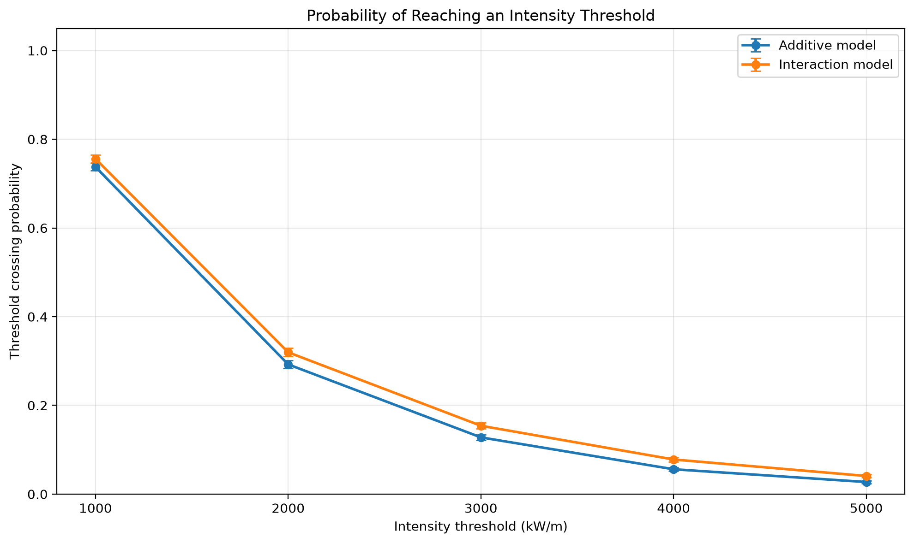
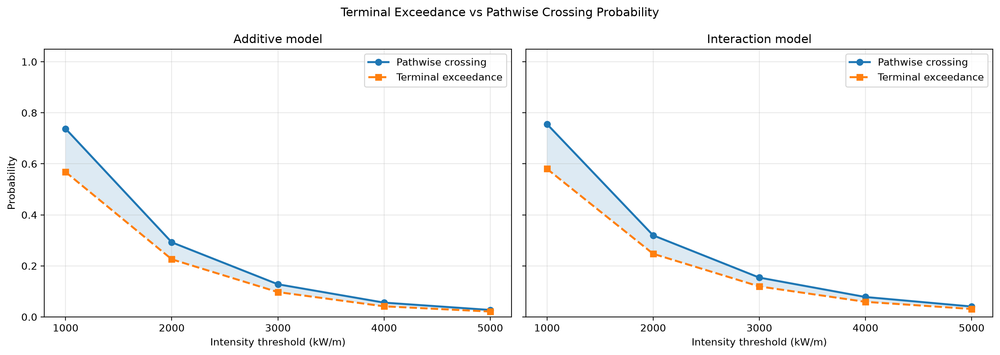
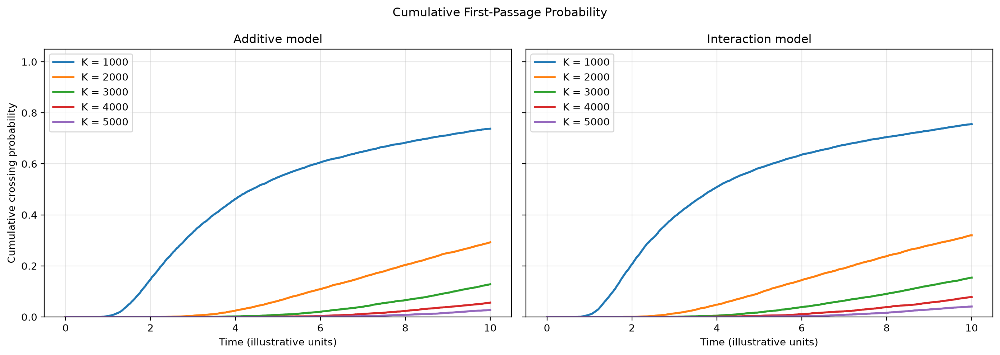
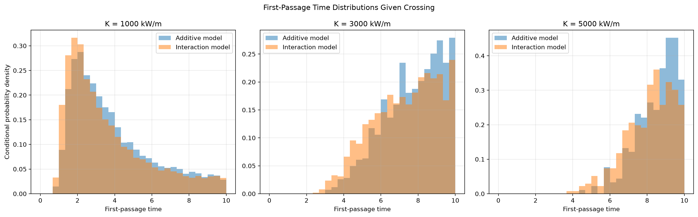
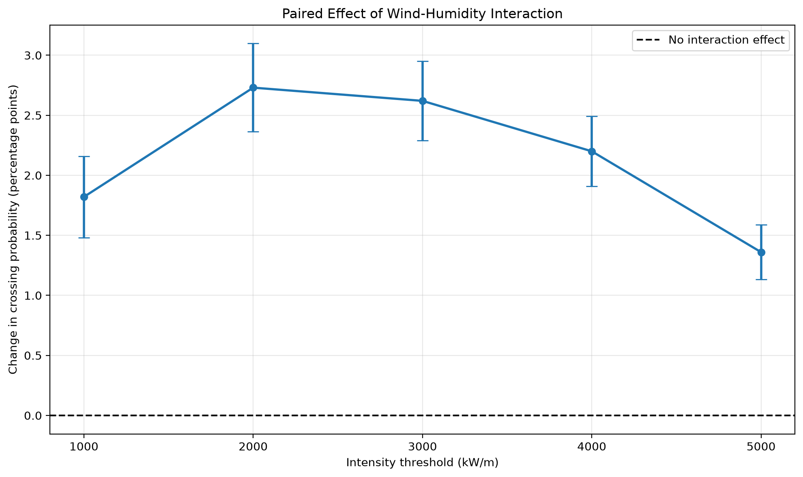

# Q3 — Threshold Crossing Probabilities and First-Passage Times

## 1. Research Question

What is the probability that wildfire intensity reaches a
specified high-intensity threshold within a given time horizon,
and how long does it take to reach that threshold?

In particular, we investigate:

- The probability of reaching different intensity thresholds.
- The distribution of first-passage times.
- The conditional expected time to reach a threshold.
- The difference between terminal and pathwise exceedance.
- The effect of wind-humidity interaction on crossing risk.
- The effect of interaction on conditional crossing times.
- The uncertainty associated with Monte Carlo estimates.

Unlike Q2, which investigates intensity at a particular future
time, Q3 investigates the complete evolution of wildfire intensity.

A wildfire may reach a high intensity during its evolution and
subsequently decrease before the observation horizon ends.

Therefore, terminal intensity alone does not fully characterize
the risk of experiencing high-intensity conditions.

---

## 2. Mathematical Foundation

### 2.1 Coupled Stochastic Wildfire Model

Following Equation (3.11) of the Mathematical Model report,
wildfire intensity satisfies

$$
dI_t =
I_t
\left(
\alpha_c+\beta_WZ_t^W-\beta_HZ_t^H
+\gamma Z_t^WZ_t^H
\right)dt
+\sigma_I I_t\,dB_t^{(I)}.
$$

The environmental processes satisfy

$$
dZ_t^W =
-\kappa_W Z_t^W\,dt
+\sigma_W\,dB_t^{(W)},
$$

$$
dZ_t^H =
-\kappa_H Z_t^H\,dt
+\sigma_H\,dB_t^{(H)}.
$$

The environmental growth-rate function is

$$
r(w,h)=
\alpha_c+\beta_Ww-\beta_Hh+\gamma wh.
$$

The complete state process is

$$
X_t=(I_t,Z_t^W,Z_t^H).
$$

We assume deterministic initial conditions and independent
Brownian drivers in the baseline model.

The intensity process remains strictly positive because of
its exponential representation derived in Q1.

---

### 2.2 First-Passage Time

Following the stopping-time framework in Section 4.4 of the
Mathematical Model report, define

$$
\boxed{
\tau_K=\inf\{t\geq0:I_t\geq K\}
}
$$

where:

- K is a positive wildfire intensity threshold.
- I_t is wildfire intensity at time t.
- tau_K is the earliest time at which intensity reaches
  or exceeds K.

If the threshold is never reached, we define

$$
\tau_K=\infty.
$$

If the initial intensity already satisfies

$$
I_0\geq K,
$$

then

$$
\boxed{\tau_K=0.}
$$

Reaching the threshold exactly counts as a crossing because
the definition uses greater than or equal to K.

---

### 2.3 Why Is the First-Passage Time a Stopping Time?

Let the natural filtration of the stochastic system be

$$
\mathcal F_t
=
\sigma(X_s:0\leq s\leq t),
$$

with the usual augmentation.

A random time tau is a stopping time if

$$
\{\tau\leq t\}\in\mathcal F_t
$$

for every t greater than or equal to zero.

Since wildfire intensity has continuous sample paths,

$$
\{\tau_K\leq t\}
=
\left\{
\sup_{0\leq s\leq t}I_s\geq K
\right\}.
$$

The event on the right depends only on intensity observations
up to time t.

Consequently,

$$
\{\tau_K\leq t\}\in\mathcal F_t.
$$

Therefore,

$$
\boxed{\tau_K\text{ is a stopping time}.}
$$

This means that determining whether a threshold has been
reached by time t does not require knowledge of future
environmental conditions or future intensity values.

---

## 3. Threshold Crossing Probability

### 3.1 Definition

The probability of reaching threshold K within the
observation horizon T is

$$
\boxed{
p_K(T)=\mathbb P(\tau_K\leq T).
}
$$

Using the definition of first-passage time,

$$
\boxed{
p_K(T)
=
\mathbb P
\left(
\sup_{0\leq t\leq T}I_t\geq K
\right).
}
$$

This is a path-dependent probability because it depends
on the entire intensity trajectory rather than only its
terminal value.

---

### 3.2 Relationship to Maximum Intensity

Define the running maximum intensity as

$$
M_t=\sup_{0\leq s\leq t}I_s.
$$

Then

$$
\{\tau_K\leq T\}=\{M_T\geq K\}.
$$

Consequently,

$$
\boxed{
\mathbb P(M_T\geq K)
=
\mathbb P(\tau_K\leq T).
}
$$

Taking complements,

$$
\boxed{
\mathbb P(M_T<K)
=
1-\mathbb P(\tau_K\leq T).
}
$$

Thus, threshold crossing probabilities also characterize
selected points of the distribution of maximum wildfire
intensity.

Q2 investigates the terminal random variable

$$
I_T,
$$

while Q3 investigates the path-dependent random variables

$$
M_T
\quad\text{and}\quad
\tau_K.
$$

---

### 3.3 Monotonicity with Respect to Threshold

Suppose

$$
K_1<K_2.
$$

Any trajectory that reaches K_2 must also reach or exceed K_1.

Therefore,

$$
\{\tau_{K_2}\leq T\}
\subseteq
\{\tau_{K_1}\leq T\}.
$$

Taking probabilities,

$$
\boxed{
\mathbb P(\tau_{K_2}\leq T)
\leq
\mathbb P(\tau_{K_1}\leq T).
}
$$

Hence, crossing probability is a non-increasing function
of the intensity threshold.

This property provides a mathematical consistency check
for the numerical experiment.

---

## 4. Terminal Versus Pathwise Exceedance

### 4.1 Terminal Exceedance Probability

In Q2, we investigated the probability

$$
\mathbb P(I_T\geq K).
$$

For the additive model, the terminal intensity satisfies

$$
I_T\sim\operatorname{Lognormal}(m_T,v_T).
$$

Therefore,

$$
\mathbb P(I_T\geq K)
=
1-\Phi
\left(
\frac{\ln K-m_T}{\sqrt{v_T}}
\right).
$$

However, this probability only considers intensity at time T.

It does not account for trajectories that reached the
threshold earlier and subsequently decreased.

---

### 4.2 Relationship Between the Two Probabilities

Since

$$
I_T\leq\sup_{0\leq t\leq T}I_t,
$$

we have

$$
\{I_T\geq K\}
\subseteq
\{\tau_K\leq T\}.
$$

Taking probabilities,

$$
\boxed{
\mathbb P(I_T\geq K)
\leq
\mathbb P(\tau_K\leq T).
}
$$

Therefore, terminal exceedance probability cannot exceed
pathwise crossing probability.

This inequality holds for both the continuous-time model
and its discrete-time numerical approximation.

---

### 4.3 Probability of Crossing but Finishing Below the Threshold

The crossing event can be decomposed into two disjoint events:

$$
\begin{aligned}
\{\tau_K\leq T\}
={}&
\{I_T\geq K\}\\
&\cup
\{\tau_K\leq T,I_T<K\}.
\end{aligned}
$$

Taking probabilities,

$$
\begin{aligned}
\mathbb P(\tau_K\leq T)
={}&
\mathbb P(I_T\geq K)\\
&+
\mathbb P(\tau_K\leq T,I_T<K).
\end{aligned}
$$

Rearranging,

$$
\boxed{
\begin{aligned}
&\mathbb P(\tau_K\leq T,I_T<K)\\
&=
\mathbb P(\tau_K\leq T)
-
\mathbb P(I_T\geq K).
\end{aligned}
}
$$

This difference measures the probability of experiencing
a threshold crossing that would not be identified through
terminal intensity analysis alone.

---

## 5. Numerical Approximation of First-Passage Times

### 5.1 Discrete Simulation Grid

The simulation uses the numerical time grid

$$
t_n=n\Delta t,
\qquad n=0,1,\ldots,N,
$$

where

$$
N=\frac{T}{\Delta t}.
$$

For the selected configuration,

$$
T=10,
\qquad
\Delta t=0.01,
$$

and therefore

$$
N=1000.
$$

Each trajectory contains 1001 intensity observations,
including the initial intensity.

---

### 5.2 Discrete First-Passage Time

The continuous first-passage time is approximated by

$$
\boxed{
\tau_K^{\Delta t}
=
\min\{t_n:I_{t_n}\geq K\}.
}
$$

If no numerical observation reaches the threshold,
the observed first-passage time is represented by infinity.

Importantly, this representation means that no crossing
was observed within the simulation horizon.

It does not imply that the continuous-time process could
never cross the threshold in the future.

---

### 5.3 Numerical Discretization Limitation

A continuous trajectory may cross a threshold between
two numerical observation times and subsequently fall
below the threshold.

Such a crossing may not be detected by the discrete grid.

For observations of the exact continuous-time process,

$$
\max_{0\leq n\leq N}I_{t_n}
\leq
\sup_{0\leq t\leq T}I_t.
$$

Consequently,

$$
\mathbb P
\left(
\max_{0\leq n\leq N}I_{t_n}\geq K
\right)
\leq
\mathbb P
\left(
\sup_{0\leq t\leq T}I_t\geq K
\right).
$$

However, our simulated intensity values also contain
numerical approximation error from the log-Euler method.

Therefore, the estimated crossing probability is not
necessarily a strict lower bound for the exact continuous-time
crossing probability.

A smaller time step and a convergence experiment would
help assess the magnitude of these numerical errors.

---

## 6. Monte Carlo Estimation

### 6.1 Crossing Probability Estimator

Suppose M independent wildfire trajectories are simulated.

For trajectory j, define

$$
A_j=
\mathbf 1_{\{\tau_K^{\Delta t,j}\leq T\}}.
$$

Equivalently,

$$
A_j=
\mathbf 1_{\{
\max_{0\leq n\leq N}I_{t_n}^{(j)}\geq K
\}}.
$$

Each A_j is a Bernoulli random variable with probability p_K
for the numerical model.

The Monte Carlo estimator is

$$
\boxed{
\widehat p_K
=
\frac{1}{M}\sum_{j=1}^M A_j.
}
$$

The estimator is unbiased for the crossing probability
of the simulated numerical model:

$$
\mathbb E[\widehat p_K]=p_K.
$$

---

### 6.2 Variance and Standard Error

Since

$$
\operatorname{Var}(A_j)=p_K(1-p_K),
$$

and the trajectories are independent,

$$
\begin{aligned}
\operatorname{Var}(\widehat p_K)
&=
\frac{1}{M^2}
\sum_{j=1}^M\operatorname{Var}(A_j)\\
&=
\frac{p_K(1-p_K)}{M}.
\end{aligned}
$$

Therefore,

$$
\boxed{
\operatorname{Var}(\widehat p_K)
=
\frac{p_K(1-p_K)}{M}.
}
$$

Replacing the unknown probability with its estimate gives

$$
\boxed{
\widehat{\operatorname{SE}}(\widehat p_K)
=
\sqrt{
\frac{\widehat p_K(1-\widehat p_K)}{M}
}.
}
$$

---

### 6.3 Approximate Confidence Interval

Using a normal approximation, the pointwise 95% Monte Carlo
confidence interval is

$$
\boxed{
\widehat p_K
\pm
1.96
\sqrt{
\frac{\widehat p_K(1-\widehat p_K)}{M}
}.
}
$$

The implementation restricts the interval endpoints to
the valid probability range [0,1].

This is a Wald confidence interval.

The approximation may be unreliable for small sample sizes
or probabilities extremely close to zero or one.

A Wilson interval could be used as an alternative for
rare-event experiments.

The confidence interval describes Monte Carlo sampling
uncertainty, not uncertainty in the model parameters.

---

## 7. Conditional First-Passage Time Distribution

### 7.1 Conditional Expected First-Passage Time

We investigate the expected time required to reach a
threshold, conditional on reaching it within T.

$$
\boxed{
\mu_K(T)
=
\mathbb E[\tau_K\mid\tau_K\leq T].
}
$$

Using the discrete simulated trajectories, the estimator is

$$
\boxed{
\widehat\mu_K(T)
=
\frac{
\sum_{j:A_j=1}\tau_K^{\Delta t,j}
}{
\sum_{j=1}^M A_j
}.
}
$$

Only trajectories that reach the threshold within the
simulation horizon are included.

If no trajectory crosses, the conditional mean cannot
be estimated from the sample.

The implementation returns NaN in that case.

---

### 7.2 Conditional Median and Quantiles

The conditional median is estimated using the finite
first-passage times.

$$
\widehat m_K
=
\operatorname{Median}
\left(
\{\tau_K^{\Delta t,j}:A_j=1\}
\right).
$$

The implementation also calculates the 2.5th and 97.5th
percentiles of the observed crossing times.

These quantiles describe the variability of first-passage
times among trajectories that cross within T.

They are not confidence intervals for the conditional mean.

---

### 7.3 Conditional Versus Unconditional Expectation

The quantity

$$
\mathbb E[\tau_K\mid\tau_K\leq T]
$$

must not be confused with

$$
\mathbb E[\tau_K].
$$

The unrestricted first-passage time may exceed the
simulation horizon or may be infinite.

Trajectories that do not cross within T are right-censored.

Consequently, the finite-horizon simulation does not
directly determine the unrestricted expected first-passage time.

---

## 8. Cumulative First-Passage Probability

### 8.1 Definition

Define

$$
\boxed{
F_K(t)=\mathbb P(\tau_K\leq t).
}
$$

This function describes the probability that a wildfire
has reached threshold K by time t.

The Monte Carlo estimator is

$$
\boxed{
\widehat F_K(t)
=
\frac{1}{M}
\sum_{j=1}^M
\mathbf 1_{\{\tau_K^{\Delta t,j}\leq t\}}.
}
$$

All simulated trajectories remain in the denominator,
including trajectories that never cross within T.

---

### 8.2 Monotonicity with Respect to Time

Suppose

$$
t_1\leq t_2.
$$

Then

$$
\{\tau_K\leq t_1\}
\subseteq
\{\tau_K\leq t_2\}.
$$

Therefore,

$$
\boxed{
F_K(t_1)\leq F_K(t_2).
}
$$

Once a trajectory crosses a threshold, it remains counted
as having crossed, even if its intensity later decreases.

Consequently, the cumulative crossing probability cannot
decrease over time.

---

### 8.3 Monotonicity with Respect to Threshold

For

$$
K_1<K_2,
$$

we have

$$
\boxed{
F_{K_1}(t)\geq F_{K_2}(t).
}
$$

Thus, the cumulative probability curve associated with
a lower threshold cannot lie below the corresponding
curve for a higher threshold when evaluated on the same paths.

---

### 8.4 Initial and Terminal Conditions

Since the initial intensity is 500 kW/m and all selected
thresholds exceed 500 kW/m,

$$
F_K(0)=0.
$$

At the terminal time,

$$
\boxed{
F_K(T)=p_K(T).
}
$$

Therefore, the final value of each cumulative crossing
probability curve must equal its corresponding threshold
crossing probability.

---

### 8.5 Relationship to the Conditional Distribution

For t less than or equal to T,

$$
\begin{aligned}
\mathbb P(\tau_K\leq t\mid\tau_K\leq T)
&=
\frac{
\mathbb P(\tau_K\leq t,\tau_K\leq T)
}{
\mathbb P(\tau_K\leq T)
}\\
&=
\frac{F_K(t)}{F_K(T)}.
\end{aligned}
$$

Therefore, whenever F_K(T) is positive,

$$
\boxed{
\mathbb P(\tau_K\leq t\mid\tau_K\leq T)
=
\frac{F_K(t)}{F_K(T)}.
}
$$

This connects the cumulative crossing probability to
the conditional first-passage time distribution.

---

## 9. Paired Interaction Analysis

### 9.1 Common Random Numbers

Following the experimental methodology introduced in Q2,
the additive and interaction models use common random numbers.

For each paired trajectory, both models receive identical
wind, humidity, and intensity innovations.

The only difference is the interaction coefficient:

$$
\gamma^{(0)}=0,
$$

$$
\gamma^{(1)}=-0.04.
$$

This allows us to compare corresponding stochastic
realizations directly.

---

### 9.2 Paired Crossing Indicators

Define the additive crossing indicator

$$
A_j^{(0)}
=
\mathbf 1_{\{\tau_K^{(0,j)}\leq T\}},
$$

and the interaction crossing indicator

$$
A_j^{(\gamma)}
=
\mathbf 1_{\{\tau_K^{(\gamma,j)}\leq T\}}.
$$

The paired difference is

$$
\boxed{
D_j=A_j^{(\gamma)}-A_j^{(0)}.
}
$$

There are four possible outcomes:

| Additive crosses | Interaction crosses | D_j |
|---|---|---:|
| No | No | 0 |
| Yes | Yes | 0 |
| No | Yes | +1 |
| Yes | No | -1 |

A positive difference means that only the interaction
model reaches the threshold.

A negative difference means that only the additive
model reaches the threshold.

---

### 9.3 Expected Interaction Effect

Taking expectations,

$$
\begin{aligned}
\mathbb E[D_j]
&=
\mathbb E[A_j^{(\gamma)}]
-
\mathbb E[A_j^{(0)}]\\
&=
p_K^{(\gamma)}-p_K^{(0)}.
\end{aligned}
$$

Therefore,

$$
\boxed{
\Delta p_K
=
p_K^{(\gamma)}-p_K^{(0)}.
}
$$

The paired Monte Carlo estimator is

$$
\boxed{
\widehat{\Delta p_K}
=
\frac{1}{M}\sum_{j=1}^M D_j.
}
$$

---

### 9.4 Variance Reduction

The variance of a paired difference satisfies

$$
\begin{aligned}
\operatorname{Var}(D_j)
={}&
\operatorname{Var}(A_j^{(\gamma)})
+
\operatorname{Var}(A_j^{(0)})\\
&-
2\operatorname{Cov}
(A_j^{(\gamma)},A_j^{(0)}).
\end{aligned}
$$

When the paired crossing indicators are positively
correlated, common random numbers reduce the variance
of the estimated probability difference.

This is useful because the models differ only through
their interaction coefficients.

---

### 9.5 Paired Standard Error and Confidence Interval

The sample variance of the paired differences is

$$
s_D^2=
\frac{1}{M-1}
\sum_{j=1}^M(D_j-\overline D)^2.
$$

The estimated standard error is

$$
\boxed{
\operatorname{SE}(\overline D)
=
\frac{s_D}{\sqrt M}.
}
$$

The approximate pointwise 95% confidence interval is

$$
\boxed{
\overline D
\pm
1.96\frac{s_D}{\sqrt M}.
}
$$

If the interval excludes zero, this provides Monte Carlo
statistical evidence of a nonzero interaction effect
under the selected numerical model.

These intervals are pointwise rather than simultaneous
confidence intervals across all thresholds.

---

### 9.6 Absolute and Relative Probability Changes

The absolute probability change is

$$
\Delta p_K
=
p_K^{(\gamma)}-p_K^{(0)}.
$$

Expressed in percentage points,

$$
\Delta p_K^{\mathrm{pp}}
=
100\Delta p_K.
$$

The relative probability change is

$$
\boxed{
R_K=
\frac{
p_K^{(\gamma)}-p_K^{(0)}
}{
p_K^{(0)}
}
\times100\%.
}
$$

The relative change is defined whenever the additive
crossing probability is positive.

Absolute and relative changes provide different
interpretations of the interaction effect.

---

## 10. Experimental Configuration

The following parameters are used in the experiment.

| Parameter | Value |
|---|---:|
| Initial intensity | 500 kW/m |
| Initial wind anomaly | 1.5 |
| Initial humidity anomaly | -1.0 |
| Baseline growth coefficient | 0.05 |
| Wind growth coefficient | 0.12 |
| Humidity growth coefficient | 0.10 |
| Wind mean-reversion rate | 0.8 |
| Wind volatility | 1.0 |
| Humidity mean-reversion rate | 0.5 |
| Humidity volatility | 0.7 |
| Intensity volatility | 0.15 |
| Additive interaction coefficient | 0 |
| Nonzero interaction coefficient | -0.04 |
| Simulation horizon | 10 |
| Time-step size | 0.01 |
| Monte Carlo trajectories per model | 10000 |
| Random seed | 42 |
| Fuel category | C2 |

The investigated thresholds are

$$
K\in\{1000,2000,3000,4000,5000\}
\text{ kW/m}.
$$

These thresholds are illustrative experimental values.

They are not validated operational wildfire danger
classifications.

The initial environmental conditions correspond to

$$
W_0\approx21.54\text{ km/h},
$$

$$
H_0\approx26.53\%.
$$

Therefore, the experiment begins under relatively windy
and dry conditions compared with the historical wildfire-event
reference statistics.

The dynamic model parameters remain illustrative rather
than statistically calibrated.

---

## 11. Software Implementation

### 11.1 Stopping-Time Module

File:

    src/stopping_times.py

The function

    first_passage_times(times, intensity_paths, threshold)

calculates the first observed crossing time for every
simulated trajectory.

The numerical procedure consists of:

1. Constructing a Boolean threshold crossing matrix.
2. Determining which trajectories cross at least once.
3. Finding the first crossing index for each trajectory.
4. Assigning the corresponding simulation time.
5. Representing non-crossing trajectories using infinity.

The crossing matrix is constructed using

    crossed = intensity_paths >= threshold

Each row represents one simulated trajectory.

The crossing indicator is obtained using

    has_crossed = np.any(crossed, axis=1)

The first crossing index is calculated using

    first_indices = np.argmax(crossed, axis=1)

Since argmax returns zero for an entirely False row,
the crossing mask is required to distinguish non-crossing
trajectories from trajectories that cross at time zero.

The final passage times are assigned using

    passage_times[has_crossed] = times[
        first_indices[has_crossed]
    ]

---

### 11.2 Threshold Statistics

The function

    threshold_statistics(times, intensity_paths, threshold)

calculates:

- Number of simulated trajectories.
- Number of successful crossings.
- Threshold crossing probability.
- Terminal exceedance probability.
- Monte Carlo standard error.
- Approximate 95% confidence interval.
- Conditional mean first-passage time.
- Conditional median first-passage time.
- Conditional 2.5th and 97.5th percentiles.

---

### 11.3 Monte Carlo Simulation

File:

    src/monte_carlo.py

The existing vectorized Monte Carlo implementation from Q2
is reused without modification.

For each model, the intensity trajectory matrix has shape

    (10000, 1001)

Each row corresponds to an independent simulated wildfire.

The complete trajectory matrices are retained because
first-passage analysis requires observations throughout
the simulation horizon.

---

### 11.4 Threshold Experiment

File:

    experiments/threshold_crossing.py

This experiment implements:

- Threshold analysis for both models.
- Paired crossing probability comparison.
- Cumulative first-passage probability estimation.
- Mathematical consistency checks.
- Numerical result export.
- Generation of five experimental figures.

The cumulative crossing probability is calculated
efficiently using sorted first-passage times:

    sorted_passage_times = np.sort(passage_times)

    cumulative_probability = np.searchsorted(
        sorted_passage_times,
        times,
        side="right"
    ) / len(passage_times)

This counts the number of observed first-passage times
less than or equal to each numerical time point.

---

## 12. Implementation Validation

### 12.1 Deterministic Example

Consider four trajectories observed at times

    [0, 1, 2, 3, 4]

with intensity matrix

    [
        [500, 800, 1200, 900, 700],
        [500, 600, 800, 900, 950],
        [500, 1100, 1300, 1500, 1600],
        [500, 700, 900, 1000, 1200]
    ]

For threshold K = 1000, the expected first-passage times are

    [2, inf, 1, 3]

The implementation produces the following results:

| Statistic | Expected | Actual |
|---|---:|---:|
| Number of trajectories | 4 | 4 |
| Number of crossings | 3 | 3 |
| Crossing probability | 0.75 | 0.75 |
| Terminal probability | 0.50 | 0.50 |
| Standard error | 0.216506 | 0.216506 |
| Conditional mean time | 2.00 | 2.00 |
| Conditional median time | 2.00 | 2.00 |
| Conditional 2.5th percentile | 1.05 | 1.05 |
| Conditional 97.5th percentile | 2.95 | 2.95 |

All calculated statistics agree with the expected values.

The example validates the implementation but is too small
for reliable normal-approximation statistical inference.

---

### 12.2 Automated Unit Tests

File:

    tests/test_stopping_times.py

The following tests were implemented:

| Test | Result |
|---|---|
| First-passage time calculation | Passed |
| Initial threshold crossing | Passed |
| No threshold crossing | Passed |
| Exact threshold crossing | Passed |
| Threshold statistics | Passed |
| Terminal probability bound | Passed |
| Threshold monotonicity | Passed |
| No-crossing statistics | Passed |
| Invalid threshold | Passed |
| Invalid dimensions | Passed |

Test execution result:

    10 passed in 0.59s

Complete project test execution result:

    12 passed in 0.33s

All tests present in the project at the time of execution passed.

---

### 12.3 Mathematical Consistency Checks

The complete Monte Carlo experiment verifies that

$$
\widehat{\mathbb P}(I_T\geq K)
\leq
\widehat{\mathbb P}(\tau_K\leq T)
$$

for every investigated threshold.

It also verifies that crossing probabilities are
non-increasing as the threshold increases.

Finally, the paired probability differences are verified
against the differences between empirical crossing probabilities:

$$
\widehat{\Delta p_K}
=
\widehat p_K^{(\gamma)}
-
\widehat p_K^{(0)}.
$$

All mathematical consistency checks passed.

---

## 13. Experimental Results

### 13.1 Additive Model

| Threshold | Crossings | Crossing probability | Terminal probability | SE | 95% CI |
|---:|---:|---:|---:|---:|---|
| 1000 | 7377 | 0.73770 | 0.56780 | 0.00440 | [0.72908, 0.74632] |
| 2000 | 2924 | 0.29240 | 0.22580 | 0.00455 | [0.28348, 0.30132] |
| 3000 | 1279 | 0.12790 | 0.09730 | 0.00334 | [0.12135, 0.13445] |
| 4000 | 560 | 0.05600 | 0.04150 | 0.00230 | [0.05149, 0.06051] |
| 5000 | 272 | 0.02720 | 0.02110 | 0.00163 | [0.02401, 0.03039] |

Crossing probability decreases substantially as the
intensity threshold increases.

Approximately 73.77% of trajectories reach 1000 kW/m,
while only 2.72% reach 5000 kW/m.

---

### 13.2 Interaction Model

| Threshold | Crossings | Crossing probability | Terminal probability | SE | 95% CI |
|---:|---:|---:|---:|---:|---|
| 1000 | 7559 | 0.75590 | 0.58030 | 0.00430 | [0.74748, 0.76432] |
| 2000 | 3197 | 0.31970 | 0.24740 | 0.00466 | [0.31056, 0.32884] |
| 3000 | 1541 | 0.15410 | 0.11940 | 0.00361 | [0.14702, 0.16118] |
| 4000 | 780 | 0.07800 | 0.05910 | 0.00268 | [0.07274, 0.08326] |
| 5000 | 408 | 0.04080 | 0.03110 | 0.00198 | [0.03692, 0.04468] |

The interaction model exhibits higher estimated crossing
probabilities at every investigated threshold.

---

### 13.3 Comparison of Crossing Probabilities

| Threshold | Additive | Interaction | Difference (pp) | Relative increase |
|---:|---:|---:|---:|---:|
| 1000 | 73.77% | 75.59% | +1.82 | 2.47% |
| 2000 | 29.24% | 31.97% | +2.73 | 9.34% |
| 3000 | 12.79% | 15.41% | +2.62 | 20.48% |
| 4000 | 5.60% | 7.80% | +2.20 | 39.29% |
| 5000 | 2.72% | 4.08% | +1.36 | 50.00% |

The largest absolute increase occurs at 2000 kW/m.

The largest relative increase occurs at 5000 kW/m.

At 5000 kW/m,

$$
\frac{0.04080-0.02720}{0.02720}
\times100\%
=
50\%.
$$

Therefore, including the interaction increases the estimated
probability of reaching 5000 kW/m by 50% relative to
the additive model.

Although the relative increase is substantial, the absolute
crossing probability remains approximately 4.08%.

---

### 13.4 Conditional First-Passage Times

| Threshold | Additive mean | Additive median | Interaction mean | Interaction median |
|---:|---:|---:|---:|---:|
| 1000 | 3.89479 | 3.26000 | 3.62587 | 2.91000 |
| 2000 | 6.74927 | 6.82000 | 6.35238 | 6.33000 |
| 3000 | 7.71501 | 7.94000 | 7.32248 | 7.51000 |
| 4000 | 8.13120 | 8.31000 | 7.83714 | 8.03500 |
| 5000 | 8.50261 | 8.79500 | 8.10963 | 8.32500 |

The interaction model exhibits lower conditional mean
and median first-passage times at every threshold.

The relative reductions in conditional mean time are:

| Threshold | Relative reduction |
|---:|---:|
| 1000 | 6.90% |
| 2000 | 5.88% |
| 3000 | 5.09% |
| 4000 | 3.62% |
| 5000 | 4.62% |

These comparisons are conditional on crossing within T.

Because the successful trajectories may differ between
models, these reductions do not directly estimate the
average paired acceleration of individual trajectories.

---

## 14. Figure Analysis

### 14.1 Figure 1 — Threshold Crossing Probability

The figure compares the estimated probability of reaching
each threshold for the additive and interaction models.

#### Threshold Monotonicity

Both probability curves decrease as the threshold increases.

This agrees with the mathematical property

$$
K_1<K_2
\implies
p_{K_1}(T)\geq p_{K_2}(T).
$$

The numerical results therefore satisfy the expected
monotonicity relationship.

#### Interaction Effect

The interaction curve lies above the additive curve
at all five investigated thresholds.

This indicates that including the interaction increases
the estimated probability of reaching high-intensity
conditions under the selected configuration.

#### Absolute Versus Relative Effects

The absolute probability difference is largest at
2000 kW/m.

However, the relative probability difference increases
across the selected thresholds.

At 5000 kW/m, the relative increase reaches 50%.

This suggests that the interaction is particularly
important when evaluating relatively rare high-intensity
outcomes under the selected model.

#### Error Bars

The error bars represent approximate pointwise 95%
Monte Carlo confidence intervals for the individual
crossing probabilities.

The paired confidence intervals in Figure 5 provide
the more appropriate direct comparison between models.

---

### 14.2 Figure 2 — Terminal Versus Pathwise Exceedance

The figure compares

$$
\mathbb P(I_T\geq K)
$$

with

$$
\mathbb P(\tau_K\leq T).
$$

For both models, pathwise crossing probabilities exceed
terminal exceedance probabilities at every threshold.

This confirms the theoretical inequality

$$
\mathbb P(I_T\geq K)
\leq
\mathbb P(\tau_K\leq T).
$$

The difference between the curves represents

$$
\mathbb P(\tau_K\leq T,I_T<K).
$$

#### Additive Model

| Threshold | Pathwise | Terminal | Difference (pp) |
|---:|---:|---:|---:|
| 1000 | 73.77% | 56.78% | 16.99 |
| 2000 | 29.24% | 22.58% | 6.66 |
| 3000 | 12.79% | 9.73% | 3.06 |
| 4000 | 5.60% | 4.15% | 1.45 |
| 5000 | 2.72% | 2.11% | 0.61 |

#### Interaction Model

| Threshold | Pathwise | Terminal | Difference (pp) |
|---:|---:|---:|---:|
| 1000 | 75.59% | 58.03% | 17.56 |
| 2000 | 31.97% | 24.74% | 7.23 |
| 3000 | 15.41% | 11.94% | 3.47 |
| 4000 | 7.80% | 5.91% | 1.89 |
| 5000 | 4.08% | 3.11% | 0.97 |

#### Example at 1000 kW/m

For the interaction model,

$$
7559
$$

trajectories reach the threshold, while only

$$
5803
$$

finish at or above the threshold.

Therefore,

$$
7559-5803=1756
$$

trajectories reach the threshold but subsequently
finish below it.

The proportion of observed crossings missed by
terminal analysis is

$$
\frac{1756}{7559}\times100\%
\approx23.23\%.
$$

Consequently, terminal intensity analysis alone would
miss approximately 23.23% of the observed threshold
crossings in this scenario.

This demonstrates the importance of studying the
complete wildfire trajectory.

---

### 14.3 Figure 3 — Cumulative First-Passage Probability

The figure estimates

$$
F_K(t)=\mathbb P(\tau_K\leq t)
$$

throughout the simulation horizon.

#### Mathematical Properties

The curves exhibit the expected properties:

- Non-decreasing with respect to time.
- Non-increasing with respect to threshold.
- Zero initial probability for all selected thresholds.
- Terminal values consistent with the crossing probabilities.

These properties support the correctness of the
cumulative probability implementation.

#### Lower Thresholds

For K = 1000, crossing probability increases rapidly
during approximately t = 1 to t = 4.

This indicates that many trajectories reach the
lower threshold relatively early.

The curve subsequently becomes flatter, indicating
a slower accumulation of new crossing events.

#### Higher Thresholds

For K = 3000, 4000, and 5000, crossing probabilities
remain close to zero during the early simulation period.

Most observed high-threshold crossings accumulate
during later periods.

This indicates that substantially higher intensities
generally require more time to develop under the
selected experimental configuration.

#### Interaction Effect

The interaction model exhibits greater cumulative
crossing probabilities over much of the displayed
time range.

This is consistent with its higher terminal crossing
probabilities and lower conditional first-passage times.

---

### 14.4 Figure 4 — Conditional First-Passage Distributions

The figure compares conditional first-passage time
distributions for thresholds of 1000, 3000, and 5000 kW/m.

Only trajectories that cross within the observation
horizon are included.

The histograms estimate the conditional distribution

$$
\tau_K\mid\tau_K\leq T.
$$

#### Threshold of 1000 kW/m

The distributions are positively skewed.

Many crossings occur around t = 1.5 to t = 3,
while some trajectories require substantially longer.

The interaction model exhibits a more prominent
early crossing peak.

Its conditional mean decreases from

$$
3.89479
$$

to

$$
3.62587.
$$

Its conditional median decreases from

$$
3.26000
$$

to

$$
2.91000.
$$

#### Threshold of 3000 kW/m

The distributions become concentrated toward later times.

The interaction model exhibits more conditional density
in several earlier time intervals.

The conditional mean decreases from

$$
7.71501
$$

to

$$
7.32248.
$$

#### Threshold of 5000 kW/m

Most observed crossings occur near the end of the
simulation horizon.

The conditional median decreases from

$$
8.795
$$

to

$$
8.325.
$$

The histogram is less smooth because fewer trajectories
reach this threshold.

There are 272 successful additive trajectories and
408 successful interaction trajectories.

#### Interpretation

The interaction model exhibits lower conditional mean
and median first-passage times at all investigated thresholds.

However, the conditional distributions are affected
by the finite observation horizon.

They should not be interpreted as unrestricted
first-passage time distributions.

---

### 14.5 Figure 5 — Paired Interaction Effect

The figure directly estimates

$$
\Delta p_K
=
p_K^{(\gamma)}-p_K^{(0)}.
$$

The results are expressed in percentage points.

| Threshold | Difference (pp) | 95% CI (pp) |
|---:|---:|---|
| 1000 | 1.82 | [1.480, 2.160] |
| 2000 | 2.73 | [2.362, 3.098] |
| 3000 | 2.62 | [2.289, 2.951] |
| 4000 | 2.20 | [1.907, 2.493] |
| 5000 | 1.36 | [1.133, 1.587] |

All five pointwise confidence intervals exclude zero.

This provides strong Monte Carlo statistical evidence
of a positive interaction effect at every investigated
threshold under the selected numerical model.

The largest estimated absolute effect occurs at
2000 kW/m.

The effect decreases at higher thresholds in absolute
terms, although its relative magnitude increases.

These results are consistent with the distributional
analysis in Q2.

---

## 15. Detailed Paired Interaction Results

### 15.1 Paired Statistical Estimates

| Threshold | Difference | SE | CI lower | CI upper |
|---:|---:|---:|---:|---:|
| 1000 | 0.01820 | 0.00173 | 0.01480 | 0.02160 |
| 2000 | 0.02730 | 0.00188 | 0.02362 | 0.03098 |
| 3000 | 0.02620 | 0.00169 | 0.02289 | 0.02951 |
| 4000 | 0.02200 | 0.00149 | 0.01907 | 0.02493 |
| 5000 | 0.01360 | 0.00116 | 0.01133 | 0.01587 |

The paired standard errors are smaller than the
standard errors obtained by treating the two model
estimates as independent.

This demonstrates the usefulness of common random
numbers for comparing closely related stochastic models.

---

### 15.2 Paired Crossing Outcomes

| Threshold | Interaction only | Additive only | Net additional crossings |
|---:|---:|---:|---:|
| 1000 | 243 | 61 | 182 |
| 2000 | 316 | 43 | 273 |
| 3000 | 277 | 15 | 262 |
| 4000 | 224 | 4 | 220 |
| 5000 | 136 | 0 | 136 |

For example, at K = 2000,

$$
\widehat{\Delta p}_{2000}
=
\frac{316-43}{10000}
=
0.02730.
$$

Therefore, the interaction produces a net increase
of 273 crossing trajectories.

---

### 15.3 High-Intensity Threshold Example

At K = 5000, the paired outcomes are:

| Outcome | Number of trajectories |
|---|---:|
| Both models cross | 272 |
| Interaction model only crosses | 136 |
| Additive model only crosses | 0 |
| Neither model crosses | 9592 |

Consequently,

$$
\widehat p_{5000}^{(0)}
=
\frac{272}{10000}
=
0.02720,
$$

and

$$
\widehat p_{5000}^{(\gamma)}
=
\frac{408}{10000}
=
0.04080.
$$

The paired probability difference is

$$
\widehat{\Delta p}_{5000}
=
\frac{136}{10000}
=
0.01360.
$$

The relative increase is

$$
\frac{136}{272}\times100\%=50\%.
$$

The absence of additive-only crossings at this threshold
is an empirical observation.

It does not prove that additive-only crossings are
mathematically impossible.

---

## 16. Mathematical Interpretation of the Interaction

### 16.1 Initial Growth Rate

Recall the environmental growth-rate function

$$
r(w,h)=
\alpha_c+\beta_Ww-\beta_Hh+\gamma wh.
$$

At the initial environmental conditions,

$$
w=1.5,
\qquad
h=-1.
$$

For the additive model,

$$
\begin{aligned}
r_0
&=
0.05+0.12(1.5)-0.10(-1)\\
&=0.33.
\end{aligned}
$$

For the interaction model,

$$
\begin{aligned}
r_\gamma
&=
0.33+(-0.04)(1.5)(-1)\\
&=0.39.
\end{aligned}
$$

Therefore, the initial proportional intensity drift
increases by

$$
\frac{0.39-0.33}{0.33}\times100\%
\approx18.18\%.
$$

This provides a mathematical explanation for why
the interaction can contribute to earlier intensity
growth under the selected windy and dry conditions.

---

### 16.2 Pathwise Interaction Effect

From Q2, paired intensity trajectories satisfy

$$
\boxed{
\frac{I_t^{(\gamma)}}{I_t^{(0)}}
=
\exp
\left(
\gamma\int_0^t Z_s^WZ_s^H\,ds
\right).
}
$$

For gamma less than zero, the interaction increases
intensity at time t whenever

$$
\int_0^t Z_s^WZ_s^H\,ds<0.
$$

However, the cumulative environmental product can
change sign across trajectories and over time.

Therefore, a nonzero interaction does not guarantee

$$
I_t^{(\gamma)}\geq I_t^{(0)}
$$

for every trajectory and every time.

This explains why some trajectories cross a threshold
only in the additive model.

The observed positive crossing probability differences
are statistical properties of the selected model
configuration rather than universal pathwise inequalities.

---

### 16.3 Connection to Q2

In Q2, including the interaction increased:

- Expected terminal intensity by 7.51%.
- Terminal intensity variance by 38.38%.
- Terminal intensity standard deviation by 17.63%.
- The upper 97.5th percentile by 14.94%.

Q3 extends these results by demonstrating increases
in the probability of experiencing high intensity
at any observed time during the simulation.

The larger relative crossing probability increases
at high thresholds are consistent with the increased
variability and upper-range outcomes observed in Q2.

---

## 17. Discussion

### 17.1 Why Is the Absolute Effect Largest at an Intermediate Threshold?

At relatively low thresholds, many trajectories already
cross without interaction.

This leaves fewer opportunities for additional crossings.

At very high thresholds, relatively few trajectories
cross under either model.

Intermediate thresholds may therefore exhibit larger
absolute probability differences.

This provides a plausible explanation for the observed
maximum absolute difference at 2000 kW/m.

It is not a general mathematical theorem that the
interaction effect must peak at an intermediate threshold.

---

### 17.2 Why Are Relative Effects Larger at Higher Thresholds?

The relative probability change is

$$
R_K=
\frac{\Delta p_K}{p_K^{(0)}}\times100\%.
$$

As the additive crossing probability becomes smaller,
even a modest absolute probability increase can
produce a substantial relative increase.

For example,

$$
0.04080-0.02720=0.01360,
$$

which represents only 1.36 percentage points.

However, relative to the additive probability of 2.72%,
the increase is 50%.

Therefore, both absolute and relative probability
changes should be reported.

---

### 17.3 Importance of Pathwise Risk

A terminal intensity distribution provides information
about wildfire intensity at one selected time.

However, high-intensity events may occur earlier.

The first-passage framework provides additional information
about:

- Whether a threshold is reached.
- When the threshold is first reached.
- How crossing probability accumulates over time.
- How frequently high-intensity events are missed
  by terminal intensity analysis.

Consequently, first-passage analysis complements the
terminal distribution analysis performed in Q2.

---

## 18. Limitations

### 18.1 Illustrative Model Parameters

The dynamic parameters have not been calibrated using
longitudinal wildfire intensity observations.

The results demonstrate the behavior of the proposed
stochastic model under selected assumptions.

They should not be interpreted as operational predictions
of actual wildfire danger.

### 18.2 Illustrative Intensity Thresholds

The thresholds are selected for numerical comparison.

They are not validated wildfire danger classifications.

### 18.3 Discrete Observation Grid

Threshold crossings between numerical time points
may not be detected.

The log-Euler intensity approximation also introduces
discretization error.

A time-step convergence experiment would help quantify
these limitations.

### 18.4 Right-Censored First-Passage Times

Trajectories that do not cross within T are right-censored.

The simulation cannot determine whether these trajectories
would cross after the observation horizon.

### 18.5 Conditional Timing Comparison

The additive and interaction models may have different
sets of successful trajectories.

Therefore, comparing conditional mean crossing times
does not directly measure the average paired timing effect.

A separate analysis restricted to trajectories crossing
in both models would be required for that comparison.

### 18.6 Monte Carlo Sampling Uncertainty

Confidence intervals quantify sampling uncertainty
conditional on the numerical model.

They do not quantify parameter uncertainty,
model misspecification, or discretization error.

### 18.7 Multiple Threshold Comparisons

The reported confidence intervals are pointwise.

They do not provide simultaneous 95% confidence coverage
across all investigated thresholds.

### 18.8 Rare-Event Estimation

Higher thresholds produce fewer successful trajectories.

Consequently, conditional first-passage distributions
become noisier and may require larger Monte Carlo samples.

### 18.9 Independent Brownian Drivers

The baseline model assumes independent environmental
and intensity Brownian drivers.

Alternative dependence assumptions may change crossing
probabilities and first-passage distributions.

These assumptions will be investigated in Q6.

### 18.10 Unbounded Environmental Processes

The OU environmental processes have unbounded Gaussian support.

Reconstructed wind speed and relative humidity may
occasionally fall outside physically realistic ranges.

This remains a limitation of the proposed environmental model.

---

## 19. Final Answer to Q3

Under the proposed coupled stochastic wildfire model,
the first-passage time associated with intensity threshold K is

$$
\boxed{
\tau_K=\inf\{t\geq0:I_t\geq K\}.
}
$$

The probability of reaching the threshold within
the observation horizon T is

$$
\boxed{
\mathbb P(\tau_K\leq T)
=
\mathbb P
\left(
\sup_{0\leq t\leq T}I_t\geq K
\right).
}
$$

Using 10000 Monte Carlo trajectories per model, crossing
probabilities were estimated for thresholds between
1000 and 5000 kW/m.

The interaction model exhibited higher estimated crossing
probabilities at every investigated threshold.

The relative probability increases ranged from

$$
2.47\%
$$

to

$$
50.00\%.
$$

The largest absolute increase occurred at 2000 kW/m,
where the crossing probability increased from

$$
29.24\%
$$

to

$$
31.97\%.
$$

The largest relative increase occurred at 5000 kW/m,
where the crossing probability increased from

$$
2.72\%
$$

to

$$
4.08\%.
$$

All five paired pointwise 95% Monte Carlo confidence
intervals excluded zero.

The interaction model also exhibited lower conditional
mean and median first-passage times at all five thresholds.

Furthermore, the numerical results confirmed that

$$
\mathbb P(I_T\geq K)
\leq
\mathbb P(\tau_K\leq T).
$$

At threshold 1000 kW/m, approximately 23.23% of observed
crossings in the interaction model would not have been
identified through terminal intensity analysis alone.

Overall, the results demonstrate that the wind-humidity
interaction can influence both the probability and timing
of high-intensity wildfire events.

They also demonstrate the importance of investigating
complete stochastic trajectories rather than exclusively
examining terminal intensity.

These conclusions are conditional on the illustrative
parameters, numerical approximation, and environmental
assumptions used in the experiment.

---

## 20. Connection to Q4

Q3 demonstrates that the interaction coefficient influences
threshold crossing probabilities and conditional
first-passage times.

However, the model contains several other parameters
that may influence wildfire behavior.

Q4 will investigate sensitivity with respect to:

- Baseline growth coefficient.
- Wind growth coefficient.
- Humidity growth coefficient.
- Wind-humidity interaction coefficient.
- Wind mean-reversion rate.
- Humidity mean-reversion rate.
- Wind volatility.
- Humidity volatility.
- Intensity volatility.
- Initial environmental conditions.

The sensitivity analysis will examine how parameter
changes affect terminal intensity distributions and
threshold crossing probabilities.

The existing Monte Carlo and stopping-time implementations
provide the computational foundation for Q4.

---

## 21. Implementation References

| File | Contribution |
|---|---|
| src/config.py | Baseline parameters and numerical configuration |
| src/environment.py | Exact OU environmental transitions |
| src/intensity.py | Growth-rate function and log-Euler method |
| src/monte_carlo.py | Vectorized Monte Carlo trajectories |
| src/stopping_times.py | First-passage times and threshold statistics |
| experiments/threshold_crossing.py | Complete threshold experiment |
| tests/test_stopping_times.py | Automated stopping-time validation |

### Run Commands

Validate the deterministic stopping-time example:

    python -m src.stopping_times

Run stopping-time unit tests:

    python -m pytest tests/test_stopping_times.py -v

Run all project tests:

    python -m pytest -q

Run the complete threshold crossing experiment:

    python -m experiments.threshold_crossing

### Generated Numerical Results

    results/threshold_additive.csv
    results/threshold_interaction.csv
    results/threshold_paired_comparison.csv

### Generated Figures

    results/figures/threshold_crossing_probability.png
    results/figures/terminal_vs_pathwise.png
    results/figures/cumulative_crossing_probability.png
    results/figures/first_passage_distributions.png
    results/figures/threshold_interaction_effect.png

---

## 22. Mathematical Model References

| Reference | Description |
|---|---|
| Equation (2.1) | Environmental standardization |
| Equations (3.1)-(3.4) | Wind OU process and analytical properties |
| Equations (3.5)-(3.8) | Humidity OU process and analytical properties |
| Equation (3.9) | Environmental growth-rate function |
| Equation (3.10) | Marginal wind effect |
| Equation (3.11) | Wildfire intensity SDE |
| Equations (3.12)-(3.13) | Ito transformation and log-intensity |
| Equations (3.14)-(3.16) | Integrated intensity representation |
| Section 3.3 | Complete coupled stochastic system |
| Section 4.1 | Markov property |
| Section 4.4 | Stopping times |

Additional derivations introduced during Q3 include:

- First-passage time characterization.
- Stopping-time measurability.
- Maximum intensity distribution relationship.
- Threshold monotonicity.
- Terminal versus pathwise exceedance inequality.
- Monte Carlo crossing probability estimator.
- Bernoulli estimator variance.
- Conditional first-passage time estimation.
- Cumulative first-passage probability.
- Paired crossing probability estimation.
- Paired Monte Carlo confidence intervals.

---

## 23. Completion Checklist

### Mathematical Analysis

- [x] Define first-passage times.
- [x] Establish the stopping-time property.
- [x] Derive the threshold crossing probability.
- [x] Establish the relationship to maximum intensity.
- [x] Establish threshold monotonicity.
- [x] Derive the terminal probability bound.
- [x] Derive the Monte Carlo crossing estimator.
- [x] Derive the estimator variance and standard error.
- [x] Define conditional first-passage time statistics.
- [x] Derive cumulative crossing probability.
- [x] Derive paired interaction estimators.

### Numerical Implementation

- [x] Implement first-passage time calculation.
- [x] Implement threshold statistics.
- [x] Validate deterministic example.
- [x] Implement stopping-time unit tests.
- [x] Pass all 10 stopping-time tests.
- [x] Pass all 12 existing project tests.
- [x] Simulate additive model.
- [x] Simulate interaction model.
- [x] Evaluate five intensity thresholds.
- [x] Implement paired interaction analysis.
- [x] Export numerical results.
- [x] Pass mathematical consistency checks.

### Visualization and Interpretation

- [x] Generate threshold crossing probability figure.
- [x] Generate terminal versus pathwise figure.
- [x] Generate cumulative crossing probability figure.
- [x] Generate conditional first-passage distributions.
- [x] Generate paired interaction effect figure.
- [x] Interpret all five figures.
- [x] Analyze absolute probability changes.
- [x] Analyze relative probability changes.
- [x] Analyze conditional crossing times.
- [x] Discuss assumptions and limitations.
- [x] Answer research question Q3.

### Additional Validation

- [ ] Perform time-step convergence analysis.
- [ ] Investigate paired crossing times among common crossings.
- [ ] Investigate alternative confidence interval methods.
- [ ] Increase sample size for rare-event estimation if needed.

Q3 Status: Implemented, validated, analyzed, and documented.

Next Research Question:

Q4 — Parameter Sensitivity Analysis.