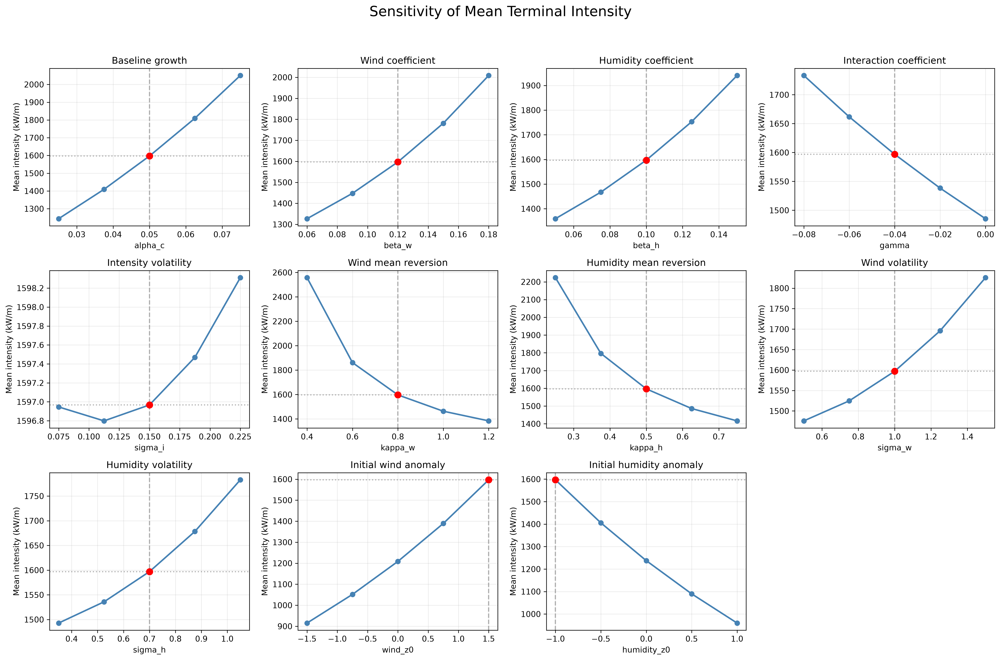
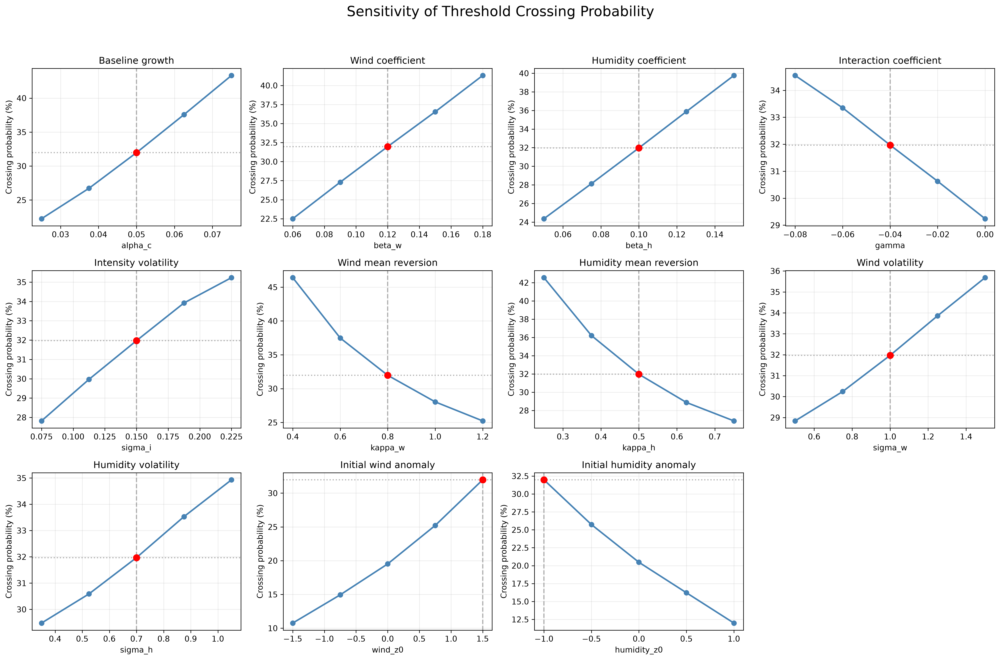
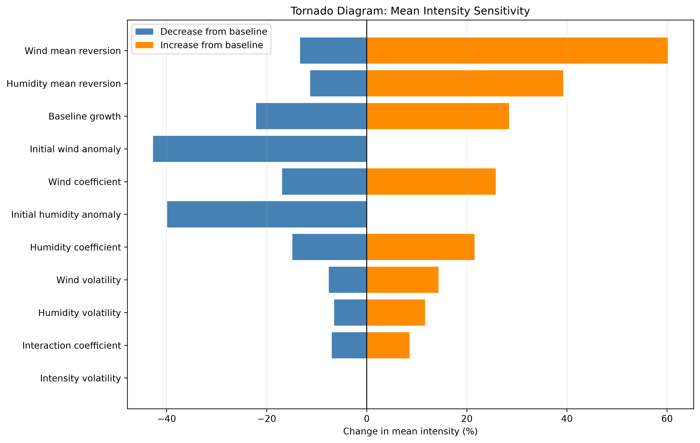
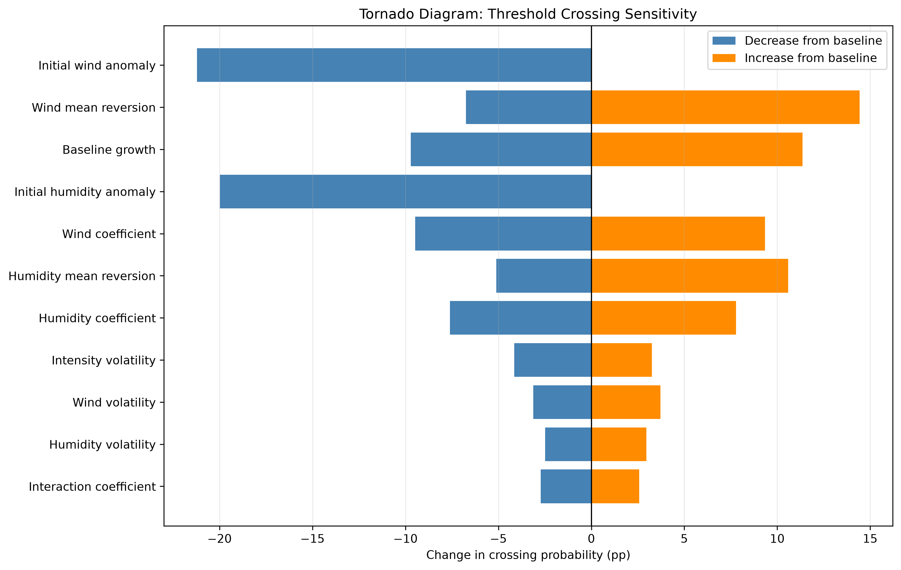
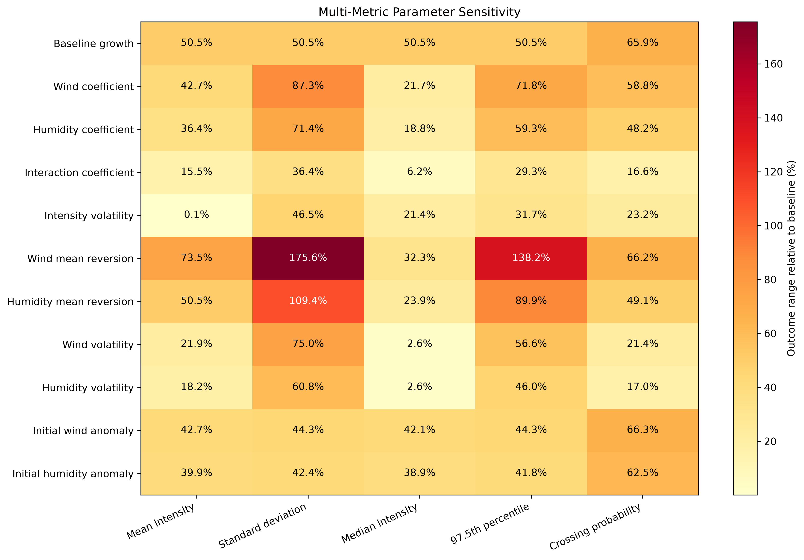

# Q4 — Sensitivity Analysis of Wildfire Intensity

## 1. Research Question

How sensitive is wildfire intensity to changes in model parameters,
environmental dynamics, and initial environmental conditions?

In particular, we investigate how individual parameters influence:

- Expected terminal wildfire intensity.
- Expected log-intensity.
- Terminal intensity variance and standard deviation.
- Median terminal intensity.
- Upper intensity quantiles.
- Threshold crossing probability.
- Extreme-event risk.

The objective is to identify which model inputs have the greatest
influence on different wildfire intensity outcomes within the
investigated parameter ranges.

This question extends Q1, Q2, and Q3 by examining how their results
change when the baseline model assumptions are modified.

---

## 2. Mathematical Foundation

### 2.1 Coupled Stochastic System

Following the mathematical modeling document, wildfire intensity
satisfies

$$
dI_t=
I_t\left(
\alpha_c+\beta_WZ_t^W-\beta_HZ_t^H+
\gamma Z_t^WZ_t^H
\right)dt
+\sigma_II_tdB_t^{(I)}.
$$

The standardized environmental processes satisfy

$$
dZ_t^W=-\kappa_WZ_t^Wdt+\sigma_WdB_t^{(W)}
$$

and

$$
dZ_t^H=-\kappa_HZ_t^Hdt+\sigma_HdB_t^{(H)}.
$$

The three Brownian drivers are assumed to be independent throughout
this sensitivity analysis.

Define the environmental growth function

$$
r(w,h)=\alpha_c+\beta_Ww-\beta_Hh+\gamma wh.
$$

The intensity process can therefore be written as

$$
dI_t=I_tr(Z_t^W,Z_t^H)dt+\sigma_II_tdB_t^{(I)}.
$$

### 2.2 Model Inputs

The sensitivity analysis investigates 11 model inputs.

| Input | Symbol | Interpretation |
|-------|--------|----------------|
| Baseline growth | $\alpha_c$ | Fuel-specific baseline intensity growth |
| Wind coefficient | $\beta_W$ | Strength of wind contribution |
| Humidity coefficient | $\beta_H$ | Strength of humidity contribution |
| Interaction coefficient | $\gamma$ | Wind-humidity interaction |
| Intensity volatility | $\sigma_I$ | Random intensity fluctuations |
| Wind mean reversion | $\kappa_W$ | Speed of wind anomaly decay |
| Humidity mean reversion | $\kappa_H$ | Speed of humidity anomaly decay |
| Wind volatility | $\sigma_W$ | Random wind fluctuations |
| Humidity volatility | $\sigma_H$ | Random humidity fluctuations |
| Initial wind anomaly | $z_0^W$ | Initial standardized wind condition |
| Initial humidity anomaly | $z_0^H$ | Initial standardized humidity condition |

These inputs represent different mechanisms affecting wildfire
intensity.

The first five parameters directly influence intensity dynamics.

The next four parameters determine environmental dynamics.

The final two inputs determine initial environmental conditions.

---

## 3. Log-Intensity Representation

### 3.1 Applying Itô's Formula

Define

$$
Y_t=\ln I_t.
$$

For

$$
f(i)=\ln i,
$$

we have

$$
f'(i)=\frac1i
$$

and

$$
f''(i)=-\frac1{i^2}.
$$

Applying Itô's formula,

$$
dY_t=
\frac1{I_t}dI_t
-\frac1{2I_t^2}(dI_t)^2.
$$

Since

$$
(dI_t)^2=\sigma_I^2I_t^2dt,
$$

we obtain

$$
dY_t=
\left(
r(Z_t^W,Z_t^H)-\frac{\sigma_I^2}{2}
\right)dt
+\sigma_IdB_t^{(I)}.
$$

### 3.2 Integrated Log-Intensity

Integrating from zero to $T$,

$$
\begin{aligned}
Y_T={}&\ln I_0+
\left(\alpha_c-\frac{\sigma_I^2}{2}\right)T\\
&+\beta_W\int_0^TZ_s^Wds\\
&-\beta_H\int_0^TZ_s^Hds\\
&+\gamma\int_0^TZ_s^WZ_s^Hds\\
&+\sigma_IB_T^{(I)}.
\end{aligned}
$$

Define

$$
J_W=\int_0^TZ_s^Wds,
$$

$$
J_H=\int_0^TZ_s^Hds,
$$

and

$$
J_{WH}=\int_0^TZ_s^WZ_s^Hds.
$$

Then

$$
Y_T=
\ln I_0+
\left(\alpha_c-\frac{\sigma_I^2}{2}\right)T
+\beta_WJ_W-\beta_HJ_H
+\gamma J_{WH}
+\sigma_IB_T^{(I)}.
$$

This representation is particularly useful for sensitivity analysis
because the intensity parameters appear explicitly.

---

## 4. Analytical Parameter Sensitivity

We first investigate the sensitivity of expected log-intensity
with respect to the five intensity parameters.

Define

$$
F(\theta)=\mathbb E[\ln I_T(\theta)].
$$

The analytical sensitivity is

$$
S_\theta=\frac{\partial F}{\partial\theta}.
$$

These derivatives provide theoretical benchmarks for validating
the numerical sensitivity implementation.

### 4.1 Baseline Growth Coefficient

Differentiating log-intensity with respect to $\alpha_c$,

$$
\frac{\partial Y_T}{\partial\alpha_c}=T.
$$

Taking expectations,

$$
\boxed{
\frac{\partial\mathbb E[Y_T]}{\partial\alpha_c}=T
}
$$

For the baseline simulation horizon,

$$
T=10,
$$

we obtain

$$
\boxed{S_{\alpha_c}=10.}
$$

The sensitivity is deterministic.

It does not depend on the environmental trajectories or Brownian
realizations.

Furthermore, since

$$
I_T=e^{Y_T},
$$

the chain rule gives

$$
\frac{\partial I_T}{\partial\alpha_c}
=
I_T\frac{\partial Y_T}{\partial\alpha_c}
=
TI_T.
$$

Because $I_T>0$, increasing baseline growth increases terminal
intensity for every trajectory when the random inputs are held fixed.

### 4.2 Wind Coefficient

Differentiating with respect to $\beta_W$,

$$
\frac{\partial Y_T}{\partial\beta_W}
=
J_W.
$$

Therefore,

$$
\frac{\partial\mathbb E[Y_T]}{\partial\beta_W}
=
\mathbb E[J_W].
$$

Using the OU mean,

$$
\mathbb E[Z_t^W]
=
z_0^We^{-\kappa_Wt},
$$

we obtain

$$
\begin{aligned}
\mathbb E[J_W]
&=
\int_0^T\mathbb E[Z_t^W]dt\\
&=
z_0^W\int_0^Te^{-\kappa_Wt}dt\\
&=
\frac{z_0^W}{\kappa_W}
(1-e^{-\kappa_WT}).
\end{aligned}
$$

Consequently,

$$
\boxed{
S_{\beta_W}
=
\frac{z_0^W}{\kappa_W}
(1-e^{-\kappa_WT})
}
$$

Using

$$
z_0^W=1.5,\qquad
\kappa_W=0.8,\qquad
T=10,
$$

we obtain

$$
S_{\beta_W}
=
\frac{1.5}{0.8}(1-e^{-8})
$$

and therefore

$$
\boxed{S_{\beta_W}\approx1.87437.}
$$

The positive derivative indicates that increasing the wind
coefficient increases expected log-intensity under the baseline
initial conditions.

However, individual trajectories may respond differently depending
on their integrated wind anomalies.

### 4.3 Humidity Coefficient

Differentiating with respect to $\beta_H$,

$$
\frac{\partial Y_T}{\partial\beta_H}
=
-J_H.
$$

Taking expectations,

$$
\frac{\partial\mathbb E[Y_T]}{\partial\beta_H}
=
-\mathbb E[J_H].
$$

Using the OU mean,

$$
\mathbb E[Z_t^H]
=
z_0^He^{-\kappa_Ht},
$$

we obtain

$$
\boxed{
S_{\beta_H}
=
-\frac{z_0^H}{\kappa_H}
(1-e^{-\kappa_HT})
}
$$

Using

$$
z_0^H=-1,\qquad
\kappa_H=0.5,\qquad
T=10,
$$

we obtain

$$
S_{\beta_H}
=
-\frac{-1}{0.5}(1-e^{-5}).
$$

Therefore,

$$
\boxed{S_{\beta_H}\approx1.98652.}
$$

The positive derivative occurs because the baseline humidity
anomaly is negative.

Increasing $\beta_H$ strengthens the effect of initially dry
conditions.

This does not mean that increasing physical humidity increases
wildfire intensity.

The humidity coefficient and the humidity state are different
quantities.

### 4.4 Interaction Coefficient

Differentiating with respect to $\gamma$,

$$
\frac{\partial Y_T}{\partial\gamma}
=
J_{WH}.
$$

Taking expectations,

$$
\frac{\partial\mathbb E[Y_T]}{\partial\gamma}
=
\int_0^T
\mathbb E[Z_t^WZ_t^H]dt.
$$

Under independent environmental Brownian drivers and deterministic
initial conditions, the wind and humidity processes are independent.

Therefore,

$$
\mathbb E[Z_t^WZ_t^H]
=
\mathbb E[Z_t^W]\mathbb E[Z_t^H].
$$

Substituting the OU means,

$$
\mathbb E[Z_t^WZ_t^H]
=
z_0^Wz_0^H
e^{-(\kappa_W+\kappa_H)t}.
$$

Consequently,

$$
\begin{aligned}
S_\gamma
&=
z_0^Wz_0^H
\int_0^T
e^{-(\kappa_W+\kappa_H)t}dt\\
&=
\frac{z_0^Wz_0^H}{\kappa_W+\kappa_H}
\left(
1-e^{-(\kappa_W+\kappa_H)T}
\right).
\end{aligned}
$$

Thus,

$$
\boxed{
S_\gamma=
\frac{z_0^Wz_0^H}{\kappa_W+\kappa_H}
\left(
1-e^{-(\kappa_W+\kappa_H)T}
\right)
}
$$

Using the baseline parameters,

$$
S_\gamma
=
\frac{(1.5)(-1)}{0.8+0.5}
(1-e^{-13}).
$$

Therefore,

$$
\boxed{S_\gamma\approx-1.15384.}
$$

The negative derivative indicates that increasing $\gamma$ toward
zero decreases expected log-intensity under the baseline initial
conditions.

Equivalently, making $\gamma$ more negative increases expected
log-intensity.

This is consistent with the interaction results obtained in Q2
and Q3.

### 4.5 Intensity Volatility

Differentiating with respect to $\sigma_I$,

$$
\frac{\partial Y_T}{\partial\sigma_I}
=
-\sigma_IT+B_T^{(I)}.
$$

Since

$$
\mathbb E[B_T^{(I)}]=0,
$$

we obtain

$$
\boxed{
S_{\sigma_I}=-\sigma_IT
}
$$

Using

$$
\sigma_I=0.15,\qquad T=10,
$$

we obtain

$$
\boxed{S_{\sigma_I}=-1.5.}
$$

Increasing intensity volatility decreases expected log-intensity
because of the Itô correction.

However, expected physical intensity behaves differently.

This distinction is investigated in Section 5.

### 4.6 Summary of Analytical Derivatives

| Parameter | Analytical sensitivity |
|-----------|------------------------|
| $\alpha_c$ | $T$ |
| $\beta_W$ | $\frac{z_0^W}{\kappa_W}(1-e^{-\kappa_WT})$ |
| $\beta_H$ | $-\frac{z_0^H}{\kappa_H}(1-e^{-\kappa_HT})$ |
| $\gamma$ | $\frac{z_0^Wz_0^H}{\kappa_W+\kappa_H}(1-e^{-(\kappa_W+\kappa_H)T})$ |
| $\sigma_I$ | $-\sigma_IT$ |

Numerical theoretical values:

| Parameter | Value |
|-----------|------:|
| alpha_c | 10.00000 |
| beta_w | 1.87437 |
| beta_h | 1.98652 |
| gamma | -1.15384 |
| sigma_i | -1.50000 |

These are local derivatives of expected log-intensity.

Their magnitudes should not be directly interpreted as normalized
parameter importance because the parameters have different units
and numerical scales.

---

## 5. Intensity Volatility and Expected Physical Intensity

One particularly important theoretical result is that intensity
volatility does not change expected physical intensity under
independent intensity and environmental Brownian drivers,
provided the expectation is finite.

### 5.1 Separating Environmental Growth and Intensity Noise

From the exponential intensity solution,

$$
I_T=
I_0\exp\left[
\int_0^Tr(Z_s^W,Z_s^H)ds
-\frac{\sigma_I^2T}{2}
+\sigma_IB_T^{(I)}
\right].
$$

Define

$$
A_T=
I_0\exp\left[
\int_0^Tr(Z_s^W,Z_s^H)ds
\right]
$$

and

$$
M_T=
\exp\left[
\sigma_IB_T^{(I)}
-\frac{\sigma_I^2T}{2}
\right].
$$

Then

$$
I_T=A_TM_T.
$$

The variable $A_T$ depends only on the environmental processes.

The variable $M_T$ depends only on the intensity Brownian motion.

Under the independence assumption, $A_T$ and $M_T$ are independent.

### 5.2 Expected Exponential Brownian Factor

Since

$$
B_T^{(I)}\sim N(0,T),
$$

the Gaussian moment-generating function gives

$$
\mathbb E[e^{\sigma_IB_T^{(I)}}]
=
e^{\sigma_I^2T/2}.
$$

Therefore,

$$
\begin{aligned}
\mathbb E[M_T]
&=
e^{-\sigma_I^2T/2}
\mathbb E[e^{\sigma_IB_T^{(I)}}]\\
&=
e^{-\sigma_I^2T/2}
e^{\sigma_I^2T/2}\\
&=1.
\end{aligned}
$$

The process $M_t$ is the exponential Brownian martingale.

### 5.3 Expected Wildfire Intensity

Using independence,

$$
\begin{aligned}
\mathbb E[I_T]
&=
\mathbb E[A_TM_T]\\
&=
\mathbb E[A_T]\mathbb E[M_T]\\
&=
\mathbb E[A_T].
\end{aligned}
$$

Consequently,

$$
\boxed{
\mathbb E[I_T]
=
I_0\mathbb E\left[
\exp\left(
\int_0^Tr(Z_s^W,Z_s^H)ds
\right)
\right]
}
$$

This expression does not contain $\sigma_I$.

Therefore, whenever the expected intensity is finite,

$$
\boxed{
\frac{\partial\mathbb E[I_T]}{\partial\sigma_I}=0.
}
$$

This result applies to both the additive and interaction models
under the stated independence assumption.

### 5.4 Second Moment and Variance

Although the expected intensity is independent of $\sigma_I$,
its second moment is not.

We have

$$
I_T^2=A_T^2M_T^2.
$$

Furthermore,

$$
M_T^2=
\exp\left(
2\sigma_IB_T^{(I)}-\sigma_I^2T
\right).
$$

Taking expectations,

$$
\begin{aligned}
\mathbb E[M_T^2]
&=
e^{-\sigma_I^2T}
\mathbb E[e^{2\sigma_IB_T^{(I)}}]\\
&=
e^{-\sigma_I^2T}
e^{2\sigma_I^2T}\\
&=
e^{\sigma_I^2T}.
\end{aligned}
$$

Therefore,

$$
\mathbb E[I_T^2]
=
\mathbb E[A_T^2]e^{\sigma_I^2T}.
$$

Assuming finite second moments,

$$
\boxed{
\operatorname{Var}(I_T)
=
\mathbb E[A_T^2]e^{\sigma_I^2T}
-\mathbb E[A_T]^2
}
$$

Differentiating,

$$
\frac{\partial\operatorname{Var}(I_T)}
{\partial\sigma_I}
=
2\sigma_IT
\mathbb E[A_T^2]e^{\sigma_I^2T}.
$$

For positive intensity volatility,

$$
\frac{\partial\operatorname{Var}(I_T)}
{\partial\sigma_I}>0.
$$

Thus, increasing intensity volatility increases variance without
changing expected physical intensity.

### 5.5 Interpretation

Two models can have identical expected wildfire intensity while
having substantially different intensity distributions.

The model with greater volatility may produce more extreme
outcomes and greater uncertainty.

Consequently, expected intensity alone is insufficient for
evaluating wildfire risk.

This provides a direct mathematical connection between Q2,
Q3, and Q4.

---

## 6. Numerical Sensitivity Methodology

### 6.1 Generalizing the Monte Carlo Engine

The original Monte Carlo simulation used fixed model parameters
defined in `src/config.py`.

For Q4, `src/monte_carlo.py` was generalized so that individual
parameters can be overridden through keyword arguments.

For example:

    simulate_many(beta_w=0.18)

    simulate_many(kappa_w=0.4)

    simulate_many(sigma_i=0.225)

    simulate_many(wind_z0=0.0)

All unspecified parameters retain their baseline values.

This avoids manually modifying the configuration file for each
experiment.

It also allows previous Q2 and Q3 experiments to remain compatible
with the generalized simulation engine.

### 6.2 Regression Validation

After generalizing the Monte Carlo implementation, the additive
baseline experiment was repeated.

The results were:

| Statistic | Value |
|-----------|------:|
| Number of trajectories | 10,000 |
| Number of time points | 1,001 |
| Mean | 1485.38922 |
| Variance | 1495024.21055 |
| Median | 1132.65977 |

These values reproduce the original Q2 additive simulation results.

The interaction baseline also reproduces:

| Statistic | Value |
|-----------|------:|
| Mean terminal intensity | 1596.96718 |
| Standard deviation | 1438.32228 |
| Crossing probability at K = 2000 | 0.31970 |

Therefore, the parameter generalization preserves the previous
baseline behavior.

All 12 existing automated tests continued to pass.

### 6.3 Central Finite Differences

For a differentiable function

$$
F(\theta)=\mathbb E[\ln I_T(\theta)],
$$

the central finite difference approximation is

$$
F'(\theta)
\approx
\frac{F(\theta+h)-F(\theta-h)}{2h}.
$$

Using Taylor expansions,

$$
F(\theta+h)
=
F(\theta)+hF'(\theta)
+\frac{h^2}{2}F''(\theta)
+O(h^3)
$$

and

$$
F(\theta-h)
=
F(\theta)-hF'(\theta)
+\frac{h^2}{2}F''(\theta)
+O(h^3).
$$

Subtracting,

$$
F(\theta+h)-F(\theta-h)
=
2hF'(\theta)+O(h^3).
$$

Dividing by $2h$,

$$
\boxed{
\frac{F(\theta+h)-F(\theta-h)}{2h}
=
F'(\theta)+O(h^2)
}
$$

The approximation has second-order truncation error under
appropriate smoothness conditions.

For the five investigated intensity parameters, log-intensity
is linear or quadratic in the parameter when the environmental
and Brownian paths are fixed.

Consequently, central differences recover the corresponding
pathwise derivatives exactly in exact arithmetic for the
discretized model.

### 6.4 Common Random Numbers

The simulations at $\theta+h$ and $\theta-h$ use the same random
seed and random-stream construction.

For trajectory $j$, define

$$
D_j=
\frac{
\ln I_T^{(j)}(\theta+h)
-
\ln I_T^{(j)}(\theta-h)
}{2h}.
$$

The numerical sensitivity estimator is

$$
\boxed{
\widehat S_\theta=
\frac1N\sum_{j=1}^ND_j
}
$$

Pairing the simulations allows the effect of changing the parameter
to be isolated from unrelated differences in stochastic realizations.

### 6.5 Monte Carlo Standard Error

Define the sample variance of the paired derivative estimates as

$$
s_D^2=
\frac1{N-1}
\sum_{j=1}^N(D_j-\overline D)^2.
$$

The estimated standard error is

$$
SE(\widehat S_\theta)
=
\frac{s_D}{\sqrt N}.
$$

An approximate pointwise 95% confidence interval is

$$
\boxed{
\widehat S_\theta
\pm1.96SE(\widehat S_\theta)
}
$$

These intervals describe Monte Carlo sampling uncertainty.

They do not account for continuous-time discretization error
or uncertainty in model calibration.

---

## 7. Analytical versus Numerical Validation

### 7.1 Numerical Results

The analytical and numerical sensitivity comparison produces:

| Parameter | Theory | Numerical | Absolute error | Standard error |
|-----------|-------:|----------:|---------------:|---------------:|
| alpha_c | 10.00000 | 10.00000 | 0.00000 | 0.00000 |
| beta_w | 1.87437 | 1.83324 | 0.04113 | 0.03553 |
| beta_h | 1.98652 | 2.07059 | 0.08406 | 0.03726 |
| gamma | -1.15384 | -1.16399 | 0.01015 | 0.02155 |
| sigma_i | -1.50000 | -1.48006 | 0.01994 | 0.03171 |

Approximate numerical confidence intervals:

| Parameter | Lower bound | Upper bound |
|-----------|------------:|------------:|
| alpha_c | 10.00000 | 10.00000 |
| beta_w | 1.76359 | 1.90289 |
| beta_h | 1.99757 | 2.14361 |
| gamma | -1.20623 | -1.12175 |
| sigma_i | -1.54221 | -1.41791 |

### 7.2 Relative Errors

Define relative absolute error as

$$
E_\theta=
100\frac{
|\widehat S_\theta-S_\theta|
}{
|S_\theta|
}.
$$

The approximate relative errors are:

| Parameter | Relative absolute error |
|-----------|------------------------:|
| alpha_c | 0.00% |
| beta_w | 2.19% |
| beta_h | 4.23% |
| gamma | 0.88% |
| sigma_i | 1.33% |

All numerical derivatives reproduce the theoretical signs.

The baseline growth derivative reproduces the theoretical value
exactly to the reported numerical precision.

### 7.3 Baseline Growth Validation

The analytical derivative is

$$
\frac{\partial Y_T}{\partial\alpha_c}=T.
$$

Because this derivative is deterministic, every paired trajectory
should produce the same derivative.

The numerical result is

$$
\widehat S_{\alpha_c}=10.
$$

The estimated standard error is zero to the reported precision.

This provides a strong consistency check for the numerical
sensitivity implementation.

### 7.4 Humidity Sensitivity Discrepancy

The theoretical humidity sensitivity is

$$
S_{\beta_H}=1.98652.
$$

The numerical estimate is

$$
\widehat S_{\beta_H}=2.07059.
$$

The approximate numerical confidence interval is

$$
[1.99757,2.14361].
$$

The continuous-time theoretical value lies slightly below this
interval.

The difference relative to the estimated Monte Carlo standard
error is approximately

$$
\frac{2.07059-1.98652}{0.03726}
\approx2.26.
$$

This discrepancy is not necessarily evidence of an implementation
error.

Possible explanations include:

- Finite Monte Carlo sampling variability.
- Left-endpoint discretization of the integrated humidity process.
- Ordinary variation when examining multiple pointwise confidence
  intervals.

The numerical estimator targets the derivative of the discretized
simulation, whereas the analytical formula describes the
continuous-time model.

For a more precise comparison, the expected discrete integrated
OU process can be calculated.

If

$$
J_Z^{\Delta t}
=
\Delta t\sum_{n=0}^{m-1}Z_{t_n},
$$

where $T=m\Delta t$, then

$$
\begin{aligned}
\mathbb E[J_Z^{\Delta t}]
&=
z_0\Delta t
\sum_{n=0}^{m-1}e^{-\kappa n\Delta t}\\
&=
z_0\Delta t
\frac{1-e^{-\kappa T}}
{1-e^{-\kappa\Delta t}}.
\end{aligned}
$$

This provides an exact expectation for the numerical left-endpoint
environmental integral.

For the humidity coefficient, the corresponding discrete derivative
is approximately 1.99149.

This is closer to the numerical estimate than the continuous-time
derivative, although it still lies slightly outside the reported
confidence interval.

Therefore, discretization explains only part of the discrepancy.

The overall results remain reasonably consistent with the
analytical sensitivity derivations.

---

## 8. One-at-a-Time Sensitivity Analysis

### 8.1 Experimental Design

The analytical derivatives describe local sensitivity of expected
log-intensity.

However, the project also investigates nonlinear changes in:

- Mean physical intensity.
- Standard deviation.
- Median.
- Upper quantiles.
- Threshold crossing probability.

These quantities are investigated using one-at-a-time sensitivity
analysis.

Let the baseline parameter vector be

$$
\boldsymbol\theta_0.
$$

For a selected parameter $\theta_i$, define

$$
\boldsymbol\theta^{(i,x)}
=
(\theta_{0,1},\ldots,x,\ldots,\theta_{0,p}).
$$

Only parameter $i$ is changed.

All remaining parameters retain their baseline values.

### 8.2 Baseline Configuration

| Parameter | Baseline |
|-----------|---------:|
| alpha_c | 0.05 |
| beta_w | 0.12 |
| beta_h | 0.10 |
| gamma | -0.04 |
| sigma_i | 0.15 |
| kappa_w | 0.8 |
| kappa_h | 0.5 |
| sigma_w | 1.0 |
| sigma_h | 0.7 |
| wind_z0 | 1.5 |
| humidity_z0 | -1.0 |

Simulation configuration:

| Setting | Value |
|---------|------:|
| Initial intensity | 500 kW/m |
| Simulation horizon | 10 |
| Time step | 0.01 |
| Trajectories per configuration | 10,000 |
| Random seed | 42 |
| Intensity threshold | 2000 kW/m |
| Fuel category | C2 |

The baseline interaction model is used for the sensitivity
experiments.

### 8.3 Parameter Ranges

Positive dynamic parameters are investigated using the relative
multipliers

$$
0.50,\quad0.75,\quad1.00,\quad1.25,\quad1.50.
$$

These represent changes of

$$
-50\%,\quad-25\%,\quad0\%,\quad+25\%,\quad+50\%.
$$

The interaction coefficient and initial environmental conditions
use explicitly defined ranges.

| Parameter | Investigated values |
|-----------|---------------------|
| alpha_c | 0.025, 0.0375, 0.05, 0.0625, 0.075 |
| beta_w | 0.06, 0.09, 0.12, 0.15, 0.18 |
| beta_h | 0.05, 0.075, 0.10, 0.125, 0.15 |
| gamma | -0.08, -0.06, -0.04, -0.02, 0 |
| sigma_i | 0.075, 0.1125, 0.15, 0.1875, 0.225 |
| kappa_w | 0.4, 0.6, 0.8, 1.0, 1.2 |
| kappa_h | 0.25, 0.375, 0.5, 0.625, 0.75 |
| sigma_w | 0.5, 0.75, 1.0, 1.25, 1.5 |
| sigma_h | 0.35, 0.525, 0.7, 0.875, 1.05 |
| wind_z0 | -1.5, -0.75, 0, 0.75, 1.5 |
| humidity_z0 | -1, -0.5, 0, 0.5, 1 |

### 8.4 Number of Experiments

There are 11 model inputs and five settings per input.

Therefore, the total number of recorded scenarios is

$$
11\times5=55.
$$

Each parameter group contains the same baseline configuration.

The baseline only needs to be simulated once.

Consequently, the number of unique configurations is

$$
1+11(5-1)=45.
$$

With 10,000 trajectories per unique configuration, the experiment
evaluates

$$
45\times10000=450000
$$

simulated trajectories.

The trajectories are paired across configurations through common
random numbers.

They should not be treated as 450,000 mutually independent
observations.

---

## 9. Sensitivity Metrics

### 9.1 Mean Terminal Intensity

For $N$ simulated trajectories,

$$
\widehat\mu_I
=
\frac1N\sum_{j=1}^NI_T^{(j)}.
$$

This measures average terminal wildfire intensity.

### 9.2 Standard Deviation

The sample standard deviation is

$$
\widehat\sigma_I^{\text{terminal}}
=
\sqrt{
\frac1{N-1}
\sum_{j=1}^N
(I_T^{(j)}-\widehat\mu_I)^2
}.
$$

This measures dispersion in terminal intensity.

It is distinct from the SDE diffusion parameter $\sigma_I$.

### 9.3 Median Terminal Intensity

The median is the empirical 50th percentile,

$$
Q_{0.5}(I_T).
$$

It describes a typical terminal intensity and is less sensitive
to extreme observations than the arithmetic mean.

### 9.4 Upper Intensity Quantile

The upper 97.5th percentile is

$$
Q_{0.975}(I_T).
$$

This metric measures high terminal intensity outcomes.

Approximately 2.5% of the distribution lies above this quantile
for a continuous distribution.

It is not a confidence interval for the mean.

### 9.5 Threshold Crossing Probability

Following Q3, define

$$
\tau_K=\inf\{t\geq0:I_t\geq K\}.
$$

The crossing probability is

$$
p_K=P(\tau_K\leq T).
$$

The numerical estimator is

$$
\widehat p_K
=
\frac1N\sum_{j=1}^N
\mathbf1_{\{
\max_n I_{t_n}^{(j)}\geq K
\}}.
$$

For Q4,

$$
K=2000.
$$

This threshold provides an intermediate baseline crossing
probability of 31.97%.

### 9.6 Relative Change from Baseline

For a positive baseline outcome metric $M_0$, define

$$
R_M(\theta)
=
100\frac{M(\theta)-M_0}{M_0}.
$$

Positive values indicate increases from baseline.

Negative values indicate decreases from baseline.

### 9.7 Normalized Sensitivity Range

For an investigated parameter range $\Theta$, define

$$
\boxed{
S_M=
100\frac{
\max_{\theta\in\Theta}M(\theta)
-
\min_{\theta\in\Theta}M(\theta)
}{M_0}
}
$$

This measures the total outcome variation relative to the
baseline outcome.

For example, a sensitivity range of 50% means that the difference
between the maximum and minimum investigated outcomes equals
50% of the baseline outcome.

It does not necessarily mean that the maximum outcome is
50% greater than baseline.

### 9.8 Crossing Probability Change

For crossing probability, absolute changes are also reported
in percentage points:

$$
\Delta p_K(\theta)
=
100[p_K(\theta)-p_K(\theta_0)].
$$

The total crossing probability range is

$$
\boxed{
S_p=
100\left[
\max_{\theta\in\Theta}p_K(\theta)
-
\min_{\theta\in\Theta}p_K(\theta)
\right]
}
$$

For example, increasing crossing probability from 30% to 40%
represents:

- An increase of 10 percentage points.
- A relative increase of approximately 33.33%.

These quantities must not be confused.

---

## 10. Baseline Results

The baseline interaction model produces:

| Outcome | Value |
|---------|------:|
| Mean terminal intensity | 1596.96718 |
| Standard deviation | 1438.32228 |
| Median terminal intensity | 1166.65167 |
| 97.5th percentile | 5434.03406 |
| Crossing probability | 31.97% |

These values are consistent with the baseline results from
Q2 and Q3.

They provide the reference point for all sensitivity comparisons.

---

## 11. Individual Parameter Results

### 11.1 Baseline Growth Coefficient

Investigated range:

$$
\alpha_c\in[0.025,0.075].
$$

| Outcome | Minimum | Maximum |
|---------|--------:|--------:|
| Mean intensity | 1243.71929 | 2050.54645 |
| Crossing probability | 22.25% | 43.33% |

The normalized mean sensitivity range is

$$
50.52246\%.
$$

The crossing probability range is

$$
21.08\text{ percentage points}.
$$

Increasing baseline growth increases intensity directly through
the drift term.

For fixed environmental and Brownian paths,

$$
I_t(\alpha_c+\delta)
=
e^{\delta t}I_t(\alpha_c).
$$

Therefore, increasing $\alpha_c$ increases intensity at every
positive time point.

It also cannot decrease threshold crossing probability under
the coupled comparison.

### 11.2 Wind Coefficient

| beta_w | Mean | Standard deviation | Q97.5 | Crossing |
|-------:|-----:|-------------------:|------:|---------:|
| 0.06 | 1326.86225 | 1001.88320 | 3972.61447 | 22.50% |
| 0.09 | 1447.65895 | 1185.38208 | 4546.43776 | 27.30% |
| 0.12 | 1596.96718 | 1438.32228 | 5434.03406 | 31.97% |
| 0.15 | 1781.18297 | 1783.74919 | 6497.99197 | 36.54% |
| 0.18 | 2008.65586 | 2257.32466 | 7873.45442 | 41.31% |

The normalized mean sensitivity range is

$$
42.69303\%.
$$

The crossing probability range is

$$
18.81\text{ percentage points}.
$$

Increasing the wind coefficient from its baseline value of
0.12 to 0.18 increases mean intensity by approximately 25.78%.

The upper 97.5th percentile increases by approximately 44.89%.

The standard deviation increases by approximately 56.94%.

Therefore, the wind coefficient affects both expected intensity
and uncertainty.

### 11.3 Humidity Coefficient

Investigated range:

$$
\beta_H\in[0.05,0.15].
$$

| Outcome | Minimum | Maximum |
|---------|--------:|--------:|
| Mean intensity | 1359.48260 | 1940.46187 |
| Crossing probability | 24.36% | 39.76% |

The normalized mean sensitivity range is

$$
36.38016\%.
$$

The crossing probability range is

$$
15.40\text{ percentage points}.
$$

Increasing the humidity coefficient increases mean intensity
under the baseline initially dry conditions.

The result is consistent with

$$
\frac{\partial\mathbb E[Y_T]}{\partial\beta_H}>0.
$$

The observed response also reflects changes in the dispersion
of integrated humidity contributions.

### 11.4 Interaction Coefficient

Investigated range:

$$
\gamma\in[-0.08,0].
$$

| Outcome | Minimum | Maximum |
|---------|--------:|--------:|
| Mean intensity | 1485.38922 | 1733.35599 |
| Crossing probability | 29.24% | 34.55% |

The normalized mean sensitivity range is

$$
15.52736\%.
$$

The crossing probability range is

$$
5.31\text{ percentage points}.
$$

The configuration $\gamma=0$ corresponds to the additive model
investigated in Q2 and Q3.

Its mean intensity and crossing probability reproduce the
previous additive baseline results.

Making the interaction coefficient more negative increases
the observed mean intensity and crossing probability.

This is consistent with the negative expected integrated
wind-humidity product under the baseline initial conditions.

### 11.5 Intensity Volatility

Investigated range:

$$
\sigma_I\in[0.075,0.225].
$$

| Outcome | Minimum | Maximum |
|---------|--------:|--------:|
| Mean intensity | 1596.79883 | 1598.31008 |
| Crossing probability | 27.82% | 35.23% |

The normalized mean sensitivity range is

$$
0.09463\%.
$$

The crossing probability range is

$$
7.41\text{ percentage points}.
$$

The simulated mean intensity remains almost unchanged across
the investigated volatility values.

This agrees with the theoretical result derived in Section 5.

Nevertheless, increasing intensity volatility produces a
substantial increase in observed threshold crossing probability.

The normalized sensitivity ranges are:

| Metric | Relative range |
|--------|---------------:|
| Mean | 0.1% |
| Standard deviation | 46.5% |
| Median | 21.4% |
| 97.5th percentile | 31.7% |
| Crossing probability | 23.2% |

This demonstrates that a parameter can have almost no effect
on expected intensity while substantially affecting extreme-event
risk.

### 11.6 Wind Mean Reversion

Investigated range:

$$
\kappa_W\in[0.4,1.2].
$$

| Outcome | Minimum | Maximum |
|---------|--------:|--------:|
| Mean intensity | 1384.01938 | 2557.56772 |
| Crossing probability | 25.23% | 46.40% |

The normalized mean sensitivity range is

$$
73.48606\%.
$$

The crossing probability range is

$$
21.17\text{ percentage points}.
$$

Reducing wind mean reversion from 0.8 to 0.4 increases mean
terminal intensity by approximately

$$
100\frac{2557.56772-1596.96718}{1596.96718}
\approx60.15\%.
$$

The crossing probability increases from 31.97% to 46.40%.

Wind mean reversion produces the largest observed mean intensity
sensitivity range among the investigated inputs.

### 11.7 Humidity Mean Reversion

| kappa_h | Mean intensity | Crossing probability |
|--------:|---------------:|---------------------:|
| 0.250 | 2223.61 | 42.55% |
| 0.375 | 1796.68 | 36.21% |
| 0.500 | 1596.97 | 31.97% |
| 0.625 | 1485.83 | 28.88% |
| 0.750 | 1416.41 | 26.86% |

The normalized mean sensitivity range is

$$
50.54533\%.
$$

The crossing probability range is

$$
15.69\text{ percentage points}.
$$

Smaller humidity mean-reversion rates allow the initially
negative humidity anomaly to persist longer on average.

Under the baseline model, this produces greater mean intensity
and crossing probability.

### 11.8 Wind Volatility

| sigma_w | Mean intensity | Crossing probability |
|--------:|---------------:|---------------------:|
| 0.50 | 1475.70 | 28.84% |
| 0.75 | 1524.66 | 30.24% |
| 1.00 | 1596.97 | 31.97% |
| 1.25 | 1695.80 | 33.86% |
| 1.50 | 1825.74 | 35.68% |

The normalized mean sensitivity range is

$$
21.91949\%.
$$

The crossing probability range is

$$
6.84\text{ percentage points}.
$$

Greater wind volatility produces larger fluctuations in
environmental growth conditions.

The mean, standard deviation, and upper intensity quantiles
increase across the investigated configurations.

The median changes comparatively little.

### 11.9 Humidity Volatility

| sigma_h | Mean intensity | Crossing probability |
|--------:|---------------:|---------------------:|
| 0.350 | 1492.84 | 29.48% |
| 0.525 | 1535.84 | 30.59% |
| 0.700 | 1596.97 | 31.97% |
| 0.875 | 1678.32 | 33.53% |
| 1.050 | 1782.80 | 34.93% |

The normalized mean sensitivity range is

$$
18.15648\%.
$$

The crossing probability range is

$$
5.45\text{ percentage points}.
$$

Greater humidity volatility increases the variability of
environmental growth conditions.

The numerical results show increased mean intensity, dispersion,
upper intensity quantiles, and threshold crossing probability.

### 11.10 Initial Wind Anomaly

| wind_z0 | Mean intensity | Crossing probability |
|--------:|---------------:|---------------------:|
| -1.50 | 915.15 | 10.76% |
| -0.75 | 1051.57 | 14.94% |
| 0.00 | 1208.51 | 19.52% |
| 0.75 | 1389.11 | 25.21% |
| 1.50 | 1596.97 | 31.97% |

The normalized mean sensitivity range is

$$
42.69443\%.
$$

The crossing probability range is

$$
21.21\text{ percentage points}.
$$

Initial wind produces the largest observed crossing probability
range, although wind mean reversion and baseline growth produce
nearly identical ranges.

The initial wind anomaly influences the subsequent environmental
trajectory through

$$
\mathbb E[Z_t^W]=z_0^We^{-\kappa_Wt}.
$$

Although the initial anomaly decays over time, its accumulated
effect on log-intensity persists.

A limitation is that negative standardized wind anomalies can
correspond to physically negative wind speeds.

For example,

$$
W_0=\mu_W+s_Wz_0^W.
$$

At $z_0^W=-1.5$,

$$
W_0=8.920230+8.415991(-1.5)
\approx-3.70\text{ km/h}.
$$

This scenario is mathematically valid for the Gaussian OU model
but is not physically realizable as a wind speed.

It should therefore be interpreted as a mathematical stress test
rather than a realistic environmental scenario.

### 11.11 Initial Humidity Anomaly

| humidity_z0 | Mean intensity | Crossing probability |
|------------:|---------------:|---------------------:|
| -1.00 | 1596.97 | 31.97% |
| -0.50 | 1405.59 | 25.73% |
| 0.00 | 1237.44 | 20.47% |
| 0.50 | 1089.66 | 16.22% |
| 1.00 | 959.77 | 11.99% |

The normalized mean sensitivity range is

$$
39.90055\%.
$$

The crossing probability range is

$$
19.98\text{ percentage points}.
$$

Increasing the initial humidity anomaly decreases mean intensity
and crossing probability across the investigated scenarios.

This is consistent with the negative humidity contribution in

$$
r(w,h)=\alpha_c+\beta_Ww-\beta_Hh+\gamma wh.
$$

The result also demonstrates that initial environmental conditions
can substantially influence wildfire intensity even when the
environmental processes share the same long-term equilibrium.

---

## 12. Overall Sensitivity Rankings

### 12.1 Mean Terminal Intensity

The parameters are ordered by their normalized mean intensity
sensitivity ranges.

| Rank | Parameter | Minimum mean | Maximum mean | Range |
|-----:|-----------|-------------:|-------------:|------:|
| 1 | kappa_w | 1384.01938 | 2557.56772 | 73.49% |
| 2 | kappa_h | 1416.41445 | 2223.60678 | 50.55% |
| 3 | alpha_c | 1243.71929 | 2050.54645 | 50.52% |
| 4 | wind_z0 | 915.15108 | 1596.96718 | 42.69% |
| 5 | beta_w | 1326.86225 | 2008.65586 | 42.69% |
| 6 | humidity_z0 | 959.76842 | 1596.96718 | 39.90% |
| 7 | beta_h | 1359.48260 | 1940.46187 | 36.38% |
| 8 | sigma_w | 1475.69695 | 1825.74403 | 21.92% |
| 9 | sigma_h | 1492.84459 | 1782.79755 | 18.16% |
| 10 | gamma | 1485.38922 | 1733.35599 | 15.53% |
| 11 | sigma_i | 1596.79883 | 1598.31008 | 0.09% |

Wind mean reversion produces the largest observed range.

Humidity mean reversion and baseline growth produce nearly
identical ranges.

Initial wind and the wind coefficient also produce nearly
identical ranges.

These small differences should not be interpreted as statistically
established differences in parameter importance.

### 12.2 Threshold Crossing Probability

| Rank | Parameter | Minimum | Maximum | Range (pp) |
|-----:|-----------|--------:|--------:|-----------:|
| 1 | wind_z0 | 10.76% | 31.97% | 21.21 |
| 2 | kappa_w | 25.23% | 46.40% | 21.17 |
| 3 | alpha_c | 22.25% | 43.33% | 21.08 |
| 4 | humidity_z0 | 11.99% | 31.97% | 19.98 |
| 5 | beta_w | 22.50% | 41.31% | 18.81 |
| 6 | kappa_h | 26.86% | 42.55% | 15.69 |
| 7 | beta_h | 24.36% | 39.76% | 15.40 |
| 8 | sigma_i | 27.82% | 35.23% | 7.41 |
| 9 | sigma_w | 28.84% | 35.68% | 6.84 |
| 10 | sigma_h | 29.48% | 34.93% | 5.45 |
| 11 | gamma | 29.24% | 34.55% | 5.31 |

The three largest observed ranges are associated with:

- Initial wind anomaly.
- Wind mean reversion.
- Baseline growth.

Their observed ranges differ by only 0.13 percentage points
between the largest and smallest of these three.

They should therefore be considered similarly influential within
the investigated scenarios.

### 12.3 Multi-Metric Sensitivity

All values below represent normalized outcome ranges relative
to their corresponding baseline outcomes.

| Parameter | Mean | SD | Median | Q97.5 | Crossing |
|-----------|-----:|---:|-------:|------:|---------:|
| alpha_c | 50.5% | 50.5% | 50.5% | 50.5% | 65.9% |
| beta_w | 42.7% | 87.3% | 21.7% | 71.8% | 58.8% |
| beta_h | 36.4% | 71.4% | 18.8% | 59.3% | 48.2% |
| gamma | 15.5% | 36.4% | 6.2% | 29.3% | 16.6% |
| sigma_i | 0.1% | 46.5% | 21.4% | 31.7% | 23.2% |
| kappa_w | 73.5% | 175.6% | 32.3% | 138.2% | 66.2% |
| kappa_h | 50.5% | 109.4% | 23.9% | 89.9% | 49.1% |
| sigma_w | 21.9% | 75.0% | 2.6% | 56.6% | 21.4% |
| sigma_h | 18.2% | 60.8% | 2.6% | 46.0% | 17.0% |
| wind_z0 | 42.7% | 44.3% | 42.1% | 44.3% | 66.3% |
| humidity_z0 | 39.9% | 42.4% | 38.9% | 41.8% | 62.5% |

Different parameters dominate different outcome metrics.

| Outcome | Largest observed sensitivity |
|---------|------------------------------|
| Mean intensity | Wind mean reversion |
| Standard deviation | Wind mean reversion |
| Median intensity | Baseline growth |
| 97.5th percentile | Wind mean reversion |
| Crossing probability | Initial wind anomaly |

This demonstrates that parameter importance depends on the
specific stochastic outcome being investigated.

---

## 13. Figure 1 — Mean Terminal Intensity Sensitivity

### 13.1 Figure Description

The figure contains 11 response curves.

Each subplot corresponds to one investigated model input.

The horizontal axis represents the parameter value.

The vertical axis represents estimated mean terminal wildfire
intensity.

The red point represents the baseline configuration.

The dashed vertical line identifies the baseline parameter value.

The dotted horizontal line identifies the baseline mean intensity.

### 13.2 Increasing Response Curves

The estimated mean intensity increases with:

- Baseline growth.
- Wind coefficient.
- Humidity coefficient.
- Wind volatility.
- Humidity volatility.
- Initial wind anomaly.

These results reflect stronger growth contributions or increased
environmental variability.

### 13.3 Decreasing Response Curves

The estimated mean intensity decreases as the following inputs
increase across their investigated ranges:

- Interaction coefficient toward zero.
- Wind mean-reversion rate.
- Humidity mean-reversion rate.
- Initial humidity anomaly.

The mean-reversion curves exhibit substantial nonlinear responses.

The largest changes occur when mean-reversion rates are relatively
small.

### 13.4 Intensity Volatility Response

The intensity volatility subplot appears to contain noticeable
variation because its vertical axis covers a very narrow range.

However, the complete mean intensity range is only approximately

$$
1598.31008-1596.79883=1.51125\text{ kW/m}.
$$

Relative to baseline, this represents approximately 0.09463%.

The apparent variation should therefore not be interpreted as
substantial mean sensitivity.

This is consistent with the theoretical invariance of expected
physical intensity with respect to intensity volatility.

### 13.5 Interpretation

The figure demonstrates that environmental persistence and
initial conditions substantially affect mean wildfire intensity.

However, the subplots use different vertical and horizontal
scales.

Visual slope alone cannot be used to compare parameter importance.

The tornado diagrams and normalized sensitivity metrics provide
more appropriate comparisons.

---

## 14. Figure 2 — Threshold Crossing Probability Sensitivity

### 14.1 Figure Description

The figure displays the estimated probability

$$
P(\tau_{2000}\leq10)
$$

for each investigated parameter configuration.

The baseline crossing probability is

$$
31.97\%.
$$

### 14.2 Environmental Persistence

Wind and humidity mean reversion produce decreasing crossing
probability curves.

Slower mean reversion allows initially unfavorable environmental
conditions to persist longer on average.

Wind mean reversion produces crossing probabilities ranging
from 25.23% to 46.40%.

Humidity mean reversion produces probabilities ranging from
26.86% to 42.55%.

### 14.3 Initial Environmental Conditions

Increasing initial wind produces a substantial increase in
crossing probability.

Increasing initial humidity produces a substantial decrease.

These findings motivate the data-informed seasonal comparison
in Q5.

### 14.4 Intensity Volatility

Increasing intensity volatility from 0.075 to 0.225 increases
the observed crossing probability from 27.82% to 35.23%.

This occurs despite almost no change in expected terminal
intensity.

Therefore, the crossing probability captures an important
aspect of stochastic wildfire risk that the mean does not.

The observed increasing relationship applies to the selected
threshold, horizon, and parameter configurations.

It is not a universal monotonicity theorem for arbitrary
first-passage problems.

---

## 15. Figure 3 — Mean Intensity Tornado Diagram

### 15.1 Figure Description

The tornado diagram displays the minimum and maximum percentage
changes in mean terminal intensity relative to baseline.

For parameter $\theta$, the endpoints are

$$
L_\theta=
100\frac{\min M(\theta)-M_0}{M_0}
$$

and

$$
U_\theta=
100\frac{\max M(\theta)-M_0}{M_0}.
$$

Blue bars represent decreases from baseline.

Orange bars represent increases from baseline.

The vertical zero line represents the baseline outcome.

### 15.2 Wind Mean Reversion

Wind mean reversion produces the largest total bar width.

The observed endpoints are approximately

$$
-13.33\%
$$

and

$$
+60.15\%.
$$

The total range is approximately

$$
73.49\%.
$$

The strongly asymmetric response indicates that decreasing
wind mean reversion has a substantially larger effect than
increasing it by the corresponding relative amount.

### 15.3 Humidity Mean Reversion and Baseline Growth

Humidity mean reversion and baseline growth produce total
sensitivity ranges of approximately 50.5%.

However, their response mechanisms differ.

Baseline growth directly scales intensity through an exponential
factor.

Humidity mean reversion modifies the environmental trajectory
and its variability.

### 15.4 Initial Environmental Conditions

The initial wind and humidity bars are one-sided.

This occurs because:

- Baseline initial wind is the highest investigated wind anomaly.
- Baseline initial humidity is the lowest investigated humidity
  anomaly.

All other tested initial wind and humidity values produce lower
mean intensity than the baseline.

This does not establish that further increases in wind or further
decreases in humidity could not increase intensity.

It reflects the selected scenario ranges.

### 15.5 Intensity Volatility

The intensity volatility bar is almost invisible.

Its normalized mean sensitivity range is only 0.09463%.

This provides a graphical confirmation of the theoretical
expected-intensity invariance result.

---

## 16. Figure 4 — Threshold Crossing Tornado Diagram

### 16.1 Figure Description

The diagram displays changes in crossing probability relative
to the baseline.

Unlike the mean intensity tornado diagram, the horizontal axis
uses percentage points.

For parameter $\theta$,

$$
L_\theta=
100[\min p_K(\theta)-p_{K,0}]
$$

and

$$
U_\theta=
100[\max p_K(\theta)-p_{K,0}].
$$

### 16.2 Largest Observed Sensitivity Ranges

The largest observed total ranges are:

| Parameter | Range |
|-----------|------:|
| Initial wind | 21.21 pp |
| Wind mean reversion | 21.17 pp |
| Baseline growth | 21.08 pp |
| Initial humidity | 19.98 pp |

Initial wind produces the largest decrease from baseline:

$$
10.76\%-31.97\%=-21.21\text{ pp}.
$$

Wind mean reversion produces the largest increase above baseline:

$$
46.40\%-31.97\%=14.43\text{ pp}.
$$

### 16.3 Comparison with Mean Intensity Tornado Diagram

The parameter ordering differs from the mean intensity
sensitivity diagram.

For example, intensity volatility ranks last for mean intensity
sensitivity but produces a crossing probability range of
7.41 percentage points.

This demonstrates that risk sensitivity cannot be determined
solely by examining expected intensity.

---

## 17. Figure 5 — Multi-Metric Parameter Sensitivity

### 17.1 Figure Description

The heatmap compares the normalized sensitivity ranges of all
11 model inputs across five outcome metrics.

The columns represent:

1. Mean terminal intensity.
2. Standard deviation.
3. Median terminal intensity.
4. Upper 97.5th percentile.
5. Threshold crossing probability.

Darker colors represent larger normalized sensitivity ranges.

All entries are percentages relative to their corresponding
baseline outcomes.

### 17.2 Wind Mean Reversion

Wind mean reversion produces the largest observed sensitivity
for three terminal distribution metrics:

| Metric | Sensitivity |
|--------|------------:|
| Mean | 73.5% |
| Standard deviation | 175.6% |
| 97.5th percentile | 138.2% |

The large standard deviation and upper quantile sensitivities
indicate that wind persistence substantially affects the
dispersion and upper tail of the simulated intensity distribution.

### 17.3 Humidity Mean Reversion

Humidity mean reversion produces:

| Metric | Sensitivity |
|--------|------------:|
| Mean | 50.5% |
| Standard deviation | 109.4% |
| Median | 23.9% |
| 97.5th percentile | 89.9% |
| Crossing probability | 49.1% |

Humidity persistence also has substantial effects on intensity
dispersion and high-intensity outcomes.

### 17.4 Environmental Volatility

Wind volatility produces:

- Mean sensitivity: 21.9%.
- Standard deviation sensitivity: 75.0%.
- Median sensitivity: 2.6%.
- Upper quantile sensitivity: 56.6%.

Humidity volatility produces:

- Mean sensitivity: 18.2%.
- Standard deviation sensitivity: 60.8%.
- Median sensitivity: 2.6%.
- Upper quantile sensitivity: 46.0%.

Both environmental volatility parameters produce relatively
small changes in median intensity but substantial changes
in dispersion and upper quantiles.

This indicates that environmental variability primarily
influences distributional uncertainty and extreme outcomes
within the investigated configurations.

### 17.5 Intensity Volatility

Intensity volatility produces almost zero mean sensitivity
but substantial sensitivity in other metrics.

The corresponding heatmap values are

$$
0.1\%,\quad46.5\%,\quad21.4\%,\quad31.7\%,\quad23.2\%.
$$

This is one of the most important theoretical and numerical
findings of Q4.

### 17.6 Baseline Growth

Baseline growth produces identical normalized sensitivity
ranges for the four terminal distribution metrics:

$$
50.5\%,\quad50.5\%,\quad50.5\%,\quad50.5\%.
$$

This is not a coincidence.

It follows from the exact exponential scaling property
derived in Section 18.

### 17.7 Interpretation of Large Percentages

A sensitivity value greater than 100% is mathematically valid.

For example, the wind mean-reversion standard deviation
sensitivity of 175.6% means that the difference between the
largest and smallest observed standard deviations is
approximately 1.756 times the baseline standard deviation.

It does not mean that the probability of an event exceeds 100%.

---

## 18. Mathematical Validation of Baseline Growth Scaling

Consider a change in baseline growth,

$$
\alpha_c'=\alpha_c+\delta.
$$

Under identical environmental and Brownian paths,

$$
Y_T'=Y_T+\delta T.
$$

Exponentiating,

$$
I_T'=e^{\delta T}I_T.
$$

Define

$$
c=e^{\delta T}>0.
$$

Then

$$
I_T'=cI_T.
$$

### 18.1 Mean Scaling

$$
\mathbb E[I_T']
=
c\mathbb E[I_T].
$$

### 18.2 Variance and Standard Deviation Scaling

$$
\operatorname{Var}(I_T')
=
c^2\operatorname{Var}(I_T).
$$

Therefore,

$$
\operatorname{SD}(I_T')
=
c\operatorname{SD}(I_T).
$$

### 18.3 Quantile Scaling

For any positive scaling constant,

$$
Q_p(cI_T)=cQ_p(I_T).
$$

Therefore,

$$
\operatorname{Median}(I_T')
=
c\operatorname{Median}(I_T)
$$

and

$$
Q_{0.975}(I_T')
=
cQ_{0.975}(I_T).
$$

### 18.4 Expected Sensitivity Range

The baseline growth coefficient is

$$
\alpha_{c,0}=0.05.
$$

The minimum investigated value is 0.025, giving

$$
\delta_{\min}=-0.025.
$$

The maximum investigated value is 0.075, giving

$$
\delta_{\max}=0.025.
$$

Since $T=10$,

$$
c_{\min}=e^{-0.25}
$$

and

$$
c_{\max}=e^{0.25}.
$$

For any of the four terminal distribution metrics,

$$
S_M
=
100\frac{c_{\max}M_0-c_{\min}M_0}{M_0}.
$$

Therefore,

$$
S_M=
100(e^{0.25}-e^{-0.25}).
$$

Numerically,

$$
\boxed{S_M\approx50.52246\%.}
$$

The numerical sensitivity heatmap reproduces approximately
50.5% for all four metrics.

This provides an exact mathematical consistency check for
the sensitivity experiment.

The crossing probability does not follow this same scaling
because it depends on the entire trajectory and a fixed
intensity threshold.

---

## 19. Mathematical Interpretation of Environmental Persistence

### 19.1 Mean-Reversion Mechanism

For an OU process,

$$
dZ_t=-\kappa Z_tdt+\sigma dB_t,
$$

the expected trajectory is

$$
\mathbb E[Z_t]=z_0e^{-\kappa t}.
$$

The characteristic decay time is

$$
t_{\text{decay}}=\frac1\kappa.
$$

The half-life of an initial anomaly is

$$
t_{1/2}=\frac{\ln2}{\kappa}.
$$

A smaller mean-reversion rate produces a longer environmental
anomaly half-life.

For wind:

| kappa_w | Anomaly half-life |
|--------:|------------------:|
| 0.4 | 1.733 |
| 0.8 | 0.866 |
| 1.2 | 0.578 |

For humidity:

| kappa_h | Anomaly half-life |
|--------:|------------------:|
| 0.25 | 2.773 |
| 0.50 | 1.386 |
| 0.75 | 0.924 |

These time values are expressed in the model's illustrative
simulation time units.

### 19.2 Integrated Environmental Exposure

The expected integrated OU process is

$$
\mathbb E[J_Z]
=
z_0\frac{1-e^{-\kappa T}}{\kappa}.
$$

Reducing $\kappa$ increases the magnitude of the expected
integrated anomaly when $z_0\neq0$.

Under the baseline initial conditions,

$$
z_0^W=1.5>0
$$

and

$$
z_0^H=-1<0.
$$

Slower wind mean reversion increases expected accumulated
positive wind exposure.

Slower humidity mean reversion increases the magnitude of
expected accumulated negative humidity exposure.

Both mechanisms favor greater wildfire intensity under the
baseline growth function.

### 19.3 Stationary Environmental Variance

The OU stationary variance is

$$
\operatorname{Var}(Z_\infty)
=
\frac{\sigma^2}{2\kappa}.
$$

When $\sigma$ is held fixed, reducing $\kappa$ also increases
stationary environmental variance.

For wind with $\sigma_W=1$:

| kappa_w | Stationary variance |
|--------:|--------------------:|
| 0.4 | 1.25000 |
| 0.8 | 0.62500 |
| 1.2 | 0.41667 |

For humidity with $\sigma_H=0.7$:

| kappa_h | Stationary variance |
|--------:|--------------------:|
| 0.25 | 0.98000 |
| 0.50 | 0.49000 |
| 0.75 | 0.32667 |

Therefore, changing mean reversion affects both:

1. Environmental persistence.
2. Environmental variability.

The large mean-reversion sensitivity observed in Q4 reflects
both mechanisms.

It should not be attributed exclusively to persistence.

### 19.4 Possible Controlled Extension

A future experiment could maintain constant stationary variance
while varying the mean-reversion rate.

If the target stationary variance is $v_\infty$, choose

$$
\sigma(\kappa)=\sqrt{2\kappa v_\infty}.
$$

Then

$$
\frac{\sigma(\kappa)^2}{2\kappa}=v_\infty.
$$

This would help separate the effects of environmental persistence
from changes in long-term marginal variability.

This controlled experiment is not part of the current Q4 results.

---

## 20. Mathematical Interpretation of Environmental Volatility

For the additive model, Q2 established that

$$
\ln I_T\sim N(m,v).
$$

The log-intensity variance is

$$
v=
\beta_W^2\operatorname{Var}(J_W)
+\beta_H^2\operatorname{Var}(J_H)
+\sigma_I^2T.
$$

The integrated OU variance is

$$
\operatorname{Var}(J_Z)
=
\frac{\sigma^2}{\kappa^2}
\left[
T-\frac{2(1-e^{-\kappa T})}{\kappa}
+\frac{1-e^{-2\kappa T}}{2\kappa}
\right].
$$

Holding all other parameters fixed, this variance increases
with environmental volatility.

### 20.1 Effect on the Median

For a lognormal distribution,

$$
\operatorname{Median}(I_T)=e^m.
$$

The expected log-intensity $m$ does not depend on environmental
volatility in the additive model.

Therefore, changing environmental volatility does not change
the theoretical additive median.

### 20.2 Effect on the Mean

The lognormal mean is

$$
\mathbb E[I_T]=e^{m+v/2}.
$$

Increasing environmental volatility increases $v$.

Therefore, it increases the theoretical additive mean whenever
the corresponding environmental coefficient is nonzero.

This is a consequence of the nonlinear exponential
transformation.

### 20.3 Effect on Upper Quantiles

The upper quantile is

$$
Q_{0.975}(I_T)
=
e^{m+\sqrt v\Phi^{-1}(0.975)}.
$$

Since

$$
\Phi^{-1}(0.975)\approx1.96>0,
$$

increasing $v$ increases the upper 97.5th percentile.

### 20.4 Connection to Numerical Results

The Q4 interaction model exhibits:

- Small median sensitivity to environmental volatility.
- Larger mean sensitivity.
- Substantial standard deviation sensitivity.
- Substantial upper quantile sensitivity.

This pattern is consistent with the additive model's analytical
behavior.

However, the interaction model is not generally lognormal.

Therefore, the additive formulas provide mathematical intuition
rather than exact formulas for the interaction model's quantiles
and moments.

---

## 21. Sensitivity to Initial Environmental Conditions

The OU solution is

$$
Z_t=
z_0e^{-\kappa t}
+\sigma\int_0^te^{-\kappa(t-s)}dB_s.
$$

Holding the Brownian path fixed,

$$
\frac{\partial Z_t}{\partial z_0}
=
e^{-\kappa t}.
$$

Consequently, the influence of the initial environmental
condition decreases exponentially over time.

However, wildfire intensity accumulates environmental effects
through the integrated growth function.

### 21.1 Initial Wind Sensitivity

Differentiating terminal log-intensity with respect to initial
wind,

$$
\frac{\partial Y_T}{\partial z_0^W}
=
\int_0^T
e^{-\kappa_Wt}
(\beta_W+\gamma Z_t^H)dt.
$$

Taking expectations under the baseline independence assumptions,

$$
\begin{aligned}
\frac{\partial\mathbb E[Y_T]}{\partial z_0^W}
={}&
\frac{\beta_W}{\kappa_W}
(1-e^{-\kappa_WT})\\
&+
\frac{\gamma z_0^H}{\kappa_W+\kappa_H}
(1-e^{-(\kappa_W+\kappa_H)T}).
\end{aligned}
$$

Using the baseline parameters gives approximately

$$
\boxed{
\frac{\partial\mathbb E[Y_T]}{\partial z_0^W}
\approx0.18072.
}
$$

The positive derivative is consistent with the increasing
initial wind response observed numerically.

### 21.2 Initial Humidity Sensitivity

Similarly,

$$
\frac{\partial Y_T}{\partial z_0^H}
=
\int_0^T
e^{-\kappa_Ht}
(-\beta_H+\gamma Z_t^W)dt.
$$

Taking expectations,

$$
\begin{aligned}
\frac{\partial\mathbb E[Y_T]}{\partial z_0^H}
={}&
-\frac{\beta_H}{\kappa_H}
(1-e^{-\kappa_HT})\\
&+
\frac{\gamma z_0^W}{\kappa_W+\kappa_H}
(1-e^{-(\kappa_W+\kappa_H)T}).
\end{aligned}
$$

Using the baseline parameters gives approximately

$$
\boxed{
\frac{\partial\mathbb E[Y_T]}{\partial z_0^H}
\approx-0.24481.
}
$$

The negative derivative is consistent with the decreasing
initial humidity response observed numerically.

These additional analytical expressions provide further
interpretation of the initial condition experiments.

They were not included in the five-parameter finite difference
validation table.

### 21.3 Connection to Seasonal Conditions

Different seasons have different observed average wind and
humidity conditions.

Since initial environmental conditions substantially affect
simulated wildfire intensity, seasonal initialization provides
a natural extension of Q4.

This forms the basis of Q5.

---

## 22. Implementation Details

### 22.1 `src/monte_carlo.py`

The Monte Carlo simulation engine was generalized to accept
parameter overrides.

Responsibilities:

- Simulate multiple independent trajectories within a configuration.
- Preserve previous baseline behavior.
- Generate reproducible random streams.
- Implement exact OU transitions.
- Implement log-Euler intensity updates.
- Allow changes to individual model parameters.
- Support paired comparisons using common random numbers.

The generalized implementation is reusable for Q5 and Q6.

### 22.2 `src/theoretical.py`

The theoretical module was extended to calculate analytical
expected log-intensity sensitivities.

Responsibilities:

- Calculate integrated OU moments.
- Calculate theoretical additive intensity distributions.
- Calculate analytical sensitivity derivatives.
- Provide theoretical benchmarks for numerical validation.

The five validated analytical derivatives correspond to:

- Baseline growth.
- Wind coefficient.
- Humidity coefficient.
- Interaction coefficient.
- Intensity volatility.

### 22.3 `src/sensitivity.py`

This module provides reusable sensitivity analysis functionality.

Responsibilities:

- Maintain a baseline parameter configuration.
- Evaluate individual parameter changes.
- Calculate terminal intensity statistics.
- Calculate threshold crossing statistics.
- Implement paired central finite differences.
- Estimate Monte Carlo standard errors.
- Construct approximate numerical confidence intervals.
- Compare numerical derivatives with theoretical derivatives.

### 22.4 `experiments/sensitivity_analysis.py`

This script conducts the full one-at-a-time sensitivity experiment.

Responsibilities:

- Construct parameter ranges.
- Simulate the common baseline configuration.
- Evaluate individual parameter settings.
- Calculate outcome metrics.
- Calculate relative changes from baseline.
- Calculate parameter-level sensitivity summaries.
- Validate mathematical consistency.
- Save numerical results to CSV files.

The experiment produces 55 recorded scenarios using 45 unique
simulated configurations.

### 22.5 `experiments/plot_sensitivity.py`

This script generates figures using the saved numerical results.

Responsibilities:

- Load sensitivity results.
- Generate individual parameter response curves.
- Generate mean intensity tornado diagrams.
- Generate threshold crossing tornado diagrams.
- Generate multi-metric sensitivity heatmaps.

Separating numerical simulation from visualization allows figures
to be regenerated without repeating the complete Monte Carlo
experiment.

---

## 23. Computational Validation

### 23.1 Automated Tests

The existing automated test suite was executed after generalizing
the Monte Carlo simulation engine.

Command:

    python -m pytest -q

Result:

    ............ [100%]
    12 passed

The existing environmental and stopping-time tests continue
to pass.

These tests support the correctness of the previously implemented
components.

They do not replace dedicated unit tests for every new sensitivity
function.

### 23.2 Mathematical Consistency Checks

The complete sensitivity experiment reports:

    All sensitivity consistency checks passed.

    Total scenarios: 55

    Trajectories per scenario: 10000

    Total unique simulated configurations: 45

    All sensitivity results saved successfully.

### 23.3 Additional Mathematical Validation

The following theoretical properties are supported by the
numerical results:

| Property | Numerical evidence |
|----------|--------------------|
| Baseline preservation | Previous Q2 and Q3 results reproduced |
| Baseline growth derivative | Numerical derivative equals 10 |
| Analytical sensitivity signs | All five signs reproduced |
| Baseline growth scaling | Four terminal metrics have identical relative ranges |
| Intensity mean invariance | Mean range is approximately 0.09463% |
| Intensity volatility and dispersion | Standard deviation changes substantially |
| Additive model recovery | gamma = 0 reproduces Q2 and Q3 additive results |

These checks provide complementary evidence that the numerical
implementation is consistent with the mathematical model.

---

## 24. Limitations

### 24.1 Illustrative Parameters

The dynamic parameters have not been calibrated using
longitudinal environmental and wildfire intensity observations.

Consequently, the sensitivity results describe the mathematical
model rather than established real-world wildfire relationships.

### 24.2 Dependence on Parameter Ranges

Sensitivity rankings depend on the investigated parameter ranges.

A parameter investigated over a wider range may produce a
larger outcome range.

The initial condition ranges are also not symmetric around
the baseline.

Therefore, the rankings should not be interpreted as intrinsic
parameter importance.

### 24.3 One-at-a-Time Analysis

Only one parameter is modified at a time.

This does not capture simultaneous parameter uncertainty or
joint parameter interactions.

A global sensitivity analysis could produce different rankings.

### 24.4 Mean Reversion and Variability

Changing OU mean reversion while holding volatility fixed
changes both environmental persistence and stationary variance.

The current experiment does not isolate these effects.

### 24.5 Physical Environmental Boundaries

The Gaussian OU processes are unbounded.

Some standardized wind and humidity values correspond to
physically unrealistic environmental conditions.

The current model does not impose physical boundaries.

The initial wind scenario of -1.5 is one explicit example
of this limitation.

### 24.6 Monte Carlo Sampling Uncertainty

The sensitivity rankings are calculated from finite Monte Carlo
samples.

No uncertainty intervals are currently provided for the complete
sensitivity rankings.

Small differences between parameter sensitivity ranges should
not be interpreted as statistically significant.

### 24.7 Numerical Discretization

The environmental OU transitions are exact at the numerical
observation times.

However, the environmental growth integral is approximated
using a left-endpoint discretization.

The threshold crossing calculation can also miss crossings
between numerical observation times.

### 24.8 Threshold Dependence

The main Q4 crossing analysis uses

$$
K=2000
$$

and

$$
T=10.
$$

Changing the threshold or simulation horizon may change the
relative importance of different parameters.

### 24.9 Independence Assumption

The analytical derivations assume independent environmental
and intensity Brownian drivers.

Alternative environmental dependence may change sensitivity
results, particularly those involving the interaction coefficient.

This will be investigated in Q6.

### 24.10 Moment Existence

The theoretical intensity volatility results assume that the
required environmental exponential moments are finite.

The interaction model contains an integrated product of Gaussian
environmental processes.

For sufficiently extreme parameter configurations, moment
existence and rare-event behavior require additional investigation.

Finite Monte Carlo sample moments alone do not establish the
existence of the corresponding theoretical moments.

---

## 25. Discussion

### 25.1 Environmental Persistence

Wind mean reversion produces the largest observed sensitivity
ranges for mean intensity, standard deviation, and upper
intensity quantiles.

This suggests that the duration and variability of environmental
anomalies are important mechanisms within the stochastic model.

Humidity mean reversion also produces substantial sensitivity.

These findings motivate future calibration of environmental
mean-reversion rates using longitudinal weather observations.

### 25.2 Initial Environmental Conditions

Initial wind and humidity produce substantial changes in both
terminal intensity and crossing probability.

The effect persists through the accumulated environmental
growth integral even though the environmental anomalies
themselves gradually decay.

This supports the investigation of seasonal initial environmental
conditions in Q5.

### 25.3 Mean Intensity versus Extreme-Event Risk

The intensity volatility experiment demonstrates that expected
intensity and extreme-event risk are distinct quantities.

The expected physical intensity is theoretically independent
of intensity volatility under the baseline independence
assumptions, provided the expectation is finite.

Nevertheless, greater intensity volatility increases variance
and produces substantial changes in observed threshold crossing
probability.

Therefore, evaluating wildfire risk requires distributional
and pathwise statistics in addition to expected intensity.

### 25.4 Importance of Distributional Analysis

Environmental volatility produces relatively small changes
in median intensity but substantial changes in upper quantiles
and standard deviation.

This illustrates why median or mean intensity alone cannot
fully describe stochastic wildfire behavior.

The combination of Q2 distribution analysis, Q3 stopping-time
analysis, and Q4 sensitivity analysis provides a more complete
description of the simulated system.

### 25.5 Importance of the Interaction Coefficient

The interaction coefficient produces smaller observed sensitivity
ranges than several other model inputs.

However, this does not imply that the interaction term is
unimportant.

Q2 and Q3 demonstrated that introducing the interaction term
changes terminal intensity and extreme-event probabilities.

Its observed importance depends on:

- Initial environmental conditions.
- Environmental dependence.
- The investigated interaction coefficient range.
- The outcome metric.
- The simulation horizon.

Q6 will investigate how environmental dependence changes
the behavior of this interaction term.

---

## 26. Final Answer to Q4

The sensitivity analysis demonstrates that wildfire intensity
and threshold crossing risk respond differently to changes
in model parameters.

Among the investigated configurations, wind mean reversion
produces the largest normalized sensitivity range in mean
terminal intensity, approximately 73.49%.

It also produces the largest observed sensitivity ranges
in standard deviation and the upper 97.5th percentile,
approximately 175.6% and 138.2%, respectively.

Initial wind anomaly, wind mean reversion, and baseline growth
produce similarly large threshold crossing probability ranges,
approximately 21 percentage points.

Initial humidity also substantially influences crossing risk,
with an observed range of 19.98 percentage points.

The analytical and numerical results further demonstrate that
intensity volatility has almost no effect on expected physical
intensity under the independent-driver model.

The observed normalized mean intensity range is only 0.09463%.

Nevertheless, intensity volatility changes threshold crossing
probability from 27.82% to 35.23%, demonstrating that a parameter
can substantially affect extreme-event risk without changing
expected intensity.

Overall, environmental persistence, initial environmental
conditions, and baseline growth are particularly influential
within the investigated parameter ranges.

The relative importance of each parameter depends on the
selected outcome metric, parameter range, threshold, and
simulation horizon.

These findings describe sensitivity within the illustrative
stochastic model and should not be interpreted as calibrated
real-world wildfire predictions.

---

## 27. Connection to Q5 and Q6

### 27.1 Q5 — Seasonal Environmental Comparison

Q4 demonstrates that initial wind and humidity conditions
substantially affect wildfire intensity.

Q5 will extend this result using historical seasonal wildfire
environmental summaries.

For each season $s$, standardized initial conditions will
be constructed as

$$
z_{0,s}^W=
\frac{\overline W_s-\mu_W}{s_W}
$$

and

$$
z_{0,s}^H=
\frac{\overline H_s-\mu_H}{s_H}.
$$

The resulting seasonal scenarios will be compared using:

- Terminal intensity distributions.
- Mean and median intensity.
- Standard deviation.
- Upper intensity quantiles.
- Threshold crossing probabilities.
- Conditional first-passage times.

The initial comparison will hold dynamic parameters fixed
to isolate the effect of seasonal initialization.

### 27.2 Q6 — Dependence Between Environmental Processes

The Q4 interaction sensitivity derivation uses

$$
\mathbb E[Z_t^WZ_t^H]
=
\mathbb E[Z_t^W]\mathbb E[Z_t^H].
$$

This equality follows from environmental independence.

Under dependent environmental processes,

$$
\mathbb E[Z_t^WZ_t^H]
=
\mathbb E[Z_t^W]\mathbb E[Z_t^H]
+
\operatorname{Cov}(Z_t^W,Z_t^H).
$$

Consequently, environmental dependence directly affects the
expected interaction contribution to log-intensity.

Q6 will investigate how introducing correlation between
environmental Brownian drivers changes:

- Environmental covariance.
- Expected log-intensity.
- Terminal intensity distributions.
- Interaction effects.
- Threshold crossing probabilities.

---

## 28. Implementation References

| File | Purpose |
|------|---------|
| src/config.py | Baseline model parameters |
| src/environment.py | Exact environmental OU transitions |
| src/intensity.py | Wildfire growth and intensity dynamics |
| src/monte_carlo.py | Generalized vectorized simulation |
| src/theoretical.py | Analytical sensitivity calculations |
| src/stopping_times.py | Threshold crossing statistics |
| src/sensitivity.py | Numerical sensitivity functions |
| experiments/sensitivity_analysis.py | Complete sensitivity experiment |
| experiments/plot_sensitivity.py | Sensitivity visualization |
| tests/test_environment.py | Environmental simulation tests |
| tests/test_stopping_times.py | Stopping-time tests |

---

## 29. Reproducing the Results

Execute all commands from the project root.

### 29.1 Validate the Generalized Monte Carlo Engine

    python -m src.monte_carlo

### 29.2 Calculate Analytical Sensitivities

    python -m src.theoretical

### 29.3 Calculate Numerical Sensitivities

    python -m src.sensitivity

### 29.4 Run the Complete Sensitivity Experiment

    python -m experiments.sensitivity_analysis

### 29.5 Generate All Sensitivity Figures

    python -m experiments.plot_sensitivity

### 29.6 Run Automated Tests

    python -m pytest -q

The visualization script can be rerun independently after the
numerical sensitivity results have been generated.

---

## 30. Generated Outputs

### 30.1 Numerical Results

- `results/sensitivity_results.csv`
- `results/sensitivity_summary.csv`

The complete results contain individual parameter configurations
and their corresponding outcome statistics.

The summary results contain parameter-level sensitivity ranges.

### 30.2 Figures

- `results/figures/sensitivity_mean_intensity.png`
- `results/figures/sensitivity_crossing_probability.png`
- `results/figures/sensitivity_tornado_mean.png`
- `results/figures/sensitivity_tornado_crossing.png`
- `results/figures/sensitivity_heatmap.png`

All five sensitivity figures have been generated and interpreted.

---

## 31. Mathematical Modeling Document References

| Reference | Mathematical component |
|-----------|------------------------|
| Equation (2.1) | Environmental standardization |
| Equation (2.3) | Wind OU process |
| Equation (2.4) | Humidity OU process |
| Equation (2.6) | Interaction growth function |
| Equation (2.7) | Wildfire intensity SDE |
| Equation (3.2) | Analytical wind OU solution |
| Equation (3.3) | Wind theoretical mean |
| Equation (3.4) | Wind theoretical variance |
| Equation (3.6) | Analytical humidity OU solution |
| Equation (3.7) | Humidity theoretical mean |
| Equation (3.8) | Humidity theoretical variance |
| Equation (3.9) | Environmental growth function |
| Equation (3.10) | Marginal wind effect |
| Equation (3.11) | Wildfire intensity SDE |
| Equation (3.12) | Itô transformation |
| Equation (3.13) | Log-intensity SDE |
| Equation (3.14) | Integrated log-intensity |
| Equation (3.15) | Exponential intensity solution |
| Equation (3.16) | Integrated intensity exponent |
| Section 4.3 | Martingale properties |
| Section 4.4 | Stopping times |

Additional mathematical results developed for Q4:

- Analytical expected log-intensity derivatives.
- Paired central finite difference estimators.
- Monte Carlo sensitivity confidence intervals.
- Expected physical intensity invariance under intensity volatility.
- Intensity volatility variance formula.
- Exact baseline growth distribution scaling.
- Environmental mean-reversion half-life.
- Environmental persistence and stationary variance interpretation.
- Analytical initial environmental condition sensitivities.
- Normalized outcome sensitivity ranges.

---

## 32. Completion Checklist

### Mathematical Development

- [x] Derive integrated log-intensity representation.
- [x] Derive baseline growth sensitivity.
- [x] Derive wind coefficient sensitivity.
- [x] Derive humidity coefficient sensitivity.
- [x] Derive interaction coefficient sensitivity.
- [x] Derive intensity volatility sensitivity.
- [x] Derive expected physical intensity invariance.
- [x] Derive intensity volatility variance relationship.
- [x] Derive baseline growth distribution scaling.
- [x] Interpret environmental persistence mathematically.
- [x] Derive initial environmental condition sensitivities.

### Numerical Implementation

- [x] Generalize Monte Carlo simulation parameters.
- [x] Preserve previous baseline behavior.
- [x] Implement analytical sensitivity functions.
- [x] Implement paired finite difference estimators.
- [x] Calculate numerical standard errors.
- [x] Calculate numerical confidence intervals.
- [x] Compare analytical and numerical sensitivities.
- [x] Construct parameter investigation ranges.
- [x] Evaluate 55 recorded sensitivity scenarios.
- [x] Simulate 45 unique configurations.
- [x] Calculate normalized sensitivity ranges.
- [x] Calculate crossing probability changes.
- [x] Save numerical results.

### Visualization

- [x] Generate mean intensity response curves.
- [x] Generate crossing probability response curves.
- [x] Generate mean intensity tornado diagram.
- [x] Generate crossing probability tornado diagram.
- [x] Generate multi-metric sensitivity heatmap.
- [x] Interpret all five figures.

### Validation and Documentation

- [x] Verify previous baseline results.
- [x] Run existing automated tests.
- [x] Complete mathematical consistency checks.
- [x] Interpret analytical and numerical discrepancies.
- [x] Discuss parameter sensitivity limitations.
- [x] Update general README.
- [x] Complete standalone Q4 documentation.
- [x] Establish connection to Q5.
- [x] Establish connection to Q6.

---

## Q4 Status: Completed

Investigated model inputs: 11.

Recorded sensitivity scenarios: 55.

Unique simulated configurations: 45.

Monte Carlo trajectories per configuration: 10,000.

Total simulated trajectories across unique configurations: 450,000.

Analytically and numerically validated intensity parameter
sensitivities: 5.

Generated sensitivity figures: 5.

Passing automated tests: 12.

The analytical derivations, numerical implementation, sensitivity
experiments, mathematical validation, visualization, and
documentation for Q4 are complete.